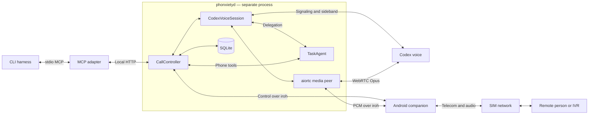

# phonxiety — выбор стека и дизайн

**Статус:** разработка.  
**Срез источников:** 24 ноября 2026.  
**Исходная установка:** rooted Google Pixel 6a и MacBook; телефон находит демон по ключу узла iroh. USB нужен только для установки модуля.

## 1. Выбранный стек

`phonxietyd` — отдельный процесс с realtime-голосовым агентом, управлением звонками и хранилищем результатов. CLI-харнессы подключаются через MCP.

Рекомендуемая основа:

| Компонент | Технология | Назначение |
|---|---|---|
| Сотовый транспорт | SIM и Android Telecom | Исходящие звонки через Pixel 6a |
| Телефон ↔ Mac | iroh: QUIC, набор по ключу узла, прямой путь либо relay. TLS WebSocket — адресная альтернатива | Двусторонний PCM и управляющие события |
| Телефонное приложение | Kotlin, non-UI `InCallService`, экран статуса и pairing, Magisk priv-app | Состояние звонка, DTMF, завершение, связь с демоном |
| Захват/инжекция | `AudioRecord` / `AudioTrack`; tinyalsa как резерв | Framework audio первым, AoC capture при необходимости |
| Демон | Python, asyncio, SQLite | Жизненный цикл звонка, контекст и результаты |
| Голосовой backend | `CodexVoiceSession` + aiortc | Signaling, WebRTC, транскрипты и делегирование |
| Первая модель | `gpt-live-1-codex` | Голосовые тесты и первый сквозной разговор |
| MCP | FastMCP | `place_call`, `wait_call_result`, `hangup_call` |

Дополнительные референсы:

- **[gsm2sip](https://github.com/pulpoff/gsm2sip)**: цифровой мост на Pixel 7/Tensor G2; ближайший аппаратный референс для Pixel 6a.
- **[AgentCall](https://github.com/sidinsearch/AgentCall)**: USB/ADB, Android, локальный daemon и MCP. Проверенная конфигурация проекта — POCO M2 Pro и Windows/Linux.
- **[ADB-helper](https://deoxy.net/blog/give-your-ai-agent-a-real-phone)**: звонки через Java `app_process` под shell UID, PCM по ADB; описание работающей установки на MediaTek/Android 11. Код не опубликован.
- **[Oh My Pi live](https://github.com/can1357/oh-my-pi/tree/230e7494405bee0188c9597d3c4647828a0824ba/packages/coding-agent/src/live)**: Codex OAuth, signaling, WebRTC, делегирование и транскрипты.

## 2. Границы задачи

Целевой сценарий: CLI-агент получает поручение, сам находит номер и контекст доступными ему средствами, передаёт ограниченное задание голосовому демону; демон звонит с SIM, разговаривает, возвращает результат и транскрипт.

Разделение ответственности:

- **Харнесс:** поиск контакта, проверка назначения номера, календарь и другой пользовательский контекст, формирование поручения и разрешённых условий договорённости.
- **Демон:** жизненный цикл звонка, голосовая сессия, исполнение ограниченных телефонных действий, сохранение результата.
- **Телефон:** штатный сотовый вызов, достоверные события Telecom, PCM в обе стороны, прекращение принадлежащего мосту вызова.

Первый поддерживаемый сценарий — один исходящий звонок за раз. Несколько харнессов могут обращаться к одному демону, но не одновременно занимать телефонную линию.

Не входят в базовую архитектуру: SMS, входящий секретарь, WhatsApp, управление экраном, облачная многопользовательская платформа, параллельные SIM-линии, клонирование голоса. Это не нужно для брони, звонка курьеру или сервису.

«Автономный» здесь означает **самостоятельный разговор после поручения**, а не работу без MacBook, интернета или облачного провайдера модели. Сон MacBook и обрыв сети между телефоном и демоном остаются эксплуатационными ограничениями.

## 3. Что уже подтверждено на подключённом телефоне

На Pixel установлен Magisk-модуль `phonxiety_bridge` с priv-app `com.phonxiety.bridge` 0.3.0. Приложение подключается к демону по iroh, по ключу узла; `adb reverse` и VPN не используются.

| Наблюдение | Результат | Источник на устройстве |
|---|---|---|
| Устройство | Pixel 6a, `bluejay` | `getprop ro.product.model`, `ro.product.device` |
| Сборка | Android 17 / API 37, `DP11.261030.003`, `bluejay_beta`, user build | `getprop ro.build.*` |
| Root | `su` возвращает UID 0, домен `u:r:magisk:s0`; Magisk 31.1 / 31100 | `su -c id`, `magisk -v`, `magisk -V` |
| SELinux | Enforcing | `getenforce` |
| Звуковая карта | Card 0, `aoc-snd-card`, `google,aoc-snd-card` | `/proc/asound/cards` |
| In-call playback PCM | D18, D19, D29: `audio_incall_pb_0/1/2` | `/proc/asound/pcm` |
| In-call capture PCM | D20, D21, D22: `audio_incall_cap_0/1/2` | `/proc/asound/pcm` |
| Audio HAL | Присутствуют `audio.primary.gs101.so`, `audio.platform.aoc.so`, `android.hardware.audio@7.1-impl.so` | `/vendor/lib64/hw`, список процессов |
| Телефонные порты | `Telephony Tx` и `Voice Call And Telephony Rx` зарегистрированы | XML + `dumpsys media.audio_policy` |
| Выход | `incall playback` и `voice call tx` → `Telephony Tx`; профили 48 kHz, PCM16, stereo | `/vendor/etc/audio_policy_configuration.xml` |
| Вход | `incall capture` и `voice call rx` ← telephony RX; 48 kHz, PCM16, mono | Тот же XML |
| Call screening | `call_screen_mode_supported="true"`, `mIsCallScreeningModeSupported=true` | XML + `dumpsys audio` |
| Shell permissions | `CALL_AUDIO_INTERCEPTION`, `CAPTURE_AUDIO_OUTPUT`, `MODIFY_PHONE_STATE`, `CONTROL_INCALL_EXPERIENCE`, `READ_PRECISE_PHONE_STATE`, `MODIFY_AUDIO_ROUTING` выданы | `dumpsys package com.android.shell` |
| tinyalsa CLI | `tinymix`, `tinyplay`, `tinycap`, `tinypcminfo` не найдены в проверенном PATH | `which` из root shell |
| Сотовое состояние | В снимке есть LTE-регистрация; IMS — false, `isVolteEnabledByPlatform=false` | TelephonyDebugService / telephony.registry |
| Framework RX/TX | `VOICE_DOWNLINK` → PCM 48 kHz mono; PCM → `AudioTrack` / `TYPE_TELEPHONY`, 48 kHz stereo | Живой SIM-звонок с речью и транскриптом обоих участников |
| Device link по адресу | Tailscale, `wss://<tailnet-адрес>:18763/device`: звонок 19 s, приветствие, ответ собеседника, повтор и прощание; предупреждений о сброшенном аудио нет | Лог демона, результат вызова |
| Device link по iroh | Tailscale на телефоне остановлен, `tun` отсутствует; телефон подключён по ключу узла, выбран прямой путь через внешний адрес домашней сети, RTT 10–60 ms; переподключение после рестарта демона — 2.5 s | `phonxiety status`, лог демона, `ip addr` |
| Завершение агентом | Проверка тишины через 2 s после прощания, `finish_call`, Telecom cause `LOCAL`; от прощания до разъединения 5.1 s | Лог демона, результат вызова |
| Обновление приложения | `adb install -r` поверх priv-app сохраняет привилегированные разрешения, перезагрузка не нужна | `dumpsys package com.phonxiety.bridge` |
| Экран выключен, устройство заблокировано | Принудительный deep Doze 40 s: соединение не прерывалось, `BridgeService` работает | `dumpsys deviceidle`, `dumpsys trust`, лог демона |
| После перезагрузки до первой разблокировки | Состояние `RUNNING_LOCKED`: `BridgeService` запущен, телефон подключён к демону по iroh через 31 s после потери связи | `dumpsys user`, `phonxiety status` |
| iroh endpoint, созданный до появления сети | Оставался на relay `euc1-1`, RTT 245 ms; новый endpoint в том же заблокированном состоянии получил прямой путь, 25 ms | `phonxiety status` до и после перезапуска `BridgeService` |
| Звонок под блокировкой по iroh | `RUNNING_LOCKED`, экран погашен, прямой путь: разговор состоялся, cause `LOCAL`; 918 кадров к телефону и 1269 обратно, счётчики Mac и телефона совпали | Лог демона, `PhonxietyAudio` в logcat, результат вызова |
| Первая минута после подключения телефона к Wi-Fi | Проверка канала сразу после загрузки: вернулись 2 кадра из 276. Прямой путь: Mac → телефон 69 из 69 датаграмм, телефон → Mac 25 из 57. Два звонка в этом окне: тишина, обрыв по heartbeat через 5 s. `ping` с Mac: 0 ответов из 120; через две минуты — 5 из 5. Причина не установлена | Счётчики путей iroh с обеих сторон, `phonxiety link-test`, `ping` |
| Поток через relay | Потерь нет, возвращается 13 кадров в секунду из 50, RTT растёт с 0.3 до 2.8 s. На LTE без Wi-Fi: 29 кадров из 281 | `phonxiety link-test --json` |
| Проба канала перед набором | Звонок поставлен во время загрузки телефона: семь проб не прошли (relay, затем односторонние потери), набор через 39 s после подключения телефона, разговор состоялся; 845 кадров к телефону и 1336 обратно | Лог демона, результат вызова |

SIM-звонки установлены; тип радиоканала во время разговора (VoLTE или CS fallback) не измерялся.

Конфигурация содержит, в частности:

```xml
<route type="mix" sink="Telephony Tx" sources="incall playback,voice call tx" />
<route type="mix" sink="incall capture" sources="Voice Call And Telephony Rx" />
<route type="mix" sink="voice call rx" sources="Voice Call And Telephony Rx" />
```

В `mixer_paths.xml` также присутствуют `telephony-rx-captureC` с `Incall Capture Stream0 = DL`, downlink-пути Stream1/2, `Incall Mic Mute`, `Incall Sink Mute`, call-screen paths.

## 4. Оценка исходных референсов

| Референс | Возможности | Применение | Ограничения |
|---|---|---|---|
| [agentring](https://github.com/mutonby/agentring) | Звонок **агента пользователю** через приложение и LiveKit; backend голосовых моделей; MCP | Разделение контекста/голоса, результат с транскриптом, интерфейс `RealtimeBackend` | Это не SIM-шлюз и не готовая тройка асинхронных call-tools |
| [BCR](https://github.com/chenxiaolong/BCR) | Привилегированный non-UI `InCallService`, Magisk-упаковка, запись телефонного аудио | Установка, разрешения, callbacks Telecom, capture lifecycle | Не инжектирует голос; не гарантирует чистый downlink на любой прошивке Tensor |
| [tinyalsa](https://github.com/tinyalsa/tinyalsa) | Работа с ALSA PCM и controls | Диагностика и подтверждённый аппаратный capture fallback | `tinyplay` сам по себе не находит путь в uplink; номера устройств непереносимы |
| [android-remote-control-mcp](https://github.com/danielealbano/android-remote-control-mcp) | Android MCP-сервер, remote UI control, auth/tunnels, service lifecycle | Отдельные эксплуатационные паттерны Android | Не телефонный аудиомост; MCP на телефоне здесь лишний |
| [droidclaw](https://github.com/unitedbyai/droidclaw) | ADB/accessibility-автоматизация интерфейса | Дополнительный диагностический инструмент, не runtime звонка | Нажатия по Dialer не решают дуплексное аудио и хрупки к UI-изменениям |
| [Pipecat](https://github.com/pipecat-ai/pipecat) | Voice pipeline, транспортные адаптеры, realtime-провайдеры, interruption frames | Кандидат после первого работающего Codex backend | Не управляет Telecom и не очищает Android playback queue без нашей команды |
| [LiveKit Agents](https://github.com/livekit/agents) | Voice agents, realtime plugins, room/SIP-интеграция, custom audio I/O | Альтернатива при выборе SIP/room-архитектуры | SIP-DTMF не становится сотовым DTMF без телефонного адаптера |
| [FastMCP](https://github.com/PrefectHQ/fastmcp) | Python MCP, async tools, HTTP/stdio proxy, совместимость протоколов | Тонкая поверхность для харнессов | Async-функция или MCP Task не делают живой звонок устойчивым к смерти процесса |

### Адаптация референсов

**agentring.** Его [MCP-сервер](https://github.com/mutonby/agentring/blob/main/daemon/src/agentring/mcp_server.py) предоставляет `send_message`, `get_replies`, `call`, `status`. `call` блокирует до завершения; закрытие stdin отменяет задачи. [CallSession](https://github.com/mutonby/agentring/blob/main/daemon/src/agentring/voice/session.py) владеет LiveKit room. Для phonxiety полезен интерфейс [RealtimeBackend](https://github.com/mutonby/agentring/blob/main/daemon/src/agentring/voice/backend.py); транспорт и lifecycle звонка требуют другой реализации.

**BCR.** Поддерживает `VOICE_CALL`, отдельные `VOICE_UPLINK` / `VOICE_DOWNLINK` и стереозапись этих направлений. В [issue #389](https://github.com/chenxiaolong/BCR/issues/389) описан низкий уровень собеседника на Pixel 6a и зависимость уровня записи от громкости звонка. [Issue #530](https://github.com/chenxiaolong/BCR/issues/530) описывает нулевой capture первого звонка после reboot на других Pixel. Эти случаи включены в проверку Android backend.

**`VOICE_UPLINK` — источник записи, не API инжекции.** Обратное направление реализуется playback-треком или аппаратным маршрутом.

## 5. Найденные решения ближе к нашей задаче

| Решение | Опубликованная проверка | Ценность для phonxiety | Решение |
|---|---|---|---|
| [gsm2sip](https://github.com/pulpoff/gsm2sip) | Pixel 7 / gs201 / LineageOS 24 / Android 17, живые VoLTE-звонки по отчёту проекта | Tensor capture/injection, local-mic isolation, call control | Главный дополнительный аппаратный референс |
| [AgentCall](https://github.com/sidinsearch/AgentCall) | POCO M2 Pro / Qualcomm / Android 15; Windows/Linux | USB-only daemon + MCP; RX/TX адаптеры и [процедура квалификации](https://github.com/sidinsearch/AgentCall/blob/main/docs/DEVICE_PORTING.md) | Потребуется порт на Pixel 6a и macOS |
| [Deoxy ADB-helper](https://deoxy.net/blog/give-your-ai-agent-a-real-phone) | UMIDIGI / MediaTek / Android 11; рассказ автора с реальными сценариями | Shell UID, `app_process`, PCM через ADB, GPT-Live | Самый дешёвый эксперимент с framework audio; код не опубликован |
| [callbridge](https://github.com/ishmum123/callbridge) | Samsung SM-G781B / LineageOS; частичные device tests | Kotlin + Gemini Live, teardown и interruption handling | Исследовательский прототип |
| [ring-gateway](https://github.com/krantiutils/ring-gateway) | Samsung Exynos по отчёту автора | Аппаратный uplink через ALSA | Маршрутизация специфична для Samsung ABOX |

В [Tensor-профиле gsm2sip](https://github.com/pulpoff/gsm2sip/blob/535c4a668f627844ac61a600973b871461179039/app/src/main/java/com/callagent/gateway/DeviceProfile.kt#L1200-L1289) на Pixel 7 `AudioRecord` downlink отдавал нули; рабочий путь — root capture PCM 0:20 / 48 kHz и `AudioTrack` в Telephony TX. Профиль выбирается для GS201. На GS101 проверяем framework capture и этот резервный путь отдельно.

### Что добавил Reddit

Полевые обсуждения:

- [Реальный Android-телефон для нескольких агентов](https://www.reddit.com/r/AI_Agents/comments/1xk2uqp/we_gave_our_ai_agents_a_real_android_phone): UI drift, конкуренция владельцев и повторные действия после retries. Для phonxiety применимы Telecom API, единственный владелец линии и сохранённый `request_id`.
- [Агент, проходящий IVR и ожидание](https://www.reddit.com/r/AI_Agents/comments/1usjxob/building_an_ai_agent_that_makes_real_phone_calls/): непредсказуемые меню, реклама вместо hold music, циклы и ошибки распознавания. Вывод — проверять эти сценарии отдельно; VAD не является детектором «оператор вернулся».

## 6. Как получить аудио: сравнение вариантов

| Вариант | Плюсы | Ограничения | Место в выборе |
|---|---|---|---|
| Framework audio из shell `app_process` | На данном телефоне shell уже имеет нужные grants; нет priv-app установки и ребута | Нужен корректный Context/attribution; нет установленного `InCallService`; управление и восстановление менее удобны | Диагностическая альтернатива |
| Привилегированный Kotlin APK | Telecom callbacks, сетевой DTMF, управление конкретным Call, аудио в одном приложении | Magisk-упаковка, Android SystemApi/hidden API и OTA-зависимость | Реализованный рабочий путь |
| Framework TX + root ALSA RX | Близкий живой пример на Tensor; не требует переписывать HAL | Владение PCM, SELinux, восстановление mixer state; нужны свои бинарники | Резерв при реально подтверждённых нулях RX |
| Прямой ALSA RX/TX | Обход framework routing | Uplink на нашем AoC не проверен; конфликт с HAL, зависимость от firmware | После исчерпания framework TX |
| gsm2sip + SIP endpoint на хосте | Готовые signalling/DTMF/status mappings, стандартный интерфейс | Надо квалифицировать 6a; добавляются SIP/RTP и codecs | Сильная альтернатива, если важнее готовый SIP-мир, чем собственный мост |
| Bluetooth HFP | Телефон сам выдаёт двусторонний call audio; может не требовать root | Профиль HF, Bluetooth audio routing, codec/latency и переподключения | Аппаратно независимый резерв |
| Акустическая петля speaker→mic | Быстрый демонстрационный макет | DSP echo cancellation, шум, самоперебивания, нет гарантированной изоляции | Не считать приемлемым решением проекта |

Для HFP есть [полевой рецепт Linux/Raspberry Pi: BlueZ + oFono + PipeWire](https://sipfront.com/blog/2025/03/automating-calls-on-real-mobile-devices-with-bluetooth-hfp-on-a-raspberry-pi/). На macOS Apple документирует [IOBluetoothHandsFreeDevice](https://developer.apple.com/documentation/iobluetooth/iobluetoothhandsfreedevice), включая dial/DTMF и перенос аудио на компьютер. Но доступ произвольного PCM в обе стороны на данном MacBook **не проверен**. Не объявляем Linux-рецепт автоматически работающим на macOS.

### 6.1 Framework-путь существует

AOSP [AudioManager](https://android.googlesource.com/platform/frameworks/base/+/refs/heads/main/media/java/android/media/AudioManager.java) содержит:

- `getCallUplinkInjectionAudioTrack(format)`;
- `getCallDownlinkExtractionAudioRecord(format)`;
- `isPstnCallAudioInterceptable()`.

Это **SystemApi/TestApi**, не обычный публичный SDK для любого APK. Они требуют `CALL_AUDIO_INTERCEPTION`; методы построения треков дополнительно зависят от режима и проверки native permissions. `@hide` означает отдельную проблему сборки/доступа к API, не решаемую одним `pm grant`.

В прочитанном AOSP коде PSTN-путь разрешён в `MODE_IN_CALL`, `MODE_CALL_SCREENING`, `MODE_CALL_REDIRECT`; перевод в redirect mode не является обязательным предварительным условием. Uplink строится с `USAGE_CALL_ASSISTANT`, downlink — с `VOICE_DOWNLINK` и call-redirection flag.

Альтернатива uplink — обычный `AudioTrack`, явный `setPreferredDevice(TYPE_TELEPHONY)` и подходящие audio attributes. [AudioPolicyInterfaceImpl](https://android.googlesource.com/platform/frameworks/av/+/refs/heads/main/services/audiopolicy/service/AudioPolicyInterfaceImpl.cpp) проверяет для Telephony TX `MODIFY_PHONE_STATE`, а для redirection также `CALL_AUDIO_INTERCEPTION`. Простое `USAGE_VOICE_COMMUNICATION` без выбора маршрута не означает отправку в модем.

[AudioService](https://android.googlesource.com/platform/frameworks/base/+/refs/heads/main/services/core/java/com/android/server/audio/AudioService.java) определяет interceptability по наличию RX/TX устройств. Это capability check, не end-to-end тест. Источник AOSP main объясняет механизм, но не является побайтовым исходником установленной beta-прошивки.

### 6.2 Выбранный путь на Pixel 6a

`PhoneAudio.kt` использует framework RX `VOICE_DOWNLINK` и TX через `AudioTrack` с выбранным `TYPE_TELEPHONY`. Capture — 48 kHz mono PCM16; playback — 48 kHz stereo PCM16 с дублированием mono-канала. Изменения HAL, tinyalsa и mixer controls не потребовались.

Резерв для других сборок — root capture по подходу gsm2sip, если framework RX действительно не получает речь собеседника. AoC D20 остаётся кандидатом: открытие этого PCM в активном звонке не проверялось, native fallback в текущую реализацию не входит.

### 6.3 Изоляция микрофона, teardown и root

`HandsetMute` сохраняет состояние microphone mute, включает mute на время принадлежащего мосту вызова и восстанавливает исходное значение при teardown. Отдельная акустическая проверка изоляции помещения ещё не выполнена.

На Pixel 7 gsm2sip использует **AoC `Incall Mic Mute` / `Incall Sink Mute`**, а не глобальный `AudioManager` mute. Перенос на 6a проверить; простое уменьшение громкости может уменьшить и записываемый downlink, как описано BCR.

Call-screen mode — отдельный вариант изоляции. `Call.enterBackgroundAudioProcessing()` по [контракту AOSP](https://android.googlesource.com/platform/frameworks/base/+/refs/heads/main/telecomm/java/android/telecom/Call.java) предназначен default dialer. Не строить продукт на отсутствующей проверке разрешения в текущей реализации сервера и не менять mode в гонке с Telecom без проверки lifecycle.

Для native fallback: одно явное владение выбранным PCM; запрещено открывать тот же endpoint одновременно с другим recorder. Сохранять фактические изменяемые controls и восстанавливать их при завершении и ошибке, а не копировать чужие «нормальные значения». Не отключать SELinux глобально.

APK собран с targetSdk 37; текущий framework backend не вызывает `su` из процесса приложения.

## 7. Голосовой backend

### 7.1 Протокол Codex voice

| Исходник | Механизм |
|---|---|
| [`live/protocol.ts`](https://github.com/can1357/oh-my-pi/blob/230e7494405bee0188c9597d3c4647828a0824ba/packages/coding-agent/src/live/protocol.ts) | Модель `gpt-live-1-codex`, `delegation: {type: "client"}`, transcript и context events |
| [`live/transport.ts`](https://github.com/can1357/oh-my-pi/blob/230e7494405bee0188c9597d3c4647828a0824ba/packages/coding-agent/src/live/transport.ts) | Codex OAuth lifecycle, SDP signaling, session/account headers и sideband |
| [`live/attestation.ts`](https://github.com/can1357/oh-my-pi/blob/230e7494405bee0188c9597d3c4647828a0824ba/packages/coding-agent/src/live/attestation.ts) | macOS DeviceCheck attestation для signaling |
| [`live/controller.ts`](https://github.com/can1357/oh-my-pi/blob/230e7494405bee0188c9597d3c4647828a0824ba/packages/coding-agent/src/live/controller.ts) | Мост `delegation.created` → ход текстового агента → `delegation.context.append`; сбор транскрипта |
| [`crates/voice/src/live.rs`](https://github.com/can1357/oh-my-pi/blob/230e7494405bee0188c9597d3c4647828a0824ba/crates/voice/src/live.rs) | WebRTC/Opus, pacing, кодирование и декодирование аудио |
| [`methods_frameless_bidi.rs`](https://github.com/openai/codex/blob/32f77f824d9e84e8cc7d16a836225c118c4f6a30/codex-rs/codex-api/src/endpoint/realtime_websocket/methods_frameless_bidi.rs) | Начальный `initial_items` с developer-сообщением и кодирование context append |

Источник аудио — телефонный downlink, приёмник — телефонный uplink.

### 7.2 Жизненный цикл сессии

`CodexVoiceSession` управляет голосовой сессией внутри `phonxietyd`.

1. Загружает и обновляет Codex OAuth credentials.
2. Создаёт [aiortc](https://github.com/aiortc/aiortc) peer: один sendrecv Opus audio track и data channel `oai-events`; собирает SDP offer.
3. Отправляет `POST ${CODEX_BASE_URL}/codex/realtime/calls?intent=quicksilver&architecture=avas` с `sdp` и `session`. В session — `gpt-live-1-codex`, стиль разговора в `instructions`, голос, client delegation и `initial_items`: developer-сообщение с целью, контекстом, условиями и правилами телефонных действий. Этот brief передаётся при создании сессии; `instructions` после инициализации не обновляются.
4. Применяет SDP answer; сохраняет `rtc_*` из `Location`. Подключает sideband `wss://api.openai.com/v1/live/<call_id>` с соответствующими auth/session headers.
5. Передаёт PCM downlink в custom audio track; читает `remote_track.recv()` и отправляет декодированный звук в телефонный uplink.
6. Обрабатывает `session.started`, transcripts, `turn.done`, delegation и ошибки. Для завершения отправляет `session.close`, закрывает peer и согласует teardown с call controller.

WebRTC переносит аудио; sideband — управление, контекст и делегирование. На device link используется 48 kHz mono PCM16LE, на границе WebRTC — audio frames с явными rate/layout/PTS и согласованный Opus.

### 7.3 Голос и выполнение поручения

В демоне две логические роли, без дополнительных процессов:

- **Realtime voice agent** слушает и говорит через Codex voice.
- **TaskAgent** следит за разговором по call brief и транскрипту и владеет телефонной линией. Текстовая модель задаётся конфигурацией демона.

TaskAgent запускается в двух случаях:

- `delegation.created`: голосовая модель просит действие. Промежуточный комментарий и итог возвращаются через `delegation.context.append` с ID делегирования.
- Тишина на линии: после 2 s без речи и событий транскрипта контроллер передаёт TaskAgent состояние линии. Повтор при продолжающейся тишине — с интервалом ×3, не чаще раза в 60 s. Речь любой стороны отменяет незавершённую проверку, пока та не начала телефонное действие; начатый набор DTMF речью не прерывается.

Проверка тишины обязательна: в локальных прогонах голосовая модель после выполненного задания не создавала делегирование, и вызов оставался открытым. Вне делегирования контекст передаётся через `session.context.append`, блоками до 500 UTF-8 bytes.

Инструменты TaskAgent — `send_dtmf` и `finish_call`; их исполняет call controller. Выполненные нажатия записываются в историю вызова строками `phone` и попадают в каждый следующий ход и в итоговую сводку: без них повторная проверка того же меню IVR нажала бы ту же клавишу ещё раз. Реплики собеседника в транскрипте — результат отдельного ASR; при расхождении с подтверждённым повтором голосовой модели TaskAgent и итоговая сводка берут версию голосовой модели.

CLI-харнесс передаёт исходный brief через `place_call`, после чего не участвует в каждой реплике. Голосовой агент может закончить разговор и сохранить результат даже после закрытия CLI-сессии.

Из `input_transcript.added` / `output_transcript.added` и `turn.done` собираются transcript segments с partial/final состоянием. Отдельно хранятся `call_id` phonxiety, Telecom Call и Codex `rtc_*`.

### 7.4 Альтернативы после первого работающего звонка

| Вариант | Когда выбирать | Что добавляет |
|---|---|---|
| **Собственный CodexVoiceSession** | Первые тесты и исходный голосовой backend | Прямое подключение к Codex voice, свой WebRTC и delegation controller |
| **Публичный S2S API** | Для сравнения моделей или другого доступа к провайдеру | Gemini Live, OpenAI Realtime или публичный GPT-Live за тем же backend-интерфейсом |
| **Pipecat** | Нужны несколько провайдеров, cascaded pipeline или готовые voice processors | Python frame pipeline, realtime adapters, resampling и transport serializers |
| **LiveKit Agents** | Выбрали SIP/gsm2sip или room-архитектуру | SIP/room-интеграция; также есть custom audio I/O |
| **STT → LLM → TTS** | Нужен конкретный голос или контроль текстовых этапов | Streaming STT, текстовая модель, streaming TTS и turn policy |

Кандидаты последующего A/B: [Gemini Live](https://ai.google.dev/gemini-api/docs/live-guide), [OpenAI Realtime](https://developers.openai.com/api/docs/guides/realtime), [публичный GPT-Live](https://developers.openai.com/api/docs/guides/live). Первый тестовый backend — именно Codex voice; тарифы и session limits публичных API к нему автоматически не относятся.

Pipecat и LiveKit остаются альтернативами реализации voice runtime. У Pipecat есть подходящий [FrameSerializer](https://github.com/pipecat-ai/pipecat/blob/main/src/pipecat/serializers/base_serializer.py), у LiveKit — [custom I/O](https://github.com/livekit/agents/blob/main/livekit-agents/livekit/agents/voice/io.py); вводить их до проверки прямого Codex backend необязательно.

## 8. Предлагаемая архитектура



### 8.1 На Mac

Python daemon содержит call controller, `CodexVoiceSession`, aiortc peer, TaskAgent и storage. FastMCP предоставляет локальный HTTP MCP endpoint; короткоживущий stdio adapter подключается к нему через [proxy](https://gofastmcp.com/docs/servers/providers/proxy).

Звонок принадлежит daemon task, а не обработчику MCP-запроса. Один экземпляр демона владеет каталогом состояния через файловый lock и отпускает его последним, после закрытия listeners. После перезапуска незавершённые вызовы переходят в `unknown` либо `cancelled`, если набор ещё не был отправлен; повторный набор с тем же `request_id` исключён.

Запуск демона:

- stdio adapter и команды `call`, `pair`, `start` поднимают демон сами, если он не отвечает: отдельная сессия процесса, лог в `daemon.log` каталога состояния. Демон переживает adapter и харнесс; `phonxiety stop` завершает его.
- `mise run daemon:install` ставит launchd-агент: демон работает с входа в систему и перезапускается после сбоя.
- `mise run daemon` — запуск на переднем плане.

`place_call` ждёт подключения телефона до 15 s: после старта демона телефон переподключается в пределах своего backoff. Перед набором демон прогоняет секундную пробу канала (§8.3) и повторяет её до 90 s, пока она не пройдёт; обрыв связи в это время — часть ожидания. Если канал так и не несёт звук, номер не набирается: `failed` / `not_started`, `phone_link_not_ready`. На время вызова демон держит `caffeinate -i`, привязанный к своему PID: простаивающий MacBook не засыпает посреди разговора.

SQLite хранит `request_id`, `call_id`, поручение, состояния, disconnect cause, транскрипт и результат. Телефонный ledger хранит владение вызовом и отмены; идентификатор `rtc_*` принадлежит текущей голосовой сессии.

### 8.2 На телефоне

Приложение-компаньон `com.phonxiety.bridge`, Kotlin, по BCR-паттерну:

- Привилегированный APK + package-specific permission allowlist через Magisk.
- Non-UI `InCallService` для `Call.Callback`, `disconnect()`, `playDtmfTone()` / `stopDtmfTone()`.
- `TelecomManager.placeCall` с явным `PhoneAccountHandle`, если нужна поддержка нескольких SIM. «Слот 1» не хранить как вечный идентификатор подписки.
- Audio endpoint на framework RX/TX; отдельные blocking audio threads, не сетевой/UI thread.
- `MainActivity`: состояние связи и маршрут, компьютер pairing, готовность телефона (разрешения, модуль, SIM), pairing по QR, отвязка.
- `BridgeService` — `specialUse` foreground service с partial wake lock: держит соединение с демоном при заблокированном и выключенном экране. Сервис и receiver `directBootAware`, pairing, ключ узла, ledger вызовов и снимок mute лежат в device-protected storage: после перезагрузки мост поднимается по `LOCKED_BOOT_COMPLETED`, до первой разблокировки.

Framework-путь использует привилегии `CONTROL_INCALL_EXPERIENCE`, `CAPTURE_AUDIO_OUTPUT`, `MODIFY_PHONE_STATE`. Runtime-разрешения `RECORD_AUDIO`, `CALL_PHONE`, `READ_PHONE_STATE`, `POST_NOTIFICATIONS` запрашивает приложение либо выдаёт задача `phone:pair`. `BIND_INCALL_SERVICE` указан как permission сервиса для привязки Telecom. `BridgeInCallService` поднимается Telecom и держит microphone FGS во время вызова.

BCR показывает non-UI binding без роли default dialer; [InCallController](https://android.googlesource.com/platform/packages/services/Telecomm/+/refs/heads/main/src/com/android/server/telecom/InCallController.java) содержит соответствующую ветку.

Вариант без модуля: обычный APK с `MANAGE_ONGOING_CALLS` app-op и аудио-процессом под shell UID, запущенным через root либо Shizuku. На этом Pixel у `com.android.shell` выданы `CAPTURE_AUDIO_OUTPUT`, `MODIFY_PHONE_STATE`, `CONTROL_INCALL_EXPERIENCE`, `CALL_AUDIO_INTERCEPTION`. Привязка `InCallService` по app-op и захват/инжекция из shell-процесса во время звонка не проверены.

### 8.3 Device link

Телефон сам подключается к демону и переподключается после обрыва. Device link передаёт PCM media peer и события call controller, независимо от выбранного голосового backend. MCP и health остаются на loopback `127.0.0.1:18762`. Транспортов два; протокол поверх них один.

**iroh, по умолчанию.** Демон и приложение встраивают [iroh](https://docs.iroh.computer) 1.x: демон — wheel `iroh` из PyPI, приложение — bindings `iroh-ffi` той же версии, собранные под `aarch64-linux-android` задачей `phone:iroh`. У каждой стороны постоянный ключ узла. Телефон набирает ключ демона с ALPN `phonxiety/device/1`; iroh находит прямой путь (одна сеть либо hole punching) и уходит на relay, если прямого нет. Адреса, VPN-приложение и открытые порты не нужны; смена сети и IP не требует нового pairing. Сообщения идут по одному двунаправленному QUIC-потоку: кадр = тип (1 byte: 1 — JSON, 2 — binary), длина uint32 big-endian, payload. Первый кадр телефона — `{"type":"auth","token":…}`; без верного токена демон закрывает соединение.

**TLS WebSocket, адресная альтернатива.** `wss://<host>:18763/device`, bearer-токен в заголовке, self-signed сертификат демона закреплён на телефоне по SHA-256; без отпечатка действует системное доверие — для туннелей с публичным сертификатом. Подходит для локальной сети, Tailscale и проброса порта.

Pairing:

- Демон при первом запуске создаёт ключ узла, сертификат и bearer-токен телефона.
- `phonxiety pair` печатает QR со ссылкой `phonxiety://pair?iroh=<ticket>&token=…`; ticket содержит ключ узла, relay и известные адреса демона. Приложение сканирует ссылку и после подтверждения сохраняет `config.json`. По USB то же делает задача `phone:pair` через root shell.
- `--lan`, `--tailscale`, `--host` выдают адресную ссылку `phonxiety://pair?url=…&token=…&cert=…`.

Wire contract:

- JSON control/events: handshake и форматы, call state, hangup, DTMF, playback flush, playback progress.
- Binary audio: заголовок `PX01` (4 bytes), epoch (uint32 big-endian), начальный sample index (uint64 big-endian); далее PCM16LE mono. Epoch связывает поток с текущим звонком.
- Wire audio: 48 kHz mono PCM16LE, кадры 20 ms, 768 kbit/s в каждую сторону. Android дублирует TX mono в stereo для выбранного AudioTrack.
- Media adapter переводит PCM в aiortc audio frames и обратно с сохранением sample rate, layout и временной шкалы. Конвертеры работают потоково, без WAV/ffmpeg на каждую реплику.
- Audio queues ограничены и при заторе сети отбрасывают старый звук: исходящая очередь демона — 200 ms, очередь отправки телефона — 500 ms, playback ring телефона — 500 ms. Control/flush обрабатывается отдельно от накопленного звука.
- Playback progress — число сэмплов, потреблённых Android audio sink; используется для таймингов и drain. Сэмплы, отброшенные при переполнении ring, в него не входят: после переполнения drain истекает по тайм-ауту и успешный звонок получает `error: playback_drain_timeout`. Переполнение на 40 ms наблюдалось в двух тестовых звонках из четырёх, ошибка в результате — в одном. Не исправлено.
- Проба канала: кадр с заголовком `PXLT` того же размера, что аудиокадр, в поле epoch — номер пробы; телефон без принадлежащего мосту звонка возвращает его как есть. Демон шлёт такие кадры каждые 20 ms, засчитывает только эхо текущей пробы и меряет долю вернувшихся, задержку кадра и задержку `ping` за ними. Канал годен, если вернулось не меньше 90 % кадров, p95 задержки не выше 400 ms и `ping` не дольше 1 s. Телефон объявляет поддержку в `capabilities.link_test`.
- Потеря соединения во время звонка завершает вызов с обеих сторон: демон ведёт heartbeat каждые 2 s с тайм-аутом 5 s, телефон прекращает вызов через 10 s без сообщений хоста.
- В конце каждого звонка обе стороны пишут в лог число кадров в каждом направлении; при обрыве связи — счётчики всех путей iroh (отправлено, принято, потери, окно, MTU).

Нормальный режим — прямой путь. Relay iroh в проверке — `euc1-1.relay.n0.iroh.link`; в двух замерах несжатый PCM через него не прошёл в реальном времени (§3), проба перед набором такой канал отклоняет. Пока путь остаётся relay, телефон раз в 5 минут пересоздаёт endpoint в поиске прямого пути. IMS на проверенной SIM выключен, мобильные данные во время звонка могут быть недоступны; телефону нужен Wi-Fi.

### 8.4 Состояния и результат

Телефонный lifecycle: `preparing → dialing → active → ending → ended`, с отдельными `failed`, `cancelled`, `unknown`.

`OFFHOOK` недостаточно для «собеседник ответил»: он включает набор. Начало разговора опирается на Telecom `STATE_ACTIVE`; оно всё равно не отличает человека от IVR/voicemail.

Внутри active разговора есть состояния диалога `ivr`, `waiting`, `speaking`, `listening`. Фраза «подождите на линии» **не равна** Telecom `STATE_HOLDING` и не означает необходимость `Call.hold()`.

Исход звонка, результат поручения и готовность данных:

- `call_outcome`: `null` до известного исхода; затем `answered`, `busy`, `declined`, `no_answer`, `cancelled`, `disconnected`, `not_started` или `unknown`. Исходный Telecom cause хранится отдельно и может отсутствовать;
- `task_outcome`: `null` до финализации; затем `succeeded`, `declined`, `incomplete`, `needs_user` или `unknown`;
- `result_status`: `pending`, `finalizing`, `ready`. Завершённый телефонный вызов может ещё находиться в финализации результата.

Ответ на звонок не означает успех поручения. Финальные условия брони, время, адрес и сумма должны быть подтверждены репликами человека; при неопределённости это отражается в результате, а не достраивается summarizer-моделью.

## 9. MCP-контракт: сохранить три инструмента

HTTP endpoint `/mcp` и stdio adapter предоставляют одинаковые инструменты.

### `place_call`

Вход: `request_id`, `destination`, `goal`, `context`, `constraints`, `max_duration_s`, `ring_timeout_s`, при необходимости `result_fields` и `phone_account`.

- `destination` — уже разрешённый харнессом номер; daemon не пытается по слову «парикмахерская» сам угадать адресата.
- `context` — минимальный call brief, а не вся история терминала.
- `constraints` — допустимые даты, бюджет, альтернативы, информация, которой можно делиться, и границы обязательств.
- `max_duration_s` — предел разговора после ответа (10–3600 s, default 900); `ring_timeout_s` — предел ожидания ответа (5–180 s, default 60).

Ответ после сохранения намерения и принятия задачи: `{call_id, state: "preparing"}`. Не ждать ответа абонента или окончания разговора.

`request_id` должен сохраняться при retry. Повтор с тем же содержимым возвращает тот же call; повтор с изменённым содержимым — конфликт. Резервирование происходит до внешнего действия; телефон получает ту же identity. Если процесс умер между отправкой dial и подтверждением, состояние **unknown**, затем сверка с Telecom, а не автоматический повторный набор. «Exactly once» через сбой телефонного процесса не обещается.

### `wait_call_result`

Вход: `call_id`, `wait_s`, `cursor` и `limit` (1–100 финальных сегментов).

- `wait_s=0` — немедленный snapshot; заменяет отдельный `get_call`.
- Default — 30 s, максимум — 45 s. Long-poll ждёт `result_status=ready`; по таймауту возвращает текущий snapshot.
- Результат сохраняется и доступен повторно.
- `transcript` содержит неизменяемые финальные сегменты. `next_cursor` — sequence последнего возвращённого сегмента, `has_more` — наличие следующей страницы.
- `current_partials` — отдельный snapshot незавершённых реплик; он не продвигает cursor. Исправление partial → final всегда попадает в последующую страницу.

Ответ включает `state`, `call_outcome`, `task_outcome`, `result_status`, `summary`, `fields`, транскрипт, `transcript_complete`, ошибку и тайминги. `transcript_complete` относится ко всему потоку, а не к текущей странице. При ошибке финализации сохраняются доступный транскрипт и явная ошибка.

### `hangup_call`

Вход: `call_id`, необязательная причина. В `preparing` отмена атомарно запрещает отправку dial и возвращает `cancelled/not_started`. После отправки dial контроллер прекращает связанный Telecom Call; `ending` означает принятие команды, а `ended` — подтверждённое завершение. Для `unknown` выполняется сверка/повторная команда hangup без повторного dial.

MCP cancellation отменяет ожидание результата, а не сотовый вызов. Явное пользовательское «прекрати звонок» реализуется `hangup_call`. Закрытый харнесс и потерянное физическое соединение телефона — разные события с разной политикой.

### Совместимость с харнессами

| Харнесс | Интеграция | Существенное ограничение |
|---|---|---|
| Claude Code | stdio MCP, `.mcp.json` / `claude mcp add` | [Документировано](https://code.claude.com/docs/en/env-vars.md) автоматическое backgrounding долгого вызова и отдельные timeout/idle settings |
| Codex | `mcp_servers` в `config.toml` | [Доки](https://developers.openai.com/codex/config-reference) указывают 60 s per-tool default; HEAD реализации и документация могут расходиться |
| OpenCode | Local MCP server в конфигурации соответствующей версии | [Схема и timeout](https://opencode.ai/docs/mcp-servers/) меняются между версиями; не копировать старый snippet agentring вслепую |
| Hermes | `mcp_servers` | [Исходник](https://github.com/NousResearch/hermes-agent/blob/main/tools/mcp_tool_common.py) содержит default tool timeout 300 s |
| Oh My Pi | `mcpServers`, stdio | [Исходник](https://github.com/can1357/oh-my-pi/blob/main/packages/coding-agent/src/mcp/timeout.ts) содержит default call timeout 600 s; progress может продлевать его |

30-секундный long-poll укладывается в документированный лимит Codex, но **не гарантирует совместимость со всеми старыми версиями и пользовательскими таймаутами**. Acceptance — запуск из каждого из пяти реальных клиентов с фиксированными версиями; в этой работе это не выполнялось.

[Ревизия MCP 2026-07-28](https://modelcontextprotocol.io/specification/2026-07-28/changelog) изменила handshake и вынесла Tasks в расширение. FastMCP поддерживает обе протокольные эпохи. Поэтому не писать свой JSON-RPC и не делать Tasks обязательными. Долговечность `call_id` обеспечивается нашим приложением независимо от MCP session.

Пакет содержит три entrypoint: `phonxietyd`, `phonxiety` и `phonxiety-mcp`. Для локального подключения используется `uv run --project /path/to/phonxiety phonxiety-mcp`; в реестр пакет не публиковался. Adapter поднимает демон, если тот не отвечает; демон не завершается вместе с adapter.

## 10. Поведение реального разговора

- **Начало:** подготовить Codex voice до ответа; приветствие — после Telecom `active` и готовности телефонного аудиопути.
- **Barge-in:** в Codex live full-duplex/turn-taking ведёт модель через WebRTC; наш peer не накладывает второй turn detector. Держать короткую Android playback queue, при cancel/hangup выполнять flush. Для будущего публичного OpenAI Realtime WS backend отдельно нужен `conversation.item.truncate`; это не сообщение текущего Codex sideband.
- **Ожидание:** после «подождите» продолжать слушать без постоянных check-in реплик; отличать музыку/рекламу от обращения к агенту.
- **IVR:** `send_dtmf` TaskAgent вызывает `Call.playDtmfTone` и парный `stopDtmfTone`. Это функция демона, не четвёртый MCP tool.
- **Действия TaskAgent:** один выполняющийся ход TaskAgent на звонок. Новое делегирование отменяет предыдущий ход, увеличивает `action_generation` и прекращает старую последовательность DTMF. Каждый телефонный инструмент проверяет актуальность поколения перед действием.
- **Voicemail:** оставить сообщение или завершить согласно call brief.
- **Новые условия:** TaskAgent обрабатывает их в рамках call brief. Для решения, требующего пользователя, вернуть `needs_user`; обратная консультация с внешним харнессом — отдельный протокол.
- **Завершение:** голосовая модель прощается и замолкает; линию отключает TaskAgent через `finish_call` — по делегированию либо по проверке тишины. `farewell_pending=false`: прощание уже прозвучало, контроллер ждёт 0.8 s тишины выходной речи, playback watermark и отключает Telecom. `farewell_pending=true`: модель получает `CALL_COMPLETE` или итог делегирования, контроллер ждёт её реплику, 0.8 s тишины и отключает вызов; общий предел ожидания — 12 s. Явный `hangup_call` прекращает вызов сразу.
- **Транскрипт:** нормализовать provider events в partial/final segments, отдельно сохранять итог поручения; имена, числа и условия проговаривать обратно собеседнику.

## 11. Жизненный цикл при сбоях

| Событие | Требуемое поведение |
|---|---|
| Второй харнесс просит звонок | Вернуть busy; не трогать активный вызов |
| Потерян ответ `place_call` | Retry того же `request_id`; не новая попытка набора |
| Истёк `wait_call_result` или умер MCP adapter | Звонок живёт в daemon, результат доступен повторно |
| Связь с телефоном потеряна / daemon умер | Phone-side controller прекращает принадлежащий мосту звонок по ограниченной политике потери связи; возвращает изменённый audio state |
| Демон не запущен в момент `place_call` | stdio adapter поднимает демон; вызов ждёт телефон до 15 s, затем `failed` / `not_started` |
| Канал до телефона не несёт звук перед набором | Ждать готовности до 90 s; затем `failed` / `not_started` с `phone_link_not_ready`, номер не набирается |
| MacBook простаивает во время вызова | Демон удерживает систему от сна до готовности результата |
| Phone process умер при root capture | Root helper должен иметь привязанный lifecycle; не оставлять PCM reader и mixer overrides без владельца |
| Provider недоступен до dial | Не начинать звонок, вернуть причину |
| Provider потерян во время разговора | Ограниченное восстановление с контекстом, если поддерживается; иначе завершение с incomplete, без новой сотовой попытки |
| Подтверждённая ошибка RX/TX | Сохранить диагностику и завершить вызов. Цифровая тишина остаётся нормальным аудиоданным и состоянием ожидания |
| Пользователь вручную вмешался в Dialer | Не захватывать несвязанный Call; при изменении ownership остановить агентское управление |

## 12. Последовательность первых тестов

| Этап | Стенд | Что проверяем |
|---|---|---|
| A. Codex voice | Собственный `phonxietyd` + `CodexVoiceSession`, локальный audio source/sink на Mac | Auth, signaling, WebRTC, разговор, перебивание, delegation и транскрипт |
| B. Подключение device link | PCM-источник и приёмник через тот же aiortc peer | Подмена локального аудио телефонным PCM без изменения голосовой сессии |
| C. Телефонный RX/TX | Обычный SIM-звонок, известные фразы с обоих концов | Capture только собеседника, слышимость injected audio на дальнем конце, правильный SIM/account |
| D. Полный разговор | Pixel ↔ Wi-Fi PCM ↔ демон ↔ Codex voice | Начало речи после ответа, дуплекс, очереди, задержки и результат звонка |
| E. Управление | TaskAgent демона → Telecom | DTMF, IVR, ожидание, возврат человека, voicemail, завершение |
| F. Lifecycle и MCP | Повторный звонок, обрыв Wi-Fi, закрытие харнесса, restart shim, retry request ID; пять харнессов | Независимость демона, восстановление audio state, отсутствие повторного набора, доступность результата |
| G. Сравнение моделей | Тот же телефонный мост с другими voice backend | Нужно ли менять Codex voice на Gemini/OpenAI API и добавлять Pipecat |

На этапе C/D выбран framework audio. Дальнейшие измерения: latency по цепочке downlink → WebRTC → первый ответ → Android playback → дальний конец и реакция на перебивание.


## 13. Запуск

Инструменты и задачи проекта задаёт `mise.toml`: Python, uv, JDK 17, Gradle, Rust. Из каталога проекта:

```sh
mise install
mise run setup
uv run phonxiety auth
```

Телефон, один раз по USB:

```sh
mise run phone:build            # собирает iroh для Android и модуль
mise run phone:install --reboot
mise run phone:pair
```

`phone:pair` выдаёт runtime-разрешения, записывает ticket демона и токен в device-protected storage приложения и перезапускает `BridgeService`. Без кабеля pairing выполняется через `mise run pair` и сканирование QR в приложении. После pairing телефон сам находит компьютер в любой сети, в том числе после перезагрузки.

Pairing по адресу вместо iroh: `--lan` (локальная сеть), `--tailscale` (tailnet-адрес компьютера), `--host` (произвольный адрес); ключи есть у `pair` и `phone:pair`.

Демон:

```sh
uv run phonxiety status          # демон, телефон, маршрут, готовность к звонку
uv run phonxiety link-test       # нагрузить канал как в звонке, без набора номера
uv run phonxiety start | stop    # фоновый запуск и остановка
mise run daemon:install          # автозапуск через launchd; daemon:uninstall, daemon:logs
```

Команда stdio-сервера для MCP-клиента; демон она поднимает сама:

```sh
uv run --project /path/to/phonxiety phonxiety-mcp
```

MCP и health — `127.0.0.1:18762` (`PHONXIETY_PORT`). Адресный device link — `0.0.0.0:18763` (`PHONXIETY_DEVICE_HOST`, `PHONXIETY_DEVICE_PORT`); iroh портов не требует. Состояние — `~/.local/share/phonxiety` либо `PHONXIETY_STATE_DIR`. Отдельный Codex login — `~/.local/state/phonxiety/auth.json` либо `PHONXIETY_AUTH_FILE`. Текстовая модель выбирается через `PHONXIETY_TASK_MODEL` или `model` в конфигурации Codex. Android SDK и NDK — `.tools/android-sdk` (`ANDROID_HOME`).

