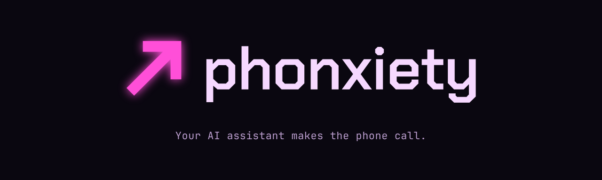
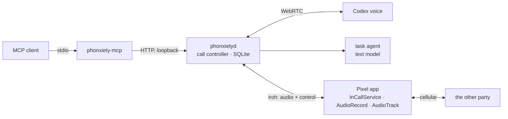

<p align="center">
  
</p>

<p align="center">
  phonxiety: an MCP server that makes real phone calls from your Android phone.
</p>

<p align="center">
  <a href="https://github.com/d3d0n/phonxiety/releases/latest"></a>
  <a href="https://github.com/d3d0n/phonxiety/actions/workflows/daemon.yml"></a>
  <a href="https://github.com/d3d0n/phonxiety/actions/workflows/android.yml"></a>
  <a href="LICENSE"></a>
  <br>
  
  
  
  
  
</p>

<p align="center">
  <a href="#what-a-call-looks-like">Example</a> |
  <a href="#installation">Installation</a> |
  <a href="#usage">Usage</a> |
  <a href="#settings">Settings</a> |
  <a href="#what-works-and-what-doesnt">What works</a> |
  <a href="#troubleshooting">Troubleshooting</a> |
  <a href="#how-it-works">How it works</a>
</p>

---

phonxiety lets a coding agent make a phone call. It has five parts:

- **Daemon** on your Mac that runs the call
- **Android app** that dials from the phone's SIM and carries the audio
- **Voice model** that does the talking: Codex realtime, Gemini Live or Deepgram
- **Text model** that reads the transcript and decides when the job is done
- **MCP server and CLI** to place a call and read the result

You give it a number and a goal. It calls, talks to whoever picks up, and gives you back a summary, the fields you asked for and the transcript. It works with Claude Code, Codex, OpenCode or any other MCP client.

It has been tested on exactly one Mac and one Pixel 6a, and the phone has to be rooted. It may not work on your setup.

> [!WARNING]
> These are real calls. They go out from your number, your carrier bills you for them, and a real person picks up and talks to a machine. Every connected call is recorded, and nothing on the call says so. Check whether that is legal where you and the other person are.

## What a call looks like

You write a brief: who to call, what to get, what not to agree to. The rest happens without you. These three are real calls from testing, with the author on a second phone playing the other side.

**The dentist.** The brief: book Timur Karimov for a first visit, Thursday or Friday after 15:00, Thursday preferred. The receptionist said "one minute, let me check the schedule" and went silent for twenty seconds. The agent waited. She came back with two slots, then interrupted the reply: "wait, 15:30 is taken... no, that's Wednesday. Thursday is free, but 16:00, not 15:30." The agent took 16:00, asked what to bring, read the booking back and hung up.

**The restaurant that says no.** A table for six on Saturday, no other days allowed. Saturday was full. The administrator offered Sunday at seven, then pushed: "let me book you anyway, cancel if you need to." The agent said no twice, wrote the offer down for you to decide, and said goodbye. Outcome: `declined`, with the alternative on record.

**Nobody picks up.** After the ring timeout the daemon hangs up and reports `no_answer`. There is no summary, because there was no conversation.

This is what the dentist call returned, trimmed. The call was in Russian.

```json
{
  "state": "ended",
  "call_outcome": "answered",
  "task_outcome": "succeeded",
  "summary": "Тимур Каримов записан на первичный осмотр в четверг в 16:00 к врачу Рахимовой, кабинет 12. Взять паспорт и прийти за 10 минут. Агент повторил запись вслух и попрощался.",
  "fields": {
    "appointment_day": "четверг",
    "appointment_time": "16:00",
    "doctor": "Рахимова",
    "room": "12",
    "what_to_bring": "паспорт; прийти за 10 минут"
  },
  "transcript_complete": true
}
```

## Installation

The only way to install phonxiety right now is from source. You need:

- a Mac (nothing else has been tried);
- [mise](https://mise.jdx.dev), which installs Python, uv, JDK 17, Gradle and Rust for you;
- a Codex sign-in;
- a rooted Pixel 6a with Magisk, Android 14 or later and a working SIM;
- a USB cable, for the first install only;
- Wi-Fi for the phone. Calls over mobile data don't work yet.

Root is not optional. The app needs three permissions that Android only gives to system apps, and a Magisk module is how it gets them.

### The computer

1. Get the code:

   ```sh
   git clone https://github.com/d3d0n/phonxiety.git
   cd phonxiety
   ```

2. Install the tools and the Python dependencies:

   ```sh
   mise install
   mise run setup
   ```

3. Sign in to Codex:

   ```sh
   uv run phonxiety auth
   ```

   The daemon keeps its own sign-in and doesn't touch `~/.codex/auth.json`.

### The Android SDK

`mise install` doesn't bring the Android SDK, so you set it up by hand. The build looks for it in `.tools/android-sdk` inside the project.

1. Download Google's [command-line tools](https://developer.android.com/studio#command-line-tools-only) and unpack them to `.tools/android-sdk/cmdline-tools/latest/`.

2. Install the platform and build tools:

   ```sh
   .tools/android-sdk/cmdline-tools/latest/bin/sdkmanager --sdk_root=.tools/android-sdk "platforms;android-37.0" "build-tools;37.0.0"
   ```

3. Make sure `adb` is on your `PATH`, or point the `ADB` variable at it.

The NDK and `cargo-ndk` are installed by the build on its first run.

### The phone

Plug the phone in, turn on USB debugging, and allow root for the shell in Magisk.

1. Build the app and the Magisk module:

   ```sh
   mise run phone:build
   ```

   The first build clones and compiles iroh for Android, so it needs network access and takes a while.

2. Install the module. This reboots the phone:

   ```sh
   mise run phone:install --reboot
   ```

3. Pair the phone with the daemon:

   ```sh
   mise run phone:pair
   ```

4. Check that it worked:

   ```sh
   uv run phonxiety status      # daemon, phone, route, ready to call
   uv run phonxiety link-test   # load the link like a call, without dialing
   ```

If `status` says it is ready to call and `link-test` says the link holds, you can unplug the cable. You won't need it again: `adb connect 127.0.0.1:15555` reaches the phone through the daemon.

The APK is signed with the debug key unless you set `PHONXIETY_KEYSTORE`.

### Your MCP client

Add this to the client's MCP configuration, with the real path to your clone:

```json
{
  "mcpServers": {
    "phonxiety": {
      "command": "uv",
      "args": ["run", "--project", "/absolute/path/to/phonxiety", "phonxiety-mcp"]
    }
  }
}
```

In Claude Code it is one command:

```sh
claude mcp add phonxiety -- uv run --project /absolute/path/to/phonxiety phonxiety-mcp
```

The client should now list three tools: `place_call`, `wait_call_result` and `hangup_call`. You don't have to start the daemon yourself, the MCP server starts it when it isn't running. If you want it running from login anyway, use `mise run daemon:install`.

### The skill

If your agent reads skills (Claude Code, Codex, Oh My Pi), it can call without MCP:

```sh
mise run skills:install
```

This links `skills/phonxiety/SKILL.md` into every harness it finds and puts the `phonxiety` command in `~/.local/bin`. The skill tells the agent how to check the line, write a brief, wait for the result and read old calls.

## Usage

Tell your agent who to call, what to get and what not to agree to. It does the rest with three tools:

| Tool | What it does |
|---|---|
| `place_call` | Takes the number, goal, context, constraints, limits and the result fields you want. Returns a `call_id` right away. |
| `wait_call_result` | Waits up to 45 s and returns the state, outcome, summary, fields and a page of the transcript. Call it again until the call is over. |
| `hangup_call` | Ends the call. Before the dial it cancels the call, after the dial it drops the line. |

A phone call takes longer than a tool call, which is why placing a call and waiting for it are separate tools.

The same thing from a terminal:

```sh
uv run phonxiety call --destination +12025550123 \
  --goal "Book a table for six on Saturday at 19:00, name Karimov." \
  --constraints "No other days. Nothing provisional." \
  --result-field booked --result-field offered_alternative
uv run phonxiety result <call_id> --wait-s 45
uv run phonxiety hangup <call_id>
```

`call` prints a `call_id`. Run `result` until `state` is `ended`, `cancelled`, `failed` or `unknown`. Run `hangup` whenever you want out.

### Call options

`place_call` takes the same values as the command line.

| Option | What it is | Default |
|---|---|---|
| `--destination` | An E.164 number like `+14155550123`, or a 3 to 6 digit service number. Emergency numbers are refused. | required |
| `--goal` | What the agent has to get done. | required |
| `--context` | Background the agent needs. | none |
| `--constraints` | What it may and may not agree to: dates, budget, alternatives, what to disclose. | none |
| `--result-field` | A field you want back. Repeat it for several fields. | none |
| `--max-duration-s` | Longest the call may last, 10 to 3600 seconds. | 900 |
| `--ring-timeout-s` | How long to let it ring, 5 to 180 seconds. | 60 |
| `--request-id` | Makes a retry safe. The same id never dials twice. | none |
| `--phone-account` | Which SIM to call from, as an Android phone account id. | the phone's default |

### What it saves

Every call is saved in `~/.local/share/phonxiety/calls/`:

| File | What's in it |
|---|---|
| `<call_id>.json` | The request, timings, outcomes, fields and the full transcript. Also `far_end`, a guess at who answered: `person`, `ivr` or `voicemail`. |
| `<call_id>.wav` | The recording, 48 kHz stereo. The other person is on the left, the agent on the right. Only for calls that connected. |
| `<call_id>.m4a` | A small copy for sharing: both sides in one channel, long pauses cut. Only for calls that connected. |

## Settings

Everything is an environment variable. You can leave all of them alone and use Codex.

| Variable | What it does | Default |
|---|---|---|
| `DEEPGRAM_API_KEY` | Key for the `deepgram` backend. A file named `deepgram-api-key` in the state directory works too. | none |
| `GEMINI_API_KEY` | Key for the `gemini` backend. A file named `gemini-api-key` in the state directory works too. | none |
| `PHONXIETY_AUDIO_CODEC` | Audio between the phone and the daemon: `opus` or `pcm`. | `opus` |
| `PHONXIETY_CODEX_AUTH_FILE` | Where the daemon keeps its Codex sign-in. | in the state directory |
| `PHONXIETY_CODEX_TASK_MODEL` | The Codex text model that supervises the call. Used with every voice backend. | |
| `PHONXIETY_CODEX_VOICE` | The Codex voice. | `sol` |
| `PHONXIETY_DEEPGRAM_LANGUAGE` | Deepgram language. | `en` |
| `PHONXIETY_DEEPGRAM_LISTEN_MODEL` | Deepgram speech recognition model. | `nova-3` |
| `PHONXIETY_DEEPGRAM_SPEAK_MODEL` | Deepgram voice. | `aura-2-thalia-en` |
| `PHONXIETY_DEEPGRAM_THINK_MODEL` | The text model Deepgram runs for the conversation. | `gpt-6-luna` |
| `PHONXIETY_GEMINI_MODEL` | Gemini Live model. | `gemini-3.8-live` |
| `PHONXIETY_GEMINI_VOICE` | Gemini voice. | `Puck` |
| `PHONXIETY_IROH_RELAYS` | Comma-separated iroh relay URLs to use instead of the public ones. | n0's public relays |
| `PHONXIETY_OPUS_BITRATE` | Opus bitrate in bit/s, 6000 to 128000. | `32000` |
| `PHONXIETY_PORT` | Loopback port for MCP and health checks. | `18762` |
| `PHONXIETY_STATE_DIR` | Where calls, keys and logs live. | `~/.local/share/phonxiety` |
| `PHONXIETY_VOICE_BACKEND` | Who talks on the line: `codex`, `deepgram` or `gemini`. | `codex` |

### Voice backends

- `codex` is Codex realtime over WebRTC. It speaks any language.
- `deepgram` is Deepgram Voice Agent: nova-3 listens, an OpenAI model hosted by Deepgram thinks, aura-2 speaks. The default voices are English.
- `gemini` is Gemini Live native audio.

Gemini and Deepgram press keys and hang up by calling the `send_dtmf` and `end_call` tools. Codex realtime has no tools, so it says `DTMF <digits>` when it wants keys pressed, and it never hangs up by itself: it says goodbye, and the text model ends the call. Either way it is the daemon that actually presses the keys and drops the line.

### Your own relay

When the phone and the computer can't reach each other directly, traffic goes through an iroh relay. The public relays are rate-limited and may not carry uncompressed call audio. You can run your own `iroh-relay` behind HTTPS and set `PHONXIETY_IROH_RELAYS`, or list the URLs one per line in a file named `iroh-relays` in the state directory.

> [!CAUTION]
> Don't put an allowlist on your relay unless you plan to maintain it. Every fresh app install, cleared app data or new computer key makes a new endpoint id. A relay that still lists the old id answers "not authorized", and the phone and the computer can't find each other.

### No iroh

If iroh doesn't work on your network, pair by address over TLS WebSocket instead: `uv run phonxiety pair --lan`, `--tailscale` or `--host`.

## What keeps a call from going wrong

A model on a live phone line can do embarrassing things. These are the checks that don't depend on the model behaving:

1. **No dial without a line check.** Before dialing, the daemon sends a second of call-sized frames to the phone and counts what comes back. If the link can't carry audio, it waits up to 90 s, then fails with `phone_link_not_ready`. Nobody's phone rings.
2. **The brief is fixed before the call.** Your agent hands it over once and isn't asked again mid-call. The constraints are part of the brief.
3. **A second model watches.** A text model reads the transcript whenever the line goes quiet (with Codex, after every turn) and decides whether the job is done. The voice model doesn't have to remember to hang up.
4. **A lost link ends the call.** The daemon pings the phone every 2 s. If the phone hears nothing for 10 s, it hangs up, so nobody is left listening to silence.
5. **The limits are enforced by the daemon.** Ring timeout and maximum duration are timers, not instructions to a model.
6. **Confirmed values win.** What the other person says goes through speech recognition and can be misheard. If the agent read a name or a number back and wasn't corrected, that version goes into the result.

## What works and what doesn't

Works:

- [x] Outbound calls from your SIM through a rooted Pixel 6a
- [x] Phone locked, screen off, no cable. It reconnects after a reboot, even before the first unlock
- [x] Phone and computer find each other by key. No VPN, no addresses, no open ports
- [x] Waiting on hold, taking a correction, refusing what the brief forbids
- [x] Saying goodbye and hanging up
- [x] No answer, ring timeout, hang-up on request
- [x] Outcome, summary, requested fields and transcript
- [x] `phonxiety link-test`, and per-call link counters in the logs

Doesn't work yet:

- [ ] Any other phone. It was built and tested on exactly one
- [ ] Calls on mobile data alone or over a relay. Uncompressed audio needs a direct path, so the phone has to be on Wi-Fi
- [ ] The first minute after the phone joins Wi-Fi. The call waits for the line instead of dialing (39 s in the test)
- [ ] Surviving a dropped link mid-call. The phone hangs up
- [ ] Telling voicemail from a person. The agent starts greeting the voicemail
- [ ] Hanging up quickly. About 5 s pass after the goodbye
- [ ] A clean `error` field. A call that finished fine can carry a false `playback_drain_timeout`
- [ ] Incoming calls, or more than one call at a time

Built but never tested:

- [ ] Keypad menus on a real call
- [ ] Pairing by QR code in the app
- [ ] A run in each MCP client

## Troubleshooting

Start with `uv run phonxiety status`. It tells you whether the daemon is up, whether the phone is connected, by what route, and whether a call would go through. If the daemon runs in the background, `mise run daemon:logs` follows its log.

| What you see | Why | What to do |
|---|---|---|
| The call fails with `phone_link_not_ready` and nobody is rung | The link can't carry call audio. The phone is on mobile data, or behind a relay, or joined Wi-Fi less than a minute ago. | Put the phone on Wi-Fi, wait a minute, run `uv run phonxiety link-test`, then call again. |
| The phone won't connect and your relay says "not authorized" | The relay's allowlist has an old endpoint id. | Add the new id, or drop the allowlist. See [Your own relay](#your-own-relay). |
| The phone won't connect over iroh at all | The network blocks it. | Pair by address. See [No iroh](#no-iroh). |
| A call that went fine has `error: playback_drain_timeout` | A known false report. | Ignore it. Trust `call_outcome` and `task_outcome`. |
| The result is `no_answer` | Nobody picked up before the ring timeout. | Call later, or raise `--ring-timeout-s`. |

## How it works



One call goes like this:

1. `place_call` stores the request and returns. The daemon waits for the phone, checks the line, opens a voice session and tells the phone to dial.
2. When someone answers, the phone streams their audio to the daemon and plays the agent's voice into the call. Audio is 48 kHz mono in 20 ms frames. It is Opus by default, about 32 kbit/s. With `PHONXIETY_AUDIO_CODEC=pcm` it is raw PCM, about 768 kbit/s.
3. The voice model talks. The text model steps in when the line goes quiet, when the voice model asks for something, and once at the end.
4. The daemon drops the line, writes the summary and the fields, and saves the call.

The phone and the computer talk over [iroh](https://www.iroh.computer), which connects two machines by public key and punches through NAT. That is why there are no addresses to configure.

All audio handling is in `src/phonxiety/audio/` and runs on PyAV's bundled FFmpeg. [`docs/audio-research.md`](docs/audio-research.md) says which parts use a library and why.

Every text a model reads is a Jinja template in `src/phonxiety/prompts/`. If you don't like how the agent talks, that is where to look.

Calls, keys, tokens and the daemon log live under `~/.local/share/phonxiety/`. At the end of every call both sides log how many frames went each way.

<details>
<summary><strong>Code map</strong></summary>

**Daemon** (`src/phonxiety/`)

- `server.py`, `mcp.py`, `cli.py`: HTTP MCP server, stdio adapter, command line
- `controller.py`: call lifecycle, line check before dialing, quiet-line supervision, result
- `voice.py`, `auth.py`: Codex voice session over WebRTC and its sign-in
- `task_agent.py`: the text model: reviews, keypad digits, summary
- `device.py`: the phone protocol: commands, events, call-audio stream, link test
- `net/`: the phone link: iroh and TLS WebSocket transports, framing, TLS identity
- `audio/`: Opus, conversion, pacing, recording, the shareable copy
- `store.py`, `models.py`, `settings.py`, `runtime.py`, `power.py`: SQLite, request models, settings, wiring, keeping the Mac awake

**Phone** (`android/`): one app in Gradle modules. [`android/README.md`](android/README.md) maps each module.

- `core/device`: the bridge: the device protocol, call ownership, call audio, Telecom, the link to the computer (`net/`)
- `core/data`: the daemon's app API client, the call cache, app and module updates
- `feature/`: the screens: setup, dashboard, live call, calls, lab, settings, updates, doctor, widgets
- `app`: the activity, navigation and notification actions
- `magisk/`: the root module

**Tasks** (`mise.toml`, `mise-tasks/`): run `mise tasks` to list them.

</details>

More reading: [`DESIGN.md`](DESIGN.md) has the design notes (in Russian), and [`docs/updates.md`](docs/updates.md) explains how app updates are published.

### Running tests

```sh
mise run test                 # unit tests, no phone, no network
uv run phonxiety link-test    # the real link under call load
```

## What it isn't

- Not a VoIP or SIP service. The call goes through the SIM in your phone.
- Not plug-and-play. It needs a rooted phone and a Magisk module.
- Not an OpenAI product. It uses Codex voice through your own sign-in, and that backend can change under us.
- Not a dialer for lists. One request is one call to one number.

## License

[Apache 2.0](LICENSE). Use it, change it, ship it. If you do, keep the `LICENSE` and [`NOTICE`](NOTICE) files with it and say what you changed.

The phonxiety name and logo aren't part of the license. Don't ship your fork under them.
