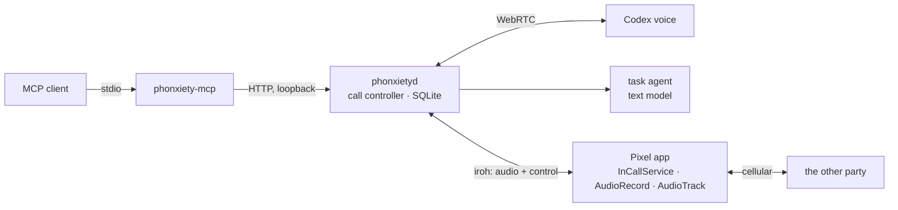

<h1 align="center">phonxiety</h1>

<p align="center">
  <strong>Your AI assistant makes the phone call. From your own SIM, through your own phone.</strong>
</p>

<p align="center">
  <a href="#getting-started">Getting started</a> ·
  <a href="#tools">Tools</a> ·
  <a href="#works-today--not-yet">Limits</a> ·
  <a href="#under-the-hood">Under the hood</a> ·
  <a href="DESIGN.md">Design notes (RU)</a>
</p>

---

## What is it

A daemon on your computer and a small app on a rooted Android phone. Connect it to Claude Code, Codex, OpenCode or any other MCP client, and your assistant can dial a number from your SIM, talk to whoever picks up, and come back with the answer.

You hand over a brief: who to call, what to get, what not to agree to. A realtime voice agent holds the conversation. You get the outcome, the fields you asked for and the transcript.

The call goes out over the cellular network with your number. The phone can stay locked, screen off, in a drawer.

---

## Stuff you do with it

- **Hand over a brief, not a script.** "Book a first visit for Thursday or Friday after 15:00, find out the doctor and the room." The agent works out the wording on the line.
- **Get fields, not a recording.** Ask for `appointment_day`, `appointment_time`, `doctor` — they come back filled in, next to a short summary and the transcript.
- **Draw the lines.** "No other days, nothing provisional." The agent keeps to it even when the other side pushes.
- **Let it wait.** "One minute, let me check" followed by silence does not end the call.
- **Pull the plug.** `hangup_call` drops the line from your side at any moment.
- **Check the line without dialing.** `phonxiety link-test` loads the phone link the way a call does and tells you whether it holds.
- **Forget about the phone.** It finds your computer by key, with no VPN app and no open ports, and comes back by itself after a reboot.

---

## Three little stories

All three are real calls from testing. The other side was the author on a second phone, playing the part.

**The dentist.** The brief: book Timur Karimov for a first visit, Thursday or Friday after 15:00, Thursday preferred. The receptionist said "one minute, let me check the schedule" and went silent for twenty seconds. The agent waited. She came back with two slots, then cut in on the agent's reply: "wait, 15:30 is taken... no, that's Wednesday. Thursday is free, but 16:00, not 15:30." The agent took 16:00, asked what to bring, read the booking back and hung up.

**The restaurant that says no.** A table for six on Saturday; other days not allowed. Saturday was full. The administrator offered Sunday at seven, then pushed: "let me book you anyway, cancel if you need to." The agent declined twice, wrote down the offer for you to decide, said goodbye. Outcome: `declined`, alternative on record.

**Nobody picks up.** After the ring timeout the daemon hangs up and reports `no_answer`. No summary, no invented conversation.

What the first one returned, trimmed (the call was in Russian):

```json
{
  "state": "ended",
  "call_outcome": "answered",
  "task_outcome": "succeeded",
  "summary": "Тимур Каримов записан на первичный осмотр в четверг в 16:00 к врачу Рахимовой, кабинет 12. Взять паспорт и прийти за 10 минут. Агент повторил запись вслух и попрощался.",
  "fields": {
    "appointment_day": "четверг",
    "appointment_time": "16:00",
    "doctor": "Рахимова",
    "room": "12",
    "what_to_bring": "паспорт; прийти за 10 минут"
  },
  "transcript_complete": true
}
```

---

## Works today · Not yet

| ✅ Works today | 🚧 Not yet |
|---|---|
| Outbound calls from your SIM through a rooted Pixel 6a | Any other phone: it was built and tested on exactly one |
| Phone locked, screen off, no cable; reconnects after a reboot before the first unlock | Calls on mobile data alone or over a relay: audio is uncompressed and needs a direct path, so the phone has to be on Wi-Fi |
| Phone and computer find each other by key: no VPN, no addresses, no open ports | The first minute after the phone joins Wi-Fi: the call waits for the line instead of dialing (39 s in the test) |
| A one-second line check before every dial, so nobody is rung into silence | Surviving a dropped link mid-call: the phone hangs up |
| Waiting on hold, taking a correction, refusing what the brief forbids | Telling a voicemail from a person: the agent starts greeting it |
| The agent says goodbye and hangs up by itself | Hanging up quickly: about 5 s pass after the goodbye |
| Outcome, summary, requested fields and transcript | A clean `error` field every time: a finished call can carry a false `playback_drain_timeout` |
| No answer, ring timeout, hang-up on request | Keypad menus: implemented, never tried on a real call |
| `phonxiety link-test` and per-call link counters in the logs | Pairing by QR in the app and a run in each MCP client: built, not tested |
| | Incoming calls; more than one call at a time |

---

## Getting started

You need a Mac (the only computer it has run on), [mise](https://mise.jdx.dev), a Codex sign-in, and a rooted Pixel 6a with Magisk and a working SIM.

**The computer**

```sh
mise install            # Python, uv, JDK 17, Gradle, Rust
mise run setup          # dependencies into .venv
uv run phonxiety auth   # its own Codex sign-in; ~/.codex/auth.json is left alone
```

**The Android toolchain, once**

`mise install` does not bring the Android SDK. The phone tasks expect:

- an SDK at `.tools/android-sdk` in the project (that is where `ANDROID_HOME` points), with Google's [command-line tools](https://developer.android.com/studio#command-line-tools-only) unpacked to `cmdline-tools/latest/`;
- the platform and build tools the app is compiled against:

  ```sh
  .tools/android-sdk/cmdline-tools/latest/bin/sdkmanager --sdk_root=.tools/android-sdk "platforms;android-37.0" "build-tools;37.0.0"
  ```

- `adb` on your `PATH`, or its location in `ADB=`.

The NDK and `cargo-ndk` are installed by the build itself on the first run.

**The phone, once, over USB**

Enable USB debugging and allow root for the shell in Magisk, then:

```sh
mise run phone:build              # iroh for Android, the app, the Magisk module
mise run phone:install --reboot   # installs the module and reboots the phone
mise run phone:pair               # grants permissions, stores the daemon's key and a token
```

The first build clones and compiles iroh for Android, so it needs network access and takes a while. The module is there because the app needs three privileged permissions that only a system app gets. The APK is signed with the debug key unless `PHONXIETY_KEYSTORE` is set. After pairing you can unplug the cable.

**Your MCP client**

```json
{
  "mcpServers": {
    "phonxiety": {
      "command": "uv",
      "args": ["run", "--project", "/absolute/path/to/phonxiety", "phonxiety-mcp"]
    }
  }
}
```

Or with Claude Code: `claude mcp add phonxiety -- uv run --project /absolute/path/to/phonxiety phonxiety-mcp`.

The adapter starts the daemon when none is running. Then:

```sh
uv run phonxiety status      # daemon, phone, route, ready to call
uv run phonxiety link-test   # load the link like a call, without dialing
```

Settings:

- `PHONXIETY_CODEX_TASK_MODEL` — the Codex text model that supervises the line (task agent), for every voice backend.
- `PHONXIETY_VOICE_BACKEND` — who talks on the line: `codex` (default, Codex realtime over WebRTC, any language), `deepgram` (Deepgram Voice Agent: nova-3 listen, an OpenAI think model hosted by Deepgram, aura-2 speak; English voices by default) or `gemini` (Gemini Live native audio). Keypresses and hanging up are line actions the daemon executes directly: Gemini and Deepgram call the `send_dtmf` and `end_call` tools; Codex sends the delegation `DTMF <digits>` for keys and, having no tools, never asks to hang up: it only says goodbye, and the task agent, asked at the end of each of its turns, ends the call. Anything else goes to the task agent.
- `DEEPGRAM_API_KEY` / `GEMINI_API_KEY` — keys for those backends, or the files `deepgram-api-key` / `gemini-api-key` in the state directory. Optional models: `PHONXIETY_DEEPGRAM_LANGUAGE` (`en`), `PHONXIETY_DEEPGRAM_LISTEN_MODEL` (`nova-3`), `PHONXIETY_DEEPGRAM_THINK_MODEL` (`gpt-4o-mini`), `PHONXIETY_DEEPGRAM_SPEAK_MODEL` (`aura-2-thalia-en`), `PHONXIETY_GEMINI_MODEL` (`gemini-3.8-live`), `PHONXIETY_GEMINI_VOICE` (`Puck`).
- `PHONXIETY_CODEX_VOICE` — the Codex voice, `sol` by default. `PHONXIETY_CODEX_AUTH_FILE` — the daemon's own Codex login file.
- `PHONXIETY_AUDIO_CODEC` — call audio on the phone link: `opus` by default, or `pcm`. Opus is used only when the phone app offers it.
- `PHONXIETY_OPUS_BITRATE` — Opus bitrate in bit/s, `32000` by default, 6000 to 128000.
- `PHONXIETY_IROH_RELAYS` — comma-separated iroh relay URLs that replace n0's public relays, e.g. your own `iroh-relay` behind HTTPS. Without the variable the daemon reads `iroh-relays` in the state directory, one URL per line, so the setting holds however the daemon is started. Public relays are rate-limited and may not carry PCM call audio.
- `PHONXIETY_STATE_DIR` — calls, keys and logs; `~/.local/share/phonxiety` by default.
- `PHONXIETY_PORT` — MCP and health on loopback, `18762` by default.

No iroh? `uv run phonxiety pair --lan`, `--tailscale` or `--host` pairs by address over TLS WebSocket instead.

---

## Skill

Agents that read skills (Claude Code, Codex, Oh My Pi) can call without MCP: `mise run skills:install` links `skills/phonxiety/SKILL.md` into each harness found on the machine and puts the `phonxiety` CLI into `~/.local/bin`. The skill covers checking the line, writing the brief, waiting for the result and reading the archive.

## Tools

Three tools. A call outlives the tool call that started it, so placing and waiting are separate.

| Tool | What it does |
|---|---|
| `place_call` | Takes the number, goal, context, constraints, limits and the result fields you want. Returns a `call_id` at once |
| `wait_call_result` | Waits up to 45 s and returns the state, outcome, summary, fields and a page of the transcript. Call it again until the result is ready |
| `hangup_call` | Ends the call. Before the dial it cancels it; after, it disconnects the line |

The same from a terminal:

```sh
uv run phonxiety call --destination +12025550123 \
  --goal "Book a table for six on Saturday at 19:00, name Karimov." \
  --constraints "No other days. Nothing provisional." \
  --result-field booked --result-field offered_alternative
uv run phonxiety result <call_id> --wait-s 45
uv run phonxiety hangup <call_id>
```

Limits per call: `max_duration_s` (10 to 3600, default 900) and `ring_timeout_s` (5 to 180, default 60). A `request_id` makes a retry safe: the same id never dials twice.

---

## What keeps a call in line

1. **No dial without a line check.** Before dialing, the daemon sends a second of call-sized frames to the phone and counts what comes back. If the link cannot carry audio, it waits up to 90 s, then fails with `phone_link_not_ready` and rings nobody.
2. **The brief is fixed before the call.** Your assistant hands it over once and is not in the loop for each reply. Constraints travel with it.
3. **Someone watches the line.** A text model reads the transcript whenever the line goes quiet, and with Codex after every turn of the agent, and decides whether the task is done. The voice model does not have to remember to hang up.
4. **A lost link ends the call.** The daemon pings the phone every 2 s; the phone hangs up after 10 s without its computer. Nobody is left on a dead line.
5. **Hard limits.** Ring timeout and maximum duration are enforced by the daemon, not by the model.
6. **What was confirmed wins.** The other side's words reach the transcript through speech recognition and can be misheard. When the agent repeated a name or a number aloud and was not corrected, that version goes into the result.

---

## Under the hood



How one call goes:

1. `place_call` stores the request and returns. The daemon waits for the phone, checks the line, opens a voice session and tells the phone to dial.
2. When the line is answered, the phone streams the downlink audio to the daemon and plays the agent's voice into the uplink. Audio is 48 kHz mono in 20 ms frames: Opus by default (~32 kbit/s), raw PCM (~768 kbit/s) with `PHONXIETY_AUDIO_CODEC=pcm` or with a phone app that predates Opus.
3. The voice model talks, presses keys and hangs up through the daemon. The task agent steps in on silence, on any other request from the voice model, and once at the end.
4. The daemon disconnects, writes the summary and fields, and keeps them by `call_id`. It also archives every call in `~/.local/share/phonxiety/calls/`: `<call_id>.json` with the request, timings, outcomes, fields, full transcript and who answered (`far_end`: `person`, `ivr` or `voicemail`, from the wording of the other side), and for connected calls `<call_id>.wav`, 48 kHz stereo with the other party on the left and the agent on the right, plus `<call_id>.m4a`, a small copy to share: both sides in one channel, long pauses cut. Nothing on the call announces the recording.

All audio handling (Opus, conversion, pacing, recording, the shareable copy) lives in `src/phonxiety/audio/` and runs on PyAV's bundled FFmpeg; `docs/audio-research.md` explains which parts use a library and why.

Every text a model reads is a Jinja template in `src/phonxiety/prompts/`: the voice agent's instructions and brief, the context lines it receives during a call, and the task agent's prompts.

Calls, keys, tokens and the daemon log live under `~/.local/share/phonxiety/`. At the end of every call both sides log how many frames went each way; on a link loss they log the counters of every iroh path.

<details>
<summary><strong>Code map</strong></summary>

**Daemon** (`src/phonxiety/`)

- `server.py`, `mcp.py`, `cli.py` — HTTP MCP server, stdio adapter, command line
- `controller.py` — call lifecycle, line check before dialing, quiet-line supervision, result
- `voice.py`, `auth.py` — Codex voice session over WebRTC and its sign-in
- `task_agent.py` — the text model: reviews, keypad digits, summary
- `device.py` — the phone protocol: commands, events, call-audio stream, link test
- `net/` — the phone link: iroh and TLS WebSocket transports, framing, TLS identity
- `audio/` — Opus, conversion, pacing, recording, the shareable copy
- `store.py`, `models.py`, `settings.py`, `runtime.py`, `power.py` — SQLite, request models, settings, wiring, keeping the Mac awake

**Phone** (`android/app/src/main/java/com/phonxiety/bridge/`)

- `BridgeEngine.kt` — the device protocol on the phone: hello, commands, call ownership
- `PhoneAudio.kt`, `HandsetMute.kt` — call audio in and out, microphone state
- `net/` — the phone link: `LinkSupervisor` (connect, reconnect, host watchdog), iroh and WebSocket transports, framing
- `BridgeService.kt`, `BridgeInCallService.kt`, `BootReceiver.kt` — foreground service, Telecom, start on boot
- `MainActivity.kt`, `BridgeConfig.kt`, `AppStorage.kt`, `CallLedger.kt` — status screen, pairing, storage

**Tasks** (`mise.toml`, `mise-tasks/`) — `setup`, `test`, `daemon`, `pair`, `phone:build`, `phone:install`, `phone:pair`, `daemon:install`

</details>

<details>
<summary><strong>Checks</strong></summary>

```sh
mise run test                 # unit tests, no phone, no network
uv run phonxiety link-test    # the real link under call load
```

</details>

---

## What it is not

- Not a VoIP or SIP service. The call leaves from your SIM, with your number, on your tariff.
- Not plug-and-play. It needs a rooted phone and a Magisk module.
- Not an OpenAI product. It uses Codex voice through your own sign-in, and that backend can change.
- Not a dialer for lists. One request is one call to one number.

---

<p align="center">
  <sub>Unofficial · your SIM, your phone, your computer</sub>
</p>
