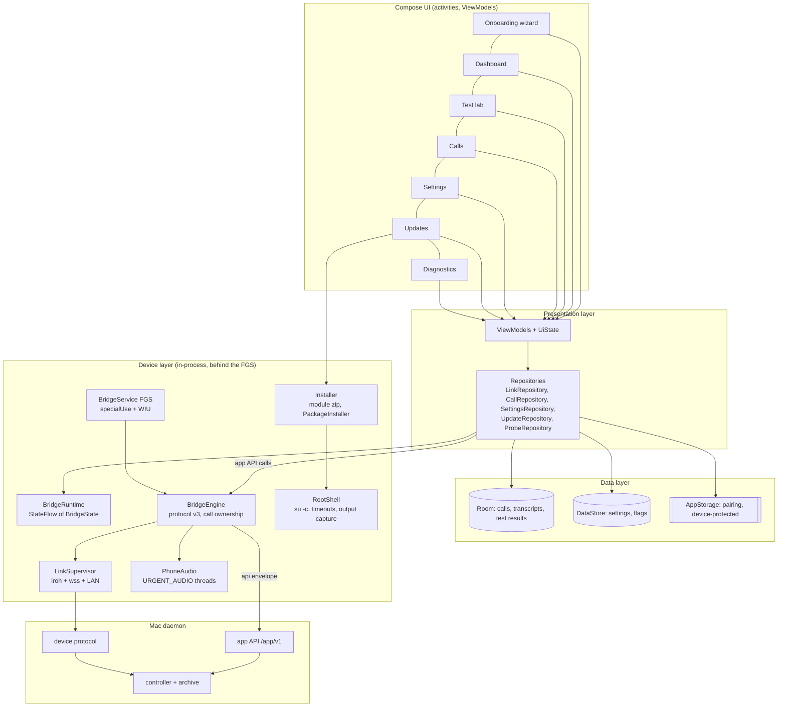

# Phonxiety mobile client — target design and plan

The app in `android/` today is deliberately minimal: one screen, pairing, a status list, and a
headless foreground service that the daemon drives. This document plans the *full* client instead:
a phone app you can use to set the whole system up, watch it work, exercise every part of it, fetch
what a call produced, tune it, and update it — with the phone as the place you configure things, not
as a headless peripheral.

It is a design and technology report only. No code is changed by it. `docs/android-research.md`
(2026-11-25) is the narrow pass that recommended keeping the single screen; this document reuses its
verified facts and overrules its scope. `docs/network-research.md` covers the transport layer and is
assumed unchanged unless a section here says otherwise.

Snapshot date: 2026-11-26. Sources are dated in place. Anything I could not confirm is in
[Not verified](#10-not-verified).

Effort scale used everywhere below: **S** ≤ 1 day, **M** 2–5 days, **L** 1–3 weeks, **XL** 3–6 weeks.
Estimates include the on-device verification each step needs, for one experienced Android developer.

---

## 1. What the app becomes

One app, package `com.phonxiety.bridge`, installed as a Magisk `priv-app`, that is the whole control
surface for the system:

| Job | What the user does | What the app does |
|---|---|---|
| Install | Opens the app on a fresh rooted phone, follows the wizard | Detects root/Magisk, installs its own module, grants what can be granted, reboots, verifies |
| Pair | Scans the daemon's QR (or opens a `phonxiety://pair` link, or types a code) | Validates the ticket/certificate/token, connects, runs a first link test |
| Choose a connection | Picks "automatic" or a specific path | Probes iroh, LAN, Tailscale (and any configured relay), scores them, keeps the best, re-probes on change |
| Watch | Leaves the dashboard open | Live path (direct/relay/LAN/Tailscale), RTT p50/p95, backlog, audio levels both ways, call state, phone health |
| Test | Runs the test lab | Link test (stream and datagram), audio loopback, a real test call, codec/bitrate trials, volume/downlink checks |
| Review | Opens Calls | History synced from the daemon, per-call outcome, summary, fields, transcript, recording playback, share |
| Tune | Opens Settings / Auto-tune | Codec and bitrate, relay, call volume, Wi-Fi low-latency lock, battery exemption, timeouts, voice backend — with measured recommendations and one-tap revert |
| Maintain | Opens Updates | App APK and Magisk module updates from the same screen, with the reboot and the rollback path spelled out |
| Diagnose | Opens Diagnostics | Self-check list, in-app log, exportable bundle (logs + `dumpsys` snapshots + last link test) |

Design rules that follow from how this system fails:

1. **Never trust the link's appearance.** The project has already lost a day to a link that looked
   up and could not carry audio, and Android 17 makes a *permission* failure look like a TCP timeout
   ([local network permission](https://developer.android.com/privacy-and-security/local-network-permission),
   §Errors). Every "connected" claim in the UI must be backed by a probe with numbers attached.
2. **The service owns the system; the UI owns nothing.** The foreground service keeps the link and
   the audio; activities and ViewModels come and go. A UI crash must not drop a call.
3. **Every automatic change is visible and revertible.** Auto-tune writes a record of what it changed
   and why, next to a revert control.
4. **Destructive steps are rehearsed.** Reboots, module installs and self-updates each have a
   documented recovery path shown *before* the action, not after it fails.
5. **Local only.** No analytics, no cloud, no Play Services requirement for anything but the QR
   scanner (which already has a fallback: the pairing link and typed code).

---

## 2. Screens and flows

### 2.1 Onboarding wizard (first run, and re-runnable from Settings)

| Step | Content | Needs from the daemon |
|---|---|---|
| 1. Welcome | What the system does, that the phone must be rooted, that calls leave from the user's SIM, and that call audio is recorded locally | nothing |
| 2. Device check | API level ≥ 34 (device is 37), telephony feature, SIM present and carrier name, Play Services present, `su` works (`su -c id` → uid 0), Magisk version (`magisk -V`), module present, app is a system app and holds the privileged permissions | nothing |
| 3. Privileged install | Install/update the bundled Magisk module, reboot, re-check. See [§6](#6-installing-and-updating-extras-from-the-app) | nothing |
| 4. Runtime permissions | `RECORD_AUDIO`, `CALL_PHONE`, `READ_PHONE_STATE`, `MODIFY_AUDIO_SETTINGS`, `POST_NOTIFICATIONS`, `ACCESS_LOCAL_NETWORK`; battery-optimisation exemption; explanation of the Wi-Fi lock | nothing |
| 5. Pair | QR scan (Google code scanner, already a dependency), `phonxiety://pair` deep link, or 8-word code typed from the Mac; shows what was validated (endpoint id / host, certificate fingerprint first 8 bytes, token present) | `/pairing` (exists), a code-based variant (new) |
| 6. Connect and measure | Runs the probe set, shows each candidate's result, applies the winner; one "link test" run so step 6 ends with a number, not a green dot | `/link-test` (exists); per-candidate probe results (new) |
| 7. Done | Starts the service, shows the dashboard, offers "run a test call" | nothing |

Re-runnable: the same screens serve "repair permissions", "repair module", "re-pair", "change
connection" from Settings.

### 2.2 Dashboard (home)

- **Hero card** — path (`Direct` / `Relay <name>` / `LAN` / `Tailscale` / `Offline`), endpoint short
  id, uptime, reconnect count, last error with a link to Diagnostics.
- **Call card** — idle / dialling / ringing / active / ending, destination masked to country+last 2,
  duration, `far_end` once known, agent state (thinking / speaking / waiting) if the daemon exposes
  it, big Hang up.
- **Live numbers** — RTT p50/p95 sparkline (from the 2 s heartbeat, already measured), control
  backlog bytes, audio in/out level meters (dBFS, 20 ms frames), negotiated codec and bitrate,
  frames sent/received, drops.
- **Phone health** — battery %, thermal status, Wi-Fi SSID/RSSI or cellular, doze exemption state,
  foreground service alive, audio route (earpiece/speaker), `ACCESS_LOCAL_NETWORK` state.
- **Quick actions** — run link test, run test call, open test lab, export diagnostics.

The dashboard is read-only except for hang-up and the two test actions: everything that changes the
system lives in Settings or the wizard.

### 2.3 Test lab

| Tool | What it does | Needs from the daemon |
|---|---|---|
| Link test | 1–30 s of call-sized frames, stream or datagram transport, chosen codec; returns p50/p95/max RTT, loss, reorder, throughput, and a verdict; history of past runs | `/link-test` exists; needs per-run storage and a datagram flag surfaced ([protocol v2 already added datagrams](network-research.md)) |
| Audio loopback | Daemon echoes the phone's uplink PCM back on the downlink; the phone measures round-trip delay by correlation, level, and gaps; 10 s run | new `loopback` command mode |
| Test call | Places a real call to a number the user types, with a canned brief, max 60 s; shows live state and final outcome; never auto-retries | new: place/wait endpoints scoped to "test" |
| Codec trial | Runs the same 5 s probe with Opus 16/32/64 kbit/s and PCM, then recommends one | `link-test?codec=` exists; needs the loop to run them in one session |
| Volume / downlink check | Plays a tone into the uplink at a chosen level, then records 5 s of downlink and plays it back locally to confirm the route | new `tone` command |
| DTMF probe | Sends digits on a live test call so a keypad menu can be exercised | `dtmf` exists in the protocol, never tried on a real call |

Every tool writes its result into a local "results" table, so the Auto-tune panel and Diagnostics can
cite real measurements instead of guesses.

### 2.4 Calls (history) and call detail

- List: paginated from the daemon (`~/.local/share/phonxiety/calls/*.json`), cached in Room, filters
  by outcome/`far_end`/date, search over summary and destination.
- Detail: request (goal, constraints, result fields), timings, state and outcomes, `far_end`,
  summary, fields, transcript with speaker turns and timestamps, audio player for the `.m4a` share
  copy (and `.wav` on request), share/save, delete on the daemon with an explicit confirmation.
- Live progress for an in-flight call (state, transcript append) through a subscription, so a call
  started by an MCP client can be watched from the phone.

Needs from the daemon: list/detail/transcript/audio/delete endpoints and a change subscription — none
of which exist today (the archive is files on the Mac and the only client is the CLI/MCP).

### 2.5 Settings

| Group | Items | Source of truth |
|---|---|---|
| Connection | automatic / iroh / LAN / Tailscale / custom address; relay: default, own relay URL, or none; re-probe interval; reconnect policy | app (which link to open) + daemon (relay for its endpoint) |
| Audio | codec: auto / opus / pcm; target bitrate 6–128 kbit/s; volume; mute handset; Wi-Fi low-latency lock; keep CPU awake during calls | hello preferences + daemon settings |
| Calls | ring timeout, max duration, default result fields, default constraints, language hint | daemon |
| Voice | backend (codex/deepgram/gemini), voice name, models | daemon |
| Device | start on boot, notification detail, battery exemption, log level | app |
| Auto-tune | on/off, what it may change, history of changes, "revert everything" | app |

Auto-tune rules (all measured, all reversible):

| Observation | Change |
|---|---|
| Path has been relay-only for > 20 s, twice in an hour | Suggest enabling/pointing at the owner's relay; escalate to a link test |
| Link test p95 RTT > 400 ms or loss > 2 % with Opus 32 | Drop to Opus 16 and re-test; tell the user the phone is on a poor path |
| Throughput ≥ 400 kbit/s and p95 < 120 ms | Allow Opus 48–64 for better far-end intelligibility |
| Cellular transport with any loss | Force Opus (never PCM: 768 kbit/s on a mobile link) |
| Thermal status ≥ `SEVERE` or battery < 15 % without charging | Release the Wi-Fi low-latency lock, keep the call, surface a warning |
| Repeated heartbeat misses with the screen off | Ask for battery exemption (never granted silently) |
| `ACCESS_LOCAL_NETWORK` denied and LAN candidate failing | Say "permission", not "network" — this is the Android 17 failure mode |

### 2.6 Updates and maintenance

One screen with three rows — **App**, **Magisk module**, **Daemon** — each showing installed vs
available version and a compatibility verdict (protocol, app API, module). Actions: check now,
download, install, reboot later, rollback to the previous APK, reinstall module, disable module.
Details in [§6](#6-installing-and-updating-extras-from-the-app).

### 2.7 Diagnostics

Self-check list (permissions, root, module, privileged grants, service, link, codec negotiation,
audio route, time offset, battery), a log viewer with filters, and **Export bundle**: a zip with the
app log, `dumpsys battery|audio|telecom|package|activity services` snapshots taken through `su`, the
last 5 link-test results, redacted config (token and secrets removed), and device build info. Shared
through `FileProvider`.

---

## 3. Architecture

### 3.1 Shape



### 3.2 Module layout

Gradle modules, with two convention plugins (`phonxiety.android.library.compose`,
`phonxiety.android.feature`) once there is more than one library:

```
:app                          activity host, navigation graph, Hilt entry points
:core:model                   @Serializable protocol + API + domain models (pure Kotlin)
:core:designsystem            theme, Material 3 Expressive components, meters, charts
:core:data                    repositories, Room, DataStore, ApiClient
:core:device                  link, engine, audio, root shell, installer, service
:feature:onboarding  :feature:dashboard  :feature:lab
:feature:calls       :feature:settings   :feature:updates  :feature:diagnostics
```

`:core:model`, `:core:data`, `:core:device` are the only places allowed to know about the wire. A
feature module that imports `okhttp`, `iroh` or `org.json` is a review failure.

This is more modules than the single-screen app justified in `docs/android-research.md`; the reason
it is justified now is build parallelism and the fact that the same code must be unit-testable on the
JVM while the UI changes daily.

### 3.3 State model

One process-wide, immutable state that the UI renders:

```kotlin
@Serializable
data class BridgeState(
  val link: LinkState,          // Offline | Connecting(candidate) | Up(path, rttP50, rttP95, since, reconnects)
  val call: CallState?,         // id, destinationMasked, phase, startedAt, farEnd, agentActivity
  val audio: AudioState,        // codec, bitrate, rxLevelDbfs, txLevelDbfs, frames, drops
  val device: DeviceState,      // battery, thermal, networkType, wifiRssi, dozeExempt, permissionSnapshot
  val capabilities: Capabilities,
  val lastError: LinkError?,    // code + human text + when
)
```

Produced by the engine on one serialised `CoroutineScope`, exposed as `StateFlow<BridgeState>` from
`BridgeRuntime`, collected by ViewModels. `MainActivity`'s 1 Hz poll disappears (it exists because
the engine has no flow today). Two exclusions stay as they are, from `android-research.md`: the audio
threads remain raw `Thread`s at `THREAD_PRIORITY_URGENT_AUDIO`, and blocking Telecom binder calls stay
under the existing lock.

Audio levels are computed *inside* the existing audio threads (RMS per 20 ms frame, one `AtomicInteger`
in dBFS×10) — a second `AudioRecord` cannot be opened on `VOICE_DOWNLINK`, and adding one would fight
the capture path.

### 3.4 Boundaries that must not leak

- `BridgeEngine` never holds a `Context` beyond `applicationContext`, a `View`, or a callback into UI.
- The app API client is a suspend function surface (`suspend fun calls(page: Int): CallPage`), not a
  socket the UI can touch.
- Root work goes through one `RootShell` object with a fixed command allowlist, a 20 s timeout, and
  output captured for Diagnostics. No feature module builds a shell string.
- The UI can request actions (place test call, run probe, install update); it cannot perform them.

---

## 4. Stack

Versions are what to pin now; the links are the primary sources checked on 2026-11-26.

| Area | Choice | Version | Source |
|---|---|---|---|
| Language | Kotlin, K2 | 2.4.21 (2.5.0-RC2 is the current pre-release) | [Maven metadata](https://repo1.maven.org/maven2/org/jetbrains/kotlin/kotlin-stdlib/maven-metadata.xml) |
| Build | AGP | 9.5.3 (max API 37, Gradle ≥ 9.6.0, JDK 17) | [AGP 9.5 notes](https://developer.android.com/build/releases/agp-9-5-0-release-notes) (Oct 2026), [Google Maven](https://dl.google.com/android/maven2/com/android/tools/build/gradle/maven-metadata.xml) |
| Build | Gradle | 9.6.0 pinned; 9.9.2 is current | [Gradle releases](https://services.gradle.org/versions/current) (2026-11-19) |
| SDK | compileSdk 37.1, target 37, min 34 | — | [Compose Nov '26](https://developer.android.com/blog/posts/jetpack-compose-november-2026-release) (2026-11-18) |
| UI | Compose BOM `2026.11.01` → Compose 1.13 | 1.13.0 | [BOM mapping](https://developer.android.com/develop/ui/compose/bom/bom-mapping), [release blog](https://developer.android.com/blog/posts/jetpack-compose-november-2026-release) (2026-11-18) |
| UI | Material 3 (Expressive components stable) | 1.5.0 | [M3 1.5.0](https://developer.android.com/jetpack/androidx/releases/compose-material3#1.5.0) |
| Compiler plugin | `org.jetbrains.kotlin.plugin.compose` (ships with Kotlin 2.x) | 2.4.21, same as Kotlin | [Compose setup](https://developer.android.com/develop/ui/compose/setup-compose-dependencies-and-compiler) |
| Navigation | Navigation 3 (`navigation3-runtime` + `-ui`) | 1.2.2 stable (1.3.0-alpha05) | [navigation3 releases](https://developer.android.com/jetpack/androidx/releases/navigation3) (2026-11-18) |
| DI | Hilt (Dagger) + `androidx.hilt` | 2.60.1 / 1.4.0 | [Dagger releases](https://github.com/google/dagger/releases) (2026-07-06), [androidx.hilt](https://developer.android.com/jetpack/androidx/releases/hilt) (2026-07-01) |
| Codegen | KSP | 2.3.14 (AGP 9 built-in Kotlin aware) | [KSP releases](https://github.com/google/ksp/releases) (2026-11-13) |
| Serialization | kotlinx.serialization | 1.13.0 | [Maven metadata](https://repo1.maven.org/maven2/org/jetbrains/kotlinx/kotlinx-serialization-json/maven-metadata.xml) (2026-11-11) |
| Async | kotlinx-coroutines | 1.11.0 | [Maven metadata](https://repo1.maven.org/maven2/org/jetbrains/kotlinx/kotlinx-coroutines-core/maven-metadata.xml) (2026-05-08) |
| Prefs | DataStore | 1.3.0 | [DataStore releases](https://developer.android.com/jetpack/androidx/releases/datastore#1.3.0) (2026-10-21) |
| Local DB | Room (KSP) | 2.8.5 | [Room releases](https://developer.android.com/jetpack/androidx/releases/room#2.8.5) (2026-09-09) |
| Background | WorkManager + `androidx.hilt:hilt-work` | 2.12.0 | [WorkManager releases](https://developer.android.com/jetpack/androidx/releases/work#2.12.0) (2026-09-23) |
| HTTP/WS | OkHttp (keep; Ktor adds nothing here) | 5.5.1 | [Maven metadata](https://repo1.maven.org/maven2/com/squareup/okhttp3/okhttp/maven-metadata.xml) (2026-10-22) |
| Media | Media3 ExoPlayer (recording playback) | 1.11.1 | [Media3 releases](https://developer.android.com/jetpack/androidx/releases/media3#1.11.1) (2026-11-11) |
| Camera | CameraX (optional: own QR scanner for non-GMS devices) | 1.7.0 | [CameraX releases](https://developer.android.com/jetpack/androidx/releases/camera) (2026-11-18) |
| QR | Google code scanner (keep; no camera permission) | 16.1.0 | [Google Maven](https://dl.google.com/android/maven2/com/google/android/gms/play-services-code-scanner/maven-metadata.xml) (latest since 2023-08) |
| Native P2P | iroh-ffi (uniffi + JNA) | 1.2.0 | [iroh-ffi docs](https://n0-computer.github.io/iroh-ffi/); Kotlin `EndpointOptions(relayMode = RelayMode.Custom(RelayMap))` verified in the [Kotlin API](https://n0-computer.github.io/iroh-ffi/kotlin/lib/computer.iroh/-endpoint-options/index.html) |
| Unit tests | JUnit 4 (existing) + Turbine | 4.13.2 / 1.2.1 | [Turbine Maven](https://repo1.maven.org/maven2/app/cash/turbine/turbine/maven-metadata.xml) (2025-06-11) |
| JVM Android tests | Robolectric | 4.18.1 (SDK 37 support) | [Robolectric releases](https://github.com/robolectric/robolectric/releases/tag/robolectric-4.18.1) (2026-11-18) |
| Screenshots | Roborazzi | 1.79.0 | [Roborazzi releases](https://github.com/takahirom/roborazzi/releases) (2026-11-12) |
| Performance | Macrobenchmark + baseline profiles | 1.5.0 | [Benchmark releases](https://developer.android.com/jetpack/androidx/releases/benchmark#1.5.0) (2026-11-18) |
| Lint | Android Lint `warningsAsErrors`, `abortOnError` | AGP 9.5 | [Lint](https://developer.android.com/studio/write/lint) |
| Style | ktlint (formatting only) | 1.8.0 | [ktlint Maven](https://repo1.maven.org/maven2/com/pinterest/ktlint/ktlint-cli/maven-metadata.xml) (2025-12-15) |

### 4.1 Decisions and why

**DI: Hilt.** The app will have ~7 destinations, ViewModels scoped to navigation entries, a
`WorkManager` worker that needs repositories, and a service that needs the engine. Hilt is the
documented recommendation for exactly that shape ([architecture recommendations](https://developer.android.com/topic/architecture/recommendations)),
it has an official Navigation 3 recipe for ViewModels with arguments
([recipe](https://developer.android.com/guide/navigation/navigation-3/recipes/passingarguments)), and
`hilt-work` injects into workers. Alternatives: **Metro** (1.5.2, 2026-11-03,
[repo](https://github.com/ZacSweers/metro)) and **kotlin-inject** — both are Kotlin compiler plugins,
i.e. one more compatibility surface against AGP 9 built-in Kotlin, and neither has the same
Navigation 3/WorkManager integration story. Hilt needs KSP, not kapt (kapt is incompatible with
built-in Kotlin, [migration guide](https://developer.android.com/build/migrate-to-built-in-kotlin)),
and Dagger fixed the Kotlin 2.4 metadata issue that broke 2.59.2
([dagger#5180](https://github.com/google/dagger/issues/5180), fixed by [#5179](https://github.com/google/dagger/pull/5179) in 2.60).

**Navigation: Navigation 3.** Stable since 1.2.0 (2026-09-23) with the result API, deep-link matchers
and `NavigationBackHandler`; 1.2.2 is a bug-fix release. The tie-in with this app is deep links: the
pairing link and "open call <id>" links are what N3's `DeepLinkMatcher`/`BackStackMatcher` are for.
The 1.3 alpha only adds dynamic feature modules, which this app will not use.

**Persistence split.** Pairing stays in the existing `AppStorage` raw files: `BridgeService` reads it
*before first unlock*, and DataStore is coroutine-first (it would need `runBlocking` on the service
thread — the same reason `android-research.md` skipped DataStore). Everything user-facing (settings,
flags, cached pages) goes to DataStore; call history and test results go to Room because they are
paged, filtered and searched.

**Serialization.** kotlinx.serialization replaces `org.json` for protocol, app API, Room and
DataStore payloads. 61 `JSONObject` sites in the app today
(`android-research.md`), and the app API adds a dozen shapes. Wire format stays the daemon's job; the
phone's models tolerate unknown keys (`ignoreUnknownKeys = true`) so a newer daemon does not break an
older app.

**HTTP client: OkHttp, no Ktor.** There is no HTTP in the app today; the device protocol is a framed
socket. The app API will ride the same framed transport (see §7.2), so OkHttp remains only for the
TLS WebSocket transport — a second HTTP engine buys nothing (same conclusion as `android-research.md`
and `network-research.md`).

**Audio.** Keep `AudioRecord(VOICE_DOWNLINK)` + `AudioTrack` and `MediaCodec` Opus exactly as they
are: AAudio/Oboe cannot open a voice-downlink source (**not verified**, see §10), and the level meter
is arithmetic on frames the app already holds. Media3 is only for playing back the daemon's `.m4a`
recording, where an ExoPlayer instance is the least code.

**Testing.**
- JVM unit tests (JUnit 4, the existing framing/link-supervisor/playback-mark tests) for protocol models, app API
  client, repositories, auto-tune rules; `kotlinx-coroutines-test` + Turbine for flows.
- Robolectric for the Android-touching units: `AppStorage`, `BridgeConfig`, `Permissions`, `RootShell`
  parsing, `Installer` state machine, package signature checks.
- Compose UI tests (`ui-test-junit4`) against fake repositories for the wizard, dashboard error
  states and settings validation.
- Roborazzi screenshots for every screen state that has a "this must never look like that" failure
  (offline, permission denied, relay-only, call active, update pending, root missing).
- Macrobenchmark 1.5.0 for dashboard cold start and "hang up latency"; baseline profile generated
  from that benchmark and shipped in the release.
- On-device instrumentation: a scripted smoke run on the Pixel (pair → link test → loopback → 30 s
  test call) as a `mise` task, because a green JVM build proves nothing about Telecom and audio.

JUnit 5 is deliberately not adopted: `android-junit5` with AGP 9 is unverified, and JUnit 4 already
works. Robolectric + Roborazzi cover what JUnit 5 would buy.

**Build hygiene.** Version catalog (`gradle/libs.versions.toml`), configuration cache, explicit
`org.jetbrains.kotlin:kotlin-gradle-plugin:2.4.21` on the root classpath so the compiler is pinned
above whatever KGP AGP bundles, R8 in the release build with keep rules for JNA/uniffi (verified by a
real call, per `android-research.md`), and a release build that fails when `PHONXIETY_KEYSTORE*` is
unset. CI: GitHub Actions on `ubuntu-latest` with JDK 17, Rust `aarch64-linux-android`,
`cargo-ndk`, NDK and the Android SDK, running `mise run phone:build` (which already builds iroh and
packages the module) plus unit tests and lint; the iroh build is cached with `Swatinem/rust-cache`.
There is no CI in the repo today, so this is new work, not a tweak.

---

## 5. Connection options

### 5.1 What each option actually is on Android

| Option | How the app reaches the Mac | App-side work | Ops burden | Cost / licence | Verdict |
|---|---|---|---|---|---|
| **iroh, own relay** (today) | QUIC to the daemon's endpoint id; direct hole-punched path when possible, own `iroh-relay` otherwise | none (existing `IrohLink`) | run `iroh-relay` behind HTTPS | already linked; relay is a small Rust binary | **Primary.** No VPN app, no open ports, survives reboots and network changes |
| **iroh, public relays** | same, n0's relays | none | none | rate-limited, and may not carry PCM audio (README) | **Fallback only**, with a visible warning |
| **Tailscale app + pair by tailnet IP** | the official Tailscale Android app installs a `VpnService`; the app connects to the Mac's `100.x` address | none beyond a candidate probe | user installs and signs into Tailscale | free for personal use; app is closed-source | **Supported second path.** Zero code risk, one app to install. Already exercisable: `phonxiety pair --tailscale` exists |
| **Embedded tsnet (in-app tailnet)** | `libtailscale` C library (BSD-3) compiled into the APK; userspace WireGuard; the app dials through a local proxy | JNI + local TCP proxy + auth-key UX | auth key from the admin console (or OAuth client) | BSD-3, but ~31 MB per ABI `.so` (Go runtime) and a third-party Android wrapper | **Optional, phase 9 spike.** Only if "no Tailscale app" becomes a requirement |
| **LAN WebSocket** (exists) | `wss://<mac-lan-ip>:port/device`, pinned certificate | candidate probe + discovery | same Wi-Fi, `ACCESS_LOCAL_NETWORK` granted | free | **Keep as the fastest path and the no-internet path** |
| **WireGuard** | `com.wireguard.android:tunnel` (Apache-2.0, 1.0.20260102) plus a `VpnService` | tunnel config generation, key exchange, route setup | a WireGuard endpoint on the Mac (another daemon), keys to manage | free | **Deferred.** It duplicates what iroh already does, with more moving parts and a VPN consent dialog |
| **WebRTC for the audio leg** | media stack (jitter buffer, FEC, congestion control) over the existing control link | large: signalling, media stack, new pairing | none extra | free | **Deferred** until iroh datagrams are measured (`network-research.md` already sequenced this) |

What the Tailscale embedding actually costs (measured from the wrapper repo, not estimated):
`libtailscale` is a Go `c-shared` build of `tsnet`, BSD-3, exposing `tailscale_new/up/dial/listen/
loopback/close`. On Android it needs (a) a synthetic `android0` interface because SELinux blocks
`/proc/net/*` for untrusted apps, which otherwise stalls netmon, (b) a `VpnService` for
`NETLINK_ROUTE`, (c) a `127.0.0.1` TCP proxy because Android sockets cannot be handed an fd
([tailscale_mobile README](https://github.com/leondgarse/tailscale_mobile)), and (d) authentication:
`tsnet` takes an `AuthKey`, an OAuth `ClientSecret`, or a workload identity — there is no
"sign in with a browser" flow in the documented API
([tsnet.Server reference](https://tailscale.com/docs/reference/tsnet-server-api), validated 2026-07-07).
An auth key in the app is a secret with an expiry the user must manage; that is a worse UX than "install
Tailscale and log in" unless the app grows its own OAuth dance.

### 5.2 Auto-selection

Candidates the app can try, in parallel when cheap, sequentially when not:

| Candidate | Probe | Typical score base |
|---|---|---|
| LAN WebSocket to the last known address | TLS + auth + `ping` (300 ms budget); re-discover via mDNS picker if the address fails | 100 |
| iroh direct | `EndpointTicket` connect; accept only if the path is not relay-only within 3 s | 90 |
| Tailscale (app) | `wss://100.x.y.z:port/device` if a tailnet address is configured | 80 |
| iroh via own relay | same connect, relay path accepted | 50 |
| iroh via public relay | last resort | 10 |

Score = base − `min(50, p50_rtt_ms / 4)` from a 1 s probe burst; a candidate must pass 3 consecutive
pings. Winner is kept with 15 % hysteresis (a challenger must beat the incumbent by 15 % for two
consecutive rounds). Re-probe on: network change (default-network callback), Wi-Fi↔cellular handover,
3 consecutive heartbeat misses, app foreground after 5 min hidden, and every 15 min idle.

Hard constraints:
- **Never re-probe or switch during a call.** A call pins the path; a dead path ends the call (the
  existing "lost link hangs up" rule) rather than migrating audio mid-sentence.
- **Check `ACCESS_LOCAL_NETWORK` before blaming the LAN candidate.** Without it, TCP to a LAN address
  times out with no error ([local network permission](https://developer.android.com/privacy-and-security/local-network-permission#errors)),
  which would otherwise look like "the Mac is off".
- **Never silently fall back to PCM** on cellular; the daemon's codec choice is reported in the hello
  reply and the app must show it.
- **Relay-only for more than 20 s** is surfaced as a warning with the measured counters, not a
  spinner — this is the failure mode that cost this project a day.

The probe results feed both the wizard's "choose a connection" step and the dashboard.

---

## 6. Installing and updating extras from the app

### 6.1 What a rooted, privileged app can do by itself

| Action | Mechanism | Permission / tool | Reboot | Reversible |
|---|---|---|---|---|
| Detect root | `su -c id` → `uid=0` | MagiskSU prompt (once) | no | — |
| Detect Magisk | `su -c magisk -V`, `/data/adb/magisk` | root | no | — |
| Install the module (first time) | copy bundled zip to `/data/local/tmp`, `su -c "magisk --install-module <zip>"` then reboot | root; CLI documented at [Magisk tools](https://topjohnwu.github.io/Magisk/tools.html) (`--install-module ZIP`) | **yes** (files land on the boot-time overlay) | `touch /data/adb/modules/<id>/remove` + reboot |
| Update the module (new privileged permission) | same as above, new zip | root | **yes** | keep the previous zip and reinstall it |
| Disable the module | `touch /data/adb/modules/<id>/disable` + reboot | root | yes | delete the file + reboot |
| Grant a runtime permission | `pm grant <pkg> <perm>` via `su`, or the normal runtime request | root, or the user | no | `pm revoke` |
| Grant a privileged permission | **cannot be granted at runtime**; requires the package to be in `priv-app` *and* listed in `/system/etc/permissions/privapp-permissions-com.phonxiety.bridge.xml` | module + reboot | yes | module disable |
| Battery-optimisation exemption | `ACTION_REQUEST_IGNORE_BATTERY_OPTIMIZATIONS` (user confirms) or `su -c "dumpsys deviceidle whitelist +<pkg>"` | user, or root | no | settings / `-pkg` |
| Reboot | `PowerManager.reboot()` with `android.permission.REBOOT` (`signature\|privileged`, [AOSP manifest](https://android.googlesource.com/platform/frameworks/base/+/refs/heads/main/core/res/AndroidManifest.xml)); else `su -c reboot` | privileged, or root | — | — |
| Self-update the APK | `PackageInstaller` session with `android.permission.INSTALL_SELF_UPDATES` (`signature\|privileged`, AOSP manifest); fallback `su -c "pm install -r <apk>"` | privileged, or root | no | keep the previous APK in `/data` and reinstall it; or `pm uninstall` to fall back to the module's `/system` copy |
| Update other packages | `INSTALL_PACKAGES` / `INSTALL_PACKAGE_UPDATES` | **not requested** — out of scope | — | — |

The existing module (`android/magisk/`) installs the APK into `/system/priv-app/phonxiety-bridge/`
plus the allowlist XML. Two permissions must be added to that allowlist for this plan:
`INSTALL_SELF_UPDATES` and `REBOOT`. Nothing else is needed; in particular the app must **not** ask
for `INSTALL_PACKAGES` — installing arbitrary packages from a call bridge is an unnecessary risk, and
`INSTALL_SELF_UPDATES` exists precisely to avoid it.

### 6.2 Flows

**First install (wizard step 3).** Read the bundled module version → compare with
`ApplicationInfo` state (`FLAG_SYSTEM` set? allowlisted perms granted?) → if missing, extract the zip
to `/data/local/tmp`, run `magisk --install-module`, parse the installer's exit status, show a
countdown and reboot, then on next launch re-verify and run the self-check. Every step has a stated
failure branch ("Magisk refused the zip" → show the captured output and a copy button).

**Routine update (no privileged change).** Download the APK from the update manifest, verify
`sha256` and that its signing certificate equals the installed one
(`PackageManager.getPackageArchiveInfo` + `signingInfo`), then a `PackageInstaller` session. The
service survives the update because `MY_PACKAGE_REPLACED` restarts it (already handled by
`BootReceiver`). No reboot.

**Privileged update (new permission in the manifest).** The manifest version and the module version
move together: the module zip carries the same APK, the allowlist gains the permission, and the
screen says "this update needs a reboot". After the reboot the app verifies each privileged
permission with `checkSelfPermission`; a missing one marks the update as failed and offers "reinstall
previous module".

**Rollback.** Three levels, all reachable from Updates:
1. *App only:* reinstall the kept previous APK (`/data/phonxiety/updates/previous.apk`) through the
   same `PackageInstaller` path.
2. *Module:* disable the module (boot works, no privileged grants) or reinstall the previous zip.
3. *Everything:* `adb` from the Mac (documented, one command in the README).

Boot-loop safety is Magisk's own: two incomplete boots put it in Safe Mode with all modules disabled,
and `magisk --remove-modules` over ADB is the manual escape
([Magisk FAQ](https://topjohnwu.github.io/Magisk/faq.html)). The app must never install a module
whose `customize.sh` can write outside its own directory, and the module zip is built by CI, not by
the app.

### 6.3 Update manifest

One JSON document, served by the Mac (or a static host), fetched by the app:

```json
{
  "channel": "stable",
  "app":   { "versionCode": 12, "versionName": "0.4.0",
             "apkUrl": "https://…/phonxiety-0.4.0.apk",
             "sha256": "…", "minDaemon": "0.4.0", "appApi": 1 },
  "module":{ "versionCode": 12, "zipUrl": "https://…/phonxiety-module-0.4.0.zip",
             "sha256": "…", "rebootRequired": true },
  "changelog": "https://…/CHANGELOG.md",
  "publishedAt": "2026-11-26T10:00:00Z"
}
```

`module.prop` also gets `updateJson=` pointing at a document in the *Magisk* format
(`version`, `versionCode`, `zipUrl`, `changelog`) so the Magisk app can update the module too
([Magisk module format](https://topjohnwu.github.io/Magisk/guides.html#moduleprop)). The app's own
updater is not redundant: it is what runs on a phone that only ever sees this app.

Checks before installing anything: monotonic `versionCode`, matching signing certificate, `sha256`,
`minDaemon` satisfied, and enough free space. Anything failing is reported with the exact reason.

### 6.4 What the daemon must do for updates

Two endpoints (§7.3): `GET /app/v1/update/manifest` (proxy or mirror) and
`GET /app/v1/compat` (daemon/app protocol compatibility). The daemon stays the authority on
"which app version works with me", because it is the side that changes first.

---

## 7. Daemon API additions

### 7.1 Principle

The phone talks to the daemon over the *same authenticated device link*, on a second logical channel,
with a small request/response envelope. This avoids opening a second port, a second TLS identity or a
second tunnel, and it inherits the existing mutual authentication (token, pinned certificate, iroh
endpoint id). It also keeps the daemon's network surface unchanged: no new listening socket.

Two channels:

- **Control** (existing, reliable, ordered): the phone sends `{"type":"api","id":…,"method":…,"params":…}`
  and the daemon answers `{"type":"api_result","id":…,"result":…}` or `…,"error":{"code":…,"message":…}`.
  This is a new message type on the same connection, not a device *command* (the command channel keeps
  its `dial`/`hangup`/… set), and the daemon never initiates a request. Responses are capped at
  256 KiB; anything larger is paged.
- **Attachment** (new, on demand): for audio and bundles, the phone opens a dedicated stream (an iroh
  bi stream, or a second WebSocket message channel keyed by `attachment_id`) and the daemon writes
  framed chunks with the existing `Framing` codec, ending with a zero-length frame. This is the one
  place where inventing a tiny protocol is cheaper than embedding an HTTP client over a byte stream.

Versioning: `hello` gains `app_api: 1`; the app refuses features that need a newer `app_api` and says
"update the daemon" instead of failing halfway through a screen. `GET /app/v1/info` reports daemon version,
protocol version, app API version, capabilities and the settings schema version.

### 7.2 Authorization

Pairing today hands out one `device_token` that can dial. The app API needs a narrower credential:

- `device_token` — unchanged, device protocol only.
- `app_token` — new, added to the pairing payload (`phonxiety://pair?...&app_token=…`): may read
  history/transcripts/audio, read and write settings, run link tests and probes, read diagnostics.
  **May not place calls** except through the explicitly-scoped `POST /app/v1/test-call`.
- Rotation: `POST /app/v1/pair/rotate` issues a new `app_token` (and optionally a new device token)
  after re-authenticating with the current one; the app re-writes its config.

### 7.3 Endpoints

All under `/app/v1`, all JSON, all requiring `app_token` except where noted. "Exists" means the logic
exists on the daemon side behind a loopback HTTP route; the work is exposing it over the link.

| # | Method & path | Purpose | Status |
|---|---|---|---|
| 1 | `GET /info` | daemon version, protocol/app API, capabilities, settings schema version | new (thin) |
| 2 | `GET /status` | health passthrough + link details: endpoint id, address, certificate fingerprint, connected since, reconnects, last error, route | wraps `controller.health()` + `server /health` (exists) |
| 3 | `POST /link-test` | `{seconds, codec, transport}` → `{p50, p95, max, loss, reorder, throughput, frames, verdict}` persisted per run | logic exists (`DeviceHub.link_test`, `/link-test`); add persistence + fields |
| 4 | `POST /probe` | `{candidates:[iroh, lan, tailscale]}` → per-candidate reachability + RTT from the daemon's viewpoint | new (small) |
| 5 | `GET /calls?limit&before&outcome&farEnd` | history page: id, destination (masked), started/ended, duration, state, call/task outcome, far_end, has_recording, summary snippet | new (reads `calls/*.json`) |
| 6 | `GET /calls/{id}` | full record: request, timings, counters, fields, far_end, summary | new |
| 7 | `GET /calls/{id}/transcript?cursor&limit` | paged transcript turns | new |
| 8 | `GET /calls/{id}/audio?format=m4a\|wav` | attachment channel descriptor → stream | new |
| 9 | `DELETE /calls/{id}` | delete archives; needs `{confirm:"<id>"}` | new |
| 10 | `GET /settings` / `PUT /settings` | daemon-side settings (codec, bitrate, relays, backends, timeouts) with schema, validation, `restart_required` | new (wraps `settings.py`) |
| 11 | `POST /test-call` | place a call with a canned brief, `max_duration_s ≤ 60`, returns `call_id`; never retried automatically | wraps `place_call` with a test profile |
| 12 | `POST /loopback` | `{seconds}` → echo mode for the audio loopback test | new |
| 13 | `POST /tone` | `{seconds, hz, level}` → play a tone into the uplink | new |
| 14 | `GET /events?topics=calls,link` | subscription: daemon pushes `{topic, revision, hint}` frames; the app re-fetches on change | new (small) |
| 15 | `GET /diagnostics` | daemon version, platform, log tail, iroh paths, network interfaces (no secrets) | new |
| 16 | `POST /diagnostics/bundle` | build a redacted zip, return attachment descriptor | new |
| 17 | `GET /update/manifest?channel=` | app/module update document + compatibility | new (static file served) |
| 18 | `GET /compat` | daemon ↔ app ↔ module compatibility verdict for the installed versions | new (small) |
| 19 | `POST /pair/rotate` | rotate `app_token` (and optionally `device_token`) | new |

Device-protocol additions (phone side, `hello.version` → 3):

| Kind | Name | Payload |
|---|---|---|
| hello field | `preferred_codec`, `max_bitrate`, `app_api` | phone's audio preference so the daemon can honour it when compatible |
| command | `set_prefs` | update preferred codec/bitrate without a reconnect |
| command | `loopback_start` / `loopback_stop` | echo uplink back on the downlink |
| command | `tone_start` / `tone_stop` | play a tone into the uplink |
| command | `diagnostics_snapshot` | one JSON blob of engine/audio/link counters |
| event | `link_route` | path changed (direct/relay), rtt, when |
| event | `audio_levels` | 10 Hz dBFS in/out, queued frames (replaces UI-side polling) |
| event | `app_event` | call progress for subscribed topics, with a revision number |

---

## 8. Roadmap

Each phase ends with something that can be installed on the Pixel and exercised. Phases 4–8 may
overlap in time with a second person; the listed dependencies are about *contracts*, not calendars.

| # | Phase | Effort | Depends on | Ends with (on the phone) |
|---|---|---|---|---|
| 0 | **Foundations.** Version catalog, `compileSdk 37.1` (fallback plan in §9), explicit KGP 2.4.21, configuration cache, ktlint + lint `warningsAsErrors`, Hilt/KSP wired, module split, CI job that builds the APK + module zip and runs unit tests, Robolectric/Roborazzi harness | M | — | CI produces an installable APK+module for every commit; `mise run phone:install` still works |
| 1 | **Compose shell.** Replace `MainActivity`'s XML/`findViewById` screen with Compose + Material 3 Expressive, Navigation 3 host, design system, edge-to-edge insets, activity survives process death; dashboard v0 reads the existing engine state (8 fields) through one ViewModel | L | 0 | App opens to the new dashboard, shows link/call/permission state, loses nothing the old screen had |
| 2 | **Wizard.** Root/Magisk detection, module install from the bundled zip, reboot + re-verify, permission matrix, battery exemption, pairing (QR/link/code), first link test | L | 1 | A phone with the app sideloaded but **no** module installed can be brought to "paired and linked" entirely from the phone |
| 3 | **Reactive engine.** 3 executors + `HandlerThread` → one serialised scope; `StateFlow<BridgeState>`; typed protocol models; `BridgeEngine` split (protocol / calls / audio-control); audio threads untouched; the existing unit tests move with it | XL | 1 | A real call still completes; the dashboard updates without the 1 Hz poll; engine logic is unit-testable on the JVM |
| 4 | **App API.** Framed `api` envelope + attachment stream; daemon endpoints `1–4, 11–14`; typed client; error taxonomy; version negotiation | L | 3 | Link test and probes run **from the phone** and match `phonxiety link-test` numbers within a few percent |
| 5 | **Test lab + dashboard v1.** Live charts, meters, phone health, link test UI, loopback, tone, test call, results history, diagnostics self-check, log viewer and export | L | 4 | A full smoke run from the phone: probe → link test → loopback → 30 s test call → export bundle |
| 6 | **Calls.** Daemon endpoints `5–9`; Room cache; list, detail, transcript, playback (Media3), share, delete; live progress via `events` | L | 4 | After a call started from the Mac, the phone lists it, shows the transcript, plays the `.m4a` |
| 7 | **Settings + auto-tune.** Settings groups, `PUT /settings`, hello preferences, auto-tune rules with change log and revert, Wi-Fi low-latency lock, thermal/battery awareness | L | 4 | Changing the codec/bitrate from the phone changes the next call's negotiated codec (visible in `hello` and the dashboard) |
| 8 | **Updates.** Update manifest, APK self-update with signature check and rollback, module update + reboot flow, `updateJson` for Magisk, compatibility gate, version screen | L | 2, 4 | A test build is installed over the air **from the app**, including one privileged update that needs a reboot, and rolled back |
| 9 | **Connections.** LAN candidate with mDNS picker, Tailscale-app mode, probe UI, own-relay configuration in-app (`RelayMode.Custom(RelayMap)`), then the **optional** embedded-tsnet spike (JNI + proxy + auth-key UX) and a WireGuard/WebRTC decision memo | XL (XL minus the spike: L) | 4 | Dashboard shows a measured Tailscale path and a LAN path; the spike either connects the phone to the Mac's tailnet with no Tailscale app, or is written off with evidence |
| 10 | **Hardening.** R8 with keep rules verified by a real call, baseline profile from Macrobenchmark, screenshot tests in CI, ktlint/lint gates, crash/ANR capture locally, release signing enforcement, memory-limiter check (`ApplicationExitInfo` for `MemoryLimiter:AnonSwap`) | M | all | A signed release APK from CI passes the smoke run and survives 24 h idle + 3 calls |

Cumulative, one developer: **≈ 24–34 weeks**. Two developers splitting phases 4–8: **≈ 14–18 weeks**.
The critical path is 0 → 1 → 3 → 4; everything else hangs off phase 4's contract.

**Optional extras, explicitly marked** (not in the totals above): quick-settings tile for "run link
test"; a home-screen widget with link state and hang-up; foldable/tablet two-pane layouts for Calls;
live transcript streaming during a call (needs daemon token streaming); an in-app "voice preview" to
hear the configured agent voice before a call; multiple daemon profiles (two Macs); embedded tsnet in
production; WebRTC audio; Wear OS companion.

---

## 9. Risks

| Risk | Where it bites | Mitigation |
|---|---|---|
| **compileSdk 37.1 vs AGP 9.5** — Compose 1.13 requires `compileSdk 37.1`, and AGP 9.5's documented maximum is "API level 37" ([AGP 9.5 notes](https://developer.android.com/build/releases/agp-9-5-0-release-notes), [Compose release notes](https://developer.android.com/jetpack/androidx/releases/compose-ui)) | Phase 0 blocks everything | Try `compileSdk { version = release(37, 1) }` first; if AGP 9.5.3 rejects it, stay on the Compose 1.12.x BOM line and move the Compose-1.13 features to a later bump. Deciding this is the first task of phase 0 |
| **Hilt/KSP on AGP 9 built-in Kotlin** | Phase 0, and every later build | Dagger 2.59+ declares AGP 9 support, KSP 2.3.10 fixed R-class resolution under built-in Kotlin; pin exact versions and keep a `kapt`-free build. If Hilt's Gradle plugin misbehaves, the fallback is constructor injection + a manual container for the first two phases (the app is small enough) |
| **Memory limiter kills the background process** — Android 17 introduces RAM-based limits; the failure is silent except for `REASON_OTHER` + `"MemoryLimiter:AnonSwap"` in `ApplicationExitInfo` ([Android 17, all apps](https://developer.android.com/about/versions/17/behavior-changes-all)) | Long idle periods, calls arriving while the app is backgrounded | Keep the service heap small (no bitmaps, no Compose in the service), report the exit reason in Diagnostics, and never keep transcripts in memory beyond the visible page |
| **Background audio hardening** — on targetSdk 37, audio APIs in the background are silenced unless a WIU-capable FGS is running ([Android 17](https://developer.android.com/about/versions/17/behavior-changes-all)) | Audio level meters and the tone/loopback tests if they run outside the call FGS | Run every audio-touching test under the `microphone`/`mediaPlayback` FGS, and keep the `dumpsys audio` check from `android-research.md` in the release checklist |
| **Local-network permission looks like a dead network** — TCP to LAN times out, not fails | Auto-selection picks LAN and hangs for seconds | Check the permission first; classify errors as `permission` / `unreachable` / `tls` / `auth` and show the class, never a generic spinner |
| **Root shell is the most dangerous code in the app** | Module install, updates, diagnostics | One `RootShell` with an allowlist and no string interpolation from UI input; every command echoed into Diagnostics; no root work from a `BroadcastReceiver` or a background worker without a user-visible step |
| **Module update bricks boot** | Phase 8 | Keep the previous zip; rely on Magisk's two-boot Safe Mode and `magisk --remove-modules`; never change the module's `customize.sh` in an update without a device test |
| **Embedded tsnet is 31 MB and a one-maintainer wrapper** | Phase 9 optional | Treat as a spike with a written go/no-go; ship "Tailscale app + tailnet IP" instead if the spike is not clean |
| **iroh-ffi pins coroutines 1.9.0** — the app wants 1.11.0 | Phase 3 | 1.11 is binary compatible with 1.9; verify on device with a real call, and keep the pin documented next to the dependency |
| **Android developer verification** — from 2026-09-30, installs from participating stores in some regions need registered developers; ADB installs are explicitly unaffected, and sideloading is protected by the "advanced flow" ([verification page](https://developer.android.com/developer-verification), [FAQ](https://developer.android.com/developer-verification/guides/faq)) | Distribution to anyone who is not using this repo's `adb` path | Keep the ADB/root install path as the documented one; if a store is ever used, register the package and ship the app under the registered key. This is not a blocker today |
| **Privileged grants fail silently after an update** | Phase 8 | Verify each privileged permission after every install and every boot; a missing one is a first-class "module out of date" state, not a mystery "calls stopped working" |

---

## 10. Not verified

- Whether AGP 9.5.3 accepts `compileSdk = release(37, 1)` as Compose 1.13 requires, or whether that
  needs a newer AGP (none is published: Google Maven tops out at 9.5.3 on 2026-11-26).
- Whether the Hilt Gradle plugin 2.60.1 + KSP 2.3.14 work cleanly with AGP 9.5 built-in Kotlin on
  this project's exact configuration (no kapt, `src/main/java` Kotlin sources, `@aar` JNA).
- Whether Navigation 3 1.2.2 (built against Compose 1.10) is fully clean on Compose 1.13; the API
  surface is stable but the pairing is untested here.
- Whether a `VpnService`-backed embedded tsnet stays alive in this app's `specialUse` FGS without a
  second notification, and whether Magisk allowlisting changes any of the SELinux/netmon behaviour
  described in the wrapper repo.
- Whether `INSTALL_SELF_UPDATES` is honoured for an app installed via Magisk's `priv-app` overlay
  (it is `@hide`/`@SystemApi`, protection level verified, behaviour as a priv-app unverified).
- Whether the Tailscale Android app routes this app's sockets to the Mac's tailnet address on this
  device (the project's `pair --tailscale` path exists; the phone→Mac direction was not re-tested for
  this report).
- Whether `PowerManager.reboot()` from this `priv-app` is permitted on this ROM, versus needing
  `su -c reboot`.
- Whether `dumpsys deviceidle whitelist +<pkg>` is honoured on this Android 17 build.
- Whether Compose `material3-ripple` and the other 1.5.0 expressive components behave as documented
  under `compileSdk 37.1` on this device (no build was run for this report).
- Whether the 20 ms-frame RMS meter is cheap enough to leave always on in the audio thread (measure
  before shipping it in the capture path).
- Detekt 2.0 (`dev.detekt:detekt-gradle-plugin:2.0.0-alpha.6`, 2026-08-04) is alpha; its AGP 9
  built-in Kotlin support is claimed in its notes but untested here — this plan uses ktlint + lint
  instead.
- The exact magisk `--install-module` output format across Magisk versions (30–31) for parsing
  errors; the CLI exists ([tools](https://topjohnwu.github.io/Magisk/tools.html)) but the strings are
  not a stable API.

---

## 11. What this plan deliberately keeps

- The single-process engine and the raw audio threads; no AAudio/Oboe, no Media3 in the capture path.
- The framed protocol and its seven commands; the app API is additive.
- `AppStorage` for pairing (device-protected, before first unlock), the raw iroh secret file, and the
  `CallLedger` invariants.
- OkHttp as the only HTTP client; no Ktor, no Retrofit.
- No Compose Multiplatform, no KMP, no Play Store dependency for the core flow, no analytics.
- `adb install -r` and `mise run phone:install` stay working forever as the escape hatch.
