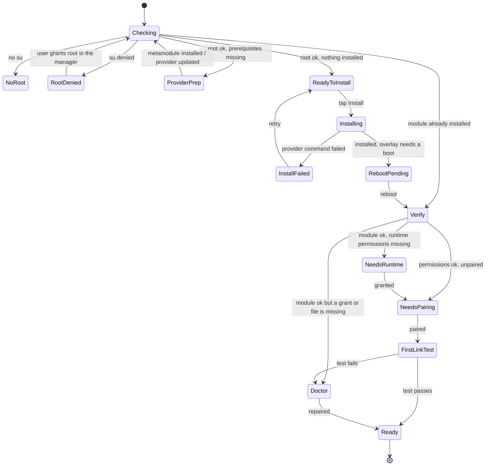
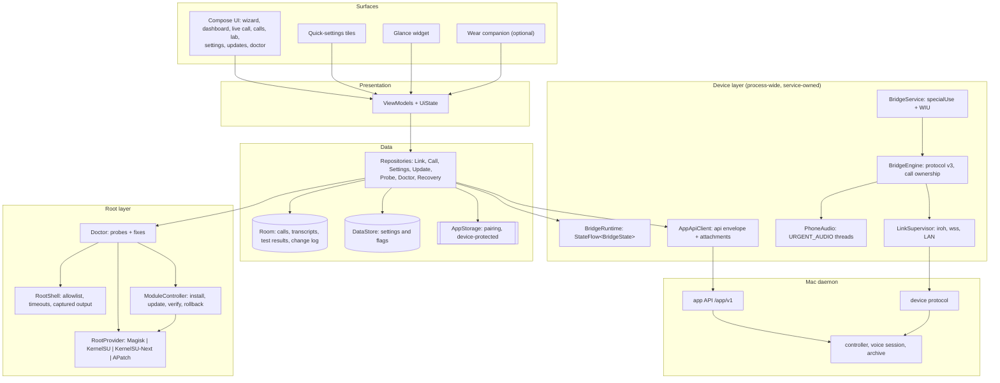

# Phonxiety mobile client — target design and plan

The app in `android/` today is deliberately minimal: one screen, pairing, a status list, and a
headless foreground service that the daemon drives. This document plans the *full* client instead:
a phone app through which the whole system is installed, configured, used, supervised, repaired and
updated — and, when it makes the system better, a set of surfaces (quick-settings tiles, widgets,
tablet layouts) that put the important controls one gesture away.

It is a design and technology report only. No code is changed by it. `docs/android-research.md`
(2026-11-25) is the narrow pass that recommended keeping the single screen; this document reuses its
verified facts and overrules its scope. `docs/network-research.md` covers the transport layer and is
assumed unchanged unless a section here says otherwise.

Snapshot date: 2026-11-26. Sources are dated in place. Anything I could not confirm is in
[Not verified](#12-not-verified).

Where a minimal or optional variant is tempting, this document recommends the full variant and says
why; the only things left out are those where the *technical* case is not established (WireGuard, WebRTC
audio, Wear OS), and each of those carries the criterion that would bring it back.

---

## 1. What the app becomes

One app, package `com.phonxiety.bridge`, installed once by the root solution the phone already runs,
that is the whole control surface for the system:

| Job | What the user does | What the app does |
|---|---|---|
| Install | Taps one button in the wizard | Detects the root provider, checks the module prerequisites for it, installs the module, reboots, verifies, and resumes by itself |
| Pair | Scans the daemon's QR (or opens a `phonxiety://pair` link, or types a code) | Validates ticket/certificate/token, connects, runs a link test and reports numbers |
| Choose a connection | Leaves it on automatic, or pins one | Probes iroh (own relay, public relay), LAN, Tailscale-app and embedded-tailnet paths, scores them, keeps the best, re-probes on change |
| Place a call | Types a number or picks a contact, writes the brief on the phone | Places it through the daemon, keeps the phone as the supervisor while it runs |
| Supervise | Watches the live call | Live transcript, agent activity, levels, timer, DTMF pad, hang-up, pause, "tell the agent this", summary on demand |
| Review | Opens Calls | History from the daemon, outcome, summary, fields, transcript, recording playback, share, delete |
| Test | Opens the test lab | Link test (stream and datagram), audio loopback, tone/volume checks, codec trials, a real test call with hard limits |
| Tune | Opens Settings / Auto-tune | Codec and bitrate, relay, volume, Wi-Fi low-latency lock, battery exemption, timeouts, voice backend — every automatic change with a revert |
| Maintain | Opens Updates | App, module and daemon versions; one-tap updates; in-manager updates through `updateJson`; reboot only when the permission set changes |
| Repair | Opens Doctor | Self-check with one-tap fixes, guided recovery for each failure mode, exportable diagnostics bundle |
| Glance | Uses a widget or a quick-settings tile | Link state, RTT, call state, hang-up and link-test without opening the app |

The product bar is: **install the app, grant root once, tap once — the phone ends up paired, linked,
and able to take a call**, with a reboot in the middle and nothing typed by hand. Everything else in
this document exists to keep that promise honest when something goes wrong.

---

## 2. Design principles

1. **Never trust the link's appearance.** The project has already been burned by a link that looked
   up and could not carry audio, and Android 17 makes a *permission* failure look like a TCP timeout
   ([local network permission](https://developer.android.com/privacy-and-security/local-network-permission),
   §Errors). Every "connected" claim in the UI is backed by a probe with numbers attached.
2. **The service owns the system; the UI owns nothing.** The foreground service keeps the link, the
   call and the audio; activities, widgets and tile services come and go. A UI crash must not drop a
   call, and a widget must be able to hang up while the app process has no activity.
3. **One decision per screen, and the app makes the others.** Where a choice can be measured, the app
   measures and picks; the user can pin it. Where a choice is irreversible, the app explains it before
   doing it and shows the recovery path.
4. **Every automatic change is visible and revertible.** Auto-tune and the Doctor write what they
   changed and why, next to a revert control.
5. **Root is a capability, not an assumption.** The app talks to a root *provider* abstraction
   ([§7](#7-root-providers-and-installing-the-module)), so Magisk, KernelSU, KernelSU-Next and APatch
   are all first-class, with their own prerequisites, commands and recovery paths.
6. **Local only.** No analytics, no cloud, no Play Services requirement for anything but the QR
   scanner (which has a fallback: the pairing link and a typed code).

---

## 3. Screens and flows

### 3.1 One-button setup (the wizard, and the centre of the product)

The wizard is a state machine, not a list of steps. It renders whatever state the phone is in, can be
re-entered from any state, and always resumes where it stopped — including across the reboot.



**What each state shows and does**

| State | What the user sees | What the app does | Failure path |
|---|---|---|---|
| `Checking` | One spinner, then the verdict: root provider and version, module state, prerequisites | `su -c id`, provider detection ([§7.3](#73-detection-and-the-rootprovider-abstraction)), reads `/data/adb/modules/phonxiety_bridge`, `PackageManager` flags, permission checks | Never leaves the spinner: a probe that cannot answer within its budget becomes an explicit "could not tell" with the captured output |
| `NoRoot` | "This phone has no root." Links to Magisk, KernelSU, KernelSU-Next and APatch install guides; what root is used for, in three lines | Nothing destructive | Stops; the app still runs in a read-only "diagnose only" mode |
| `RootDenied` | Provider-specific instructions naming the exact screen to open (each manager calls it Superuser) and the app's own entry in that list | Re-probes on return to foreground | Retry button; "why does it need root" expander |
| `ProviderPrep` | Only appears when the provider needs something first. Today: KernelSU without a metamodule ([§7.1](#71-what-each-provider-is)) | Offers to install the pinned metamodule (download + SHA-256 check + `ksud module install` + reboot), or explains the manual path | "Install later" leaves the module uninstalled and says why |
| `ReadyToInstall` | Exactly what will happen: module name/version, the privileged permissions it allowlists (the three call/audio ones plus self-update and reboot), the fact that a reboot follows, and the rollback | Stages the zip, runs the provider command, streams the output tail | Install failure shows the provider's own message and the log; retry is idempotent |
| `Installing` | Progress + last lines of the installer output | Copies the zip to `/data/local/tmp`, runs `magisk --install-module` / `ksud module install` / `apd module install`, parses exit status | Cancellation is disabled after the command starts; the state is recovered on next launch from the module directory, not from app memory |
| `RebootPending` | "One reboot, then everything else is automatic." Countdown, "Reboot now", "Later" | `PowerManager.reboot()` with `android.permission.REBOOT`, else `su -c reboot` | "Later" persists the state and puts a notification; the service is not started until verified |
| `Verify` | Runs by itself on the first launch after boot (and from `BootReceiver`) | Checks: package has `FLAG_SYSTEM`, `pm path` under `/system/priv-app`, every allowlisted permission granted, module directory present with no `disable`/`remove` flag, provider reported success | Any failed check → `Doctor` with that check preselected |
| `NeedsRuntime` | One screen, each permission with a one-line reason and what breaks without it; "Grant all" | Requests `RECORD_AUDIO`, `CALL_PHONE`, `READ_PHONE_STATE`, `MODIFY_AUDIO_SETTINGS`, `POST_NOTIFICATIONS`, `ACCESS_LOCAL_NETWORK`; offers the battery-exemption dialog; explains the Wi-Fi lock | Denied permissions degrade specific features and are listed on the dashboard, never hidden |
| `NeedsPairing` | QR scanner, `phonxiety://pair` link, or an 8-word code typed from the Mac | Validates and stores the pairing, starts the service | Invalid/expired pairing → the reason from the validator, not a generic error |
| `FirstLinkTest` | A 5 s probe with live numbers and a plain verdict | Runs the link test with the negotiated codec | Failing test → `Doctor` with the probe results attached |
| `Ready` | Dashboard | Starts the service and leaves the wizard | — |

**The two decisions.** The whole flow is designed so the user makes exactly two decisions — grant root
(once, in the provider's own UI) and accept the reboot — plus the system permission dialogs. Everything
else is derived: provider, prerequisites, module version, permissions, pairing payload, connection,
codec. Where the app must ask (battery exemption, unpair, delete a recording, update the module), it
asks once and remembers the answer.

**Why a reboot, and when there is none.** The first install must put the APK into a privileged location
and the allowlist into `/system/etc/permissions`; on all four providers that is a boot-time overlay, so
a reboot is unavoidable ([§7.6](#76-priv-apps-and-the-privapp-permissions-allowlist)). Routine APK
updates do **not** need one: same package, same signature, installed into `/data/app` by
`PackageInstaller` with `INSTALL_SELF_UPDATES` (see [§7.4](#74-install-update-and-rollback-flows)).
A module reinstall and reboot is required only when the *permission set* changes — which should be rare
and is visible in the Updates screen as "needs a reboot".

### 3.2 Dashboard (home)

- **Hero card** — path (`Direct` / `Relay <name>` / `LAN` / `Tailscale` / `Embedded tailnet` /
  `Offline`), endpoint short id, uptime, reconnect count, last error with a link to Doctor.
- **Call card** — idle / dialling / ringing / active / ending, destination masked to country+last 2,
  duration, `far_end` once known, agent state (thinking / speaking / waiting), big Hang up, and
  "open live call".
- **Live numbers** — RTT p50/p95 sparkline (2 s heartbeat, already measured), control backlog, audio
  in/out level meters (dBFS, 20 ms frames), negotiated codec and bitrate, frames and drops.
- **Phone health** — battery %, thermal status, Wi-Fi SSID/RSSI or cellular, doze exemption, service
  alive, audio route, `ACCESS_LOCAL_NETWORK`, root provider and module version.
- **Quick actions** — place a call, run link test, export diagnostics, open Doctor.

### 3.3 Live call

This is the screen that makes the phone the supervisor rather than a bystander.

- **Header**: destination, timer, `far_end`, state, recording indicator, route (earpiece/speaker).
- **Transcript**: streamed turns, speaker-labelled, with the agent's own turns visually distinct.
  Auto-scroll with a "jump to live" pill; tap a turn to copy; low-confidence words marked.
- **Agent activity**: thinking / speaking / waiting-on-hold; the task agent's last decision ("waiting,
  the other side asked for a minute") so the silence is explained.
- **Controls**:
  - Hang up (the only destructive one; confirm only if the call is younger than 3 s to avoid a mis-tap).
  - DTMF pad — sends digits through the existing `dtmf` command.
  - **Pause / resume the agent's speech** — the agent stops talking, keeps listening.
  - **Tell the agent** — a one-line instruction ("ask for Thursday", "they said 16:00, confirm it")
    delivered to the voice session as an out-of-band directive, not spoken into the call.
  - **Summarise now** — asks the task agent for the summary/fields at any point.
  - **Mark** — "agreed", "refused", "needs follow-up", stored with the call and shown in history.
- **Audio**: in/out meters, codec/bitrate, "mute handset speaker" toggle, and a **listen** control that
  plays the downlink locally through the phone's earpiece at low volume (supervision without taking
  over; off by default and labelled as recording-adjacent).
- **Safety rails**: the phone can hang up and instruct, but hard limits (ring timeout, max duration)
  stay enforced by the daemon; the app cannot extend them mid-call.

The technical dependency is a push channel from the daemon for transcript deltas and agent activity, and
three new daemon operations (instruct, pause/resume, summarise) — [§9](#9-daemon-api-additions). How
much of "instruct" and "pause" each voice backend can honour differs; Codex has no tools today
(README), so the first version must be per-backend capability-flagged rather than pretending.

### 3.4 Calls (history) and call detail

- List: paged from the daemon (`~/.local/share/phonxiety/calls/*.json`), cached in Room, filtered by
  outcome/`far_end`/date, searchable over summary and destination; on tablets and foldables the list
  and the detail share one screen.
- Detail: request (goal, constraints, result fields), timings, state and outcomes, `far_end`, summary,
  fields, transcript with speaker turns and timestamps, audio player for the `.m4a` share copy (and
  `.wav` on request), share/save, delete on the daemon with an explicit confirmation, "call again with
  the same brief".
- Live progress for an in-flight call, so a call started by an MCP client can be watched and supervised
  from the phone.

### 3.5 Test lab

| Tool | What it does | Needs from the daemon |
|---|---|---|
| Link test | 1–30 s of call-sized frames, stream or datagram transport, chosen codec; p50/p95/max RTT, loss, reorder, throughput, verdict; history of runs | `/link-test` exists; needs per-run storage and the datagram flag surfaced ([protocol v2 already added datagrams](network-research.md)) |
| Audio loopback | The daemon echoes the phone's uplink PCM back on the downlink; the phone measures round-trip delay by correlation, level and gaps | new `loopback` mode |
| Tone / volume check | Plays a tone into the uplink at a chosen level, records 5 s of downlink and plays it back locally to confirm the route | new `tone` mode |
| Codec trial | Runs the same probe at Opus 16/32/64 kbit/s and PCM, then recommends one | `link-test?codec=` exists |
| Test call | A real call with a canned brief, `max_duration_s ≤ 60`, never retried, never counted in history unless the user keeps it | `POST /test-call` |
| DTMF probe | Sends digits on a live test call so a keypad menu can be exercised | `dtmf` exists, never tried on a real call |

Results land in a local table so auto-tune and the Doctor cite measurements, not guesses.

### 3.6 Settings and auto-tune

| Group | Items | Source of truth |
|---|---|---|
| Connection | automatic / iroh / LAN / Tailscale / custom; relay: default, own relay URL, or none; re-probe interval; reconnect policy | app (which link to open) + daemon (its relay) |
| Audio | codec auto/opus/pcm; target bitrate 6–128 kbit/s; volume; mute handset; Wi-Fi low-latency lock; keep CPU awake during calls | hello preferences + daemon settings |
| Calls | ring timeout, max duration, default result fields and constraints, language hint | daemon |
| Voice | backend (codex/deepgram/gemini), voice, models | daemon |
| Device | start on boot, notification detail, battery exemption, log level | app |
| Auto-tune | on/off, what it may change, change log, "revert everything" | app |

Auto-tune rules (measured, reversible):

| Observation | Change |
|---|---|
| Relay-only for > 20 s, twice in an hour | Suggest pointing at the owner's relay; escalate to a link test |
| Link test p95 > 400 ms or loss > 2 % at Opus 32 | Drop to Opus 16 and re-test; say the phone is on a poor path |
| Throughput ≥ 400 kbit/s and p95 < 120 ms | Allow Opus 48–64 for better far-end intelligibility |
| Cellular with any loss | Force Opus; never PCM (768 kbit/s on a mobile link) |
| Thermal ≥ `SEVERE` or battery < 15 % on battery | Release the Wi-Fi low-latency lock, keep the call, warn |
| Heartbeat misses with the screen off | Offer battery exemption (never granted silently) |
| `ACCESS_LOCAL_NETWORK` denied and the LAN candidate failing | Say "permission", not "network" |

### 3.7 Updates

One screen, three rows — **App**, **Module**, **Daemon** — each with installed vs available version,
compatibility verdict (protocol, app API, module schema) and the exact action. Module updates are also
offered inside the root manager itself via `updateJson` ([§8](#8-what-the-root-ecosystem-offers-and-what-we-should-use)),
so a user who lives in Magisk/KernelSU never has to open Phonxiety to update it.

### 3.8 Diagnostics, Doctor and guided recovery

**Self-check** (each row: state, evidence, action): root provider and version, module present/enabled,
overlay actually applied (`pm path`, package flags), each privileged permission, each runtime
permission, notification permission, battery exemption, service running and its FGS type, link state
and last probe, codec negotiation, audio route, Telecom availability, SIM state, time offset, storage.

**Doctor** — a decision tree with executable fixes, classified by risk:

| Class | Examples | Behaviour |
|---|---|---|
| Automatic | restart the service, re-open the link, re-probe the path, flush a stalled audio backlog, refresh an expired `app_token` while the device token is valid, clear a stale update marker | Done on open, recorded in the change log |
| Confirm once | re-grant a runtime permission, reinstall the module, reboot, rotate tokens, toggle the Wi-Fi lock, disable a conflicting module | Explains the effect and the rollback, then acts |
| Never automatic | uninstall the module, `pm uninstall` an update, anything that can drop a live call, anything requiring a reboot during a call | Only on an explicit, typed confirmation |

**Guided recovery** — one page per failure mode, each with what happened, what to do on the phone, and
what to do from the Mac (`adb` commands included verbatim):

| Failure | Recovery |
|---|---|
| Bootloop after a module update | Provider-specific safe mode ([§7.7](#77-recovery-per-provider)); the page shows the exact key sequence and the `adb` command |
| Module disabled by safe mode | Re-enable from the manager or from Doctor, reboot |
| Root lost after an OTA | Re-root with the provider's own flow (link), then re-run the wizard; the app keeps the pairing |
| Privileged grants missing after an update | Doctor names the missing permission, reinstalls the module, verifies after boot |
| Daemon unreachable | Path-by-path probe with the daemon's own view, Tailscale/relay hints, "check from the Mac" commands |
| Pairing rejected | Token rotation flow; shows whether the failure is token, certificate or protocol version |
| Link up, audio silent | The exact Android 17 audio-hardening check (`cmd audio set-enable-hardening throw`, `dumpsys audio \| grep AudioHardening`) and the FGS/WIU guidance |
| Call dropped at the phone | Provider and link counters, last 200 log lines, "was the screen off?" |

**Export bundle**: app log, `dumpsys battery|audio|telecom|package|activity services` snapshots taken
through the root provider, last five link-test results, redacted config, device build info; shared via
`FileProvider`.

### 3.9 Widgets, tiles, watch and large screens

These earn their place because the intended use is a phone in a drawer:

- **Quick-settings tiles (recommended)**: "Link" (state dot; tap = link test) and "Hang up" (enabled
  only during a call). A `TileService` is cheap and works when the app has no activity.
- **Widget (recommended)**: 2×1 with path, RTT, call state and a hang-up button, built with Glance;
  updates through `WorkManager` and the service's state flow, never a timer.
- **Tablet and foldable (recommended)**: list-detail for Calls, a two-pane live call (transcript +
  controls), and a dashboard that keeps numbers visible while a call runs. Adaptive layout with
  `WindowSizeClass`, no separate APK.
- **Wear OS (optional, with a criterion)**: a companion that shows call state and can hang up is
  genuinely useful when the phone is in a bag, but it is a second UI, a second review surface and a
  second release path. It ships only if the phone-side live-call state can be exposed to Wear without
  a new daemon channel (it can, through the same process state + Data Layer), and it is scoped to
  state + hang up.

---

## 4. Architecture

### 4.1 Shape



### 4.2 Module layout

```
:app                 activity host, navigation graph, Hilt entry points, tiles, widget receivers
:core:model          @Serializable protocol, API, domain and doctor models (pure Kotlin)
:core:designsystem   theme, Material 3 Expressive components, meters, charts, transcript rendering
:core:data           repositories, Room, DataStore, AppApiClient
:core:device         link, engine, audio, service, runtime
:core:root           RootShell, RootProvider implementations, ModuleController, Doctor probes
:feature:onboarding  :feature:dashboard  :feature:livecall  :feature:calls
:feature:lab         :feature:settings   :feature:updates   :feature:doctor
:feature:widgets     Glance widget + tile services (kept thin, no logic of their own)
```

`:core:model`, `:core:data`, `:core:device` and `:core:root` are the only places allowed to know about
the wire or the shell. A feature module that imports `okhttp`, `iroh`, `org.json` or builds a shell
string is a review failure.

### 4.3 State model

```kotlin
@Serializable
data class BridgeState(
  val link: LinkState,          // Offline | Connecting(candidate) | Up(path, rttP50, rttP95, since, reconnects)
  val call: CallState?,         // id, destinationMasked, phase, startedAt, farEnd, agentActivity, liveTranscript
  val audio: AudioState,        // codec, bitrate, rxLevelDbfs, txLevelDbfs, frames, drops
  val device: DeviceState,      // battery, thermal, network, rssi, dozeExempt, permissions, module, provider
  val capabilities: Capabilities,
  val lastError: LinkError?,    // code + human text + when
)
```

Produced by the engine on one serialised `CoroutineScope`, exposed as `StateFlow<BridgeState>` from
`BridgeRuntime`, collected by ViewModels, tiles and the widget. The 1 Hz `MainActivity` poll disappears.
Audio threads stay raw `Thread`s at `THREAD_PRIORITY_URGENT_AUDIO`; blocking Telecom binder calls stay
under the existing lock (both from `android-research.md`). Audio levels are computed inside those
threads (RMS per 20 ms frame into an atomic in dBFS×10) — a second `AudioRecord` cannot be opened on
`VOICE_DOWNLINK`.

### 4.4 Boundaries that must not leak

- `BridgeEngine` never holds a `Context` beyond `applicationContext`, a `View`, or a UI callback.
- The app API client is a suspend-function surface (`suspend fun calls(page: Int): CallPage`), not a
  socket the UI can touch.
- Root work goes through `RootShell` + `RootProvider` only ([§7.3](#73-detection-and-the-rootprovider-abstraction));
  no feature module interpolates user text into a shell command.
- Surfaces (widget, tile, Wear) read `BridgeState` and call the same repository actions as the UI; they
  never talk to the transport.

---

## 5. Stack

Versions to pin now; links are the primary sources checked on 2026-11-26.

| Area | Choice | Version | Source |
|---|---|---|---|
| Language | Kotlin, K2 | 2.4.21 (2.5.0-RC2 is the current pre-release) | [Maven metadata](https://repo1.maven.org/maven2/org/jetbrains/kotlin/kotlin-stdlib/maven-metadata.xml) |
| Build | AGP | 9.5.3 (max API 37, Gradle ≥ 9.6.0, JDK 17) | [AGP 9.5 notes](https://developer.android.com/build/releases/agp-9-5-0-release-notes), [Google Maven](https://dl.google.com/android/maven2/com/android/tools/build/gradle/maven-metadata.xml) |
| Build | Gradle | 9.6.0 pinned; 9.9.2 is current | [Gradle releases](https://services.gradle.org/versions/current) (2026-11-19) |
| SDK | compileSdk 37.1, target 37, min 34 | — | [Compose Nov '26](https://developer.android.com/blog/posts/jetpack-compose-november-2026-release) (2026-11-18) |
| UI | Compose BOM `2026.11.01` → Compose 1.13 | 1.13.0 | [BOM mapping](https://developer.android.com/develop/ui/compose/bom/bom-mapping), [release blog](https://developer.android.com/blog/posts/jetpack-compose-november-2026-release) (2026-11-18) |
| UI | Material 3 (Expressive components stable) | 1.5.0 | [M3 1.5.0](https://developer.android.com/jetpack/androidx/releases/compose-material3#1.5.0) |
| Compiler plugin | `org.jetbrains.kotlin.plugin.compose` | 2.4.21, same as Kotlin | [Compose setup](https://developer.android.com/develop/ui/compose/setup-compose-dependencies-and-compiler) |
| Navigation | Navigation 3 (`navigation3-runtime` + `-ui`) | 1.2.2 stable (1.3.0-alpha05) | [navigation3 releases](https://developer.android.com/jetpack/androidx/releases/navigation3) (2026-11-18) |
| DI | Hilt (Dagger) + `androidx.hilt` (incl. `hilt-work`) | 2.60.1 / 1.4.0 | [Dagger releases](https://github.com/google/dagger/releases) (2026-07-06), [androidx.hilt](https://developer.android.com/jetpack/androidx/releases/hilt) (2026-07-01) |
| Codegen | KSP | 2.3.14 (AGP 9 built-in Kotlin aware) | [KSP releases](https://github.com/google/ksp/releases) (2026-11-13) |
| Serialization | kotlinx.serialization | 1.13.0 | [Maven metadata](https://repo1.maven.org/maven2/org/jetbrains/kotlinx/kotlinx-serialization-json/maven-metadata.xml) (2026-11-11) |
| Async | kotlinx-coroutines | 1.11.0 | [Maven metadata](https://repo1.maven.org/maven2/org/jetbrains/kotlinx/kotlinx-coroutines-core/maven-metadata.xml) (2026-05-08) |
| Prefs | DataStore | 1.3.0 | [DataStore releases](https://developer.android.com/jetpack/androidx/releases/datastore#1.3.0) (2026-10-21) |
| Local DB | Room (KSP) | 2.8.5 | [Room releases](https://developer.android.com/jetpack/androidx/releases/room#2.8.5) (2026-09-09) |
| Background | WorkManager + `hilt-work` | 2.12.0 | [WorkManager releases](https://developer.android.com/jetpack/androidx/releases/work#2.12.0) (2026-09-23) |
| HTTP/WS | OkHttp (keep; Ktor adds nothing) | 5.5.1 | [Maven metadata](https://repo1.maven.org/maven2/com/squareup/okhttp3/okhttp/maven-metadata.xml) (2026-10-22) |
| Media | Media3 ExoPlayer (recording playback) | 1.11.1 | [Media3 releases](https://developer.android.com/jetpack/androidx/releases/media3#1.11.1) (2026-11-11) |
| Widget | Glance AppWidget | 1.2.0 stable (1.3.0-alpha02) | [Google Maven](https://dl.google.com/android/maven2/androidx/glance/glance-appwidget/maven-metadata.xml) |
| Camera | CameraX (own QR scanner for non-GMS devices) | 1.7.0 | [CameraX releases](https://developer.android.com/jetpack/androidx/releases/camera) (2026-11-18) |
| QR | Google code scanner (no camera permission) | 16.1.0 | [Google Maven](https://dl.google.com/android/maven2/com/google/android/gms/play-services-code-scanner/maven-metadata.xml) (latest since 2023-08) |
| Native P2P | iroh-ffi (uniffi + JNA) | 1.2.0 | [iroh-ffi docs](https://n0-computer.github.io/iroh-ffi/); `EndpointOptions(relayMode = RelayMode.Custom(RelayMap))` verified in the [Kotlin API](https://n0-computer.github.io/iroh-ffi/kotlin/lib/computer.iroh/-endpoint-options/index.html) |
| Unit tests | JUnit 4 (existing) + Turbine | 4.13.2 / 1.2.1 | [Turbine Maven](https://repo1.maven.org/maven2/app/cash/turbine/turbine/maven-metadata.xml) (2025-06-11) |
| JVM Android tests | Robolectric | 4.18.1 | [Robolectric releases](https://github.com/robolectric/robolectric/releases/tag/robolectric-4.18.1) (2026-11-18) |
| Screenshots | Roborazzi | 1.79.0 | [Roborazzi releases](https://github.com/takahirom/roborazzi/releases) (2026-11-12) |
| Performance | Macrobenchmark + baseline profiles | 1.5.0 | [Benchmark releases](https://developer.android.com/jetpack/androidx/releases/benchmark#1.5.0) (2026-11-18) |
| Lint | Android Lint `warningsAsErrors`, `abortOnError` | AGP 9.5 | [Lint](https://developer.android.com/studio/write/lint) |
| Style | ktlint (formatting only) | 1.8.0 | [ktlint Maven](https://repo1.maven.org/maven2/com/pinterest/ktlint/ktlint-cli/maven-metadata.xml) (2025-12-15) |

Decisions and their reasons (unchanged from the earlier draft except where noted):

**DI: Hilt.** ~8 destinations, ViewModels per navigation entry, a `WorkManager` worker and a service that
need repositories, plus tile and widget entry points. Hilt is the documented recommendation for that
shape ([architecture](https://developer.android.com/topic/architecture/recommendations)), has an
official Navigation 3 recipe ([recipe](https://developer.android.com/guide/navigation/navigation-3/recipes/passingarguments))
and injects into workers. Metro and kotlin-inject are compiler plugins — one more compatibility surface
against AGP 9 built-in Kotlin with no Navigation 3/WorkManager story. Hilt needs KSP; kapt is
incompatible with built-in Kotlin ([migration](https://developer.android.com/build/migrate-to-built-in-kotlin)),
and Dagger fixed the Kotlin 2.4 metadata failure from 2.59.2 ([dagger#5180](https://github.com/google/dagger/issues/5180)).

**Navigation: Navigation 3.** Stable 1.2.0 (2026-09-23) with the result API, deep-link matchers and
predictive back; 1.2.2 is bug fixes. The app is deep-link driven (`phonxiety://pair`, "open call
<id>"), which is exactly what `DeepLinkMatcher`/`BackStackMatcher` are for.

**Persistence split.** Pairing stays in `AppStorage` (raw, device-protected, read by the service before
first unlock); DataStore for user settings; Room for paged, filtered, searched history and the Doctor's
change log. The reason DataStore is not used for pairing is unchanged from `android-research.md`: it is
coroutine-first and the service reads the pairing synchronously.

**Serialization.** kotlinx.serialization replaces `org.json` for protocol, app API, Room and DataStore.
Wire format stays the daemon's; the phone tolerates unknown keys.

**HTTP client: OkHttp only.** The app API rides the existing framed transport ([§9](#9-daemon-api-additions)),
so OkHttp remains only for the TLS WebSocket. No Ktor, no Retrofit.

**Audio.** Keep `AudioRecord(VOICE_DOWNLINK)` + `AudioTrack` + `MediaCodec` Opus; add
`AudioTrack.Builder.setPerformanceMode(PERFORMANCE_MODE_LOW_LATENCY)` ([AudioTrack.Builder](https://developer.android.com/reference/android/media/AudioTrack.Builder#setPerformanceMode(int))).
Media3 only for recording playback.

**Testing.** JVM unit tests (framing, link supervisor, playback marks, protocol models, app API client,
repositories, auto-tune and Doctor rules); `kotlinx-coroutines-test` + Turbine; Robolectric for
`AppStorage`, `BridgeConfig`, `Permissions`, `RootShell` parsing, `RootProvider` detection and
`ModuleController` state machine; Compose UI tests against fake repositories; Roborazzi screenshots for
every state that must never look wrong (no root, root denied, module missing, permission denied,
relay-only, call active, update pending); Macrobenchmark for dashboard cold start and hang-up latency
with a baseline profile from it; a device smoke run (pair → link test → loopback → 30 s test call →
module reinstall) as a `mise` task, because a green JVM build proves nothing about Telecom and audio.

**Build hygiene.** Version catalog, configuration cache, explicit KGP 2.4.21 on the root classpath, R8
in release with keep rules for JNA/uniffi verified by a real call, release build fails without
`PHONXIETY_KEYSTORE*`, ktlint + lint gates, CI (GitHub Actions, JDK 17, Rust `aarch64-linux-android`,
`cargo-ndk`, NDK, Android SDK) running `mise run phone:build`, unit tests and lint, with the iroh build
cached. No CI exists in the repo today.

---

## 6. Connection options

### 6.1 What each option actually is on Android

| Option | How the app reaches the Mac | App-side work | Ops burden | Cost / licence | Verdict |
|---|---|---|---|---|---|
| **iroh, own relay** (today) | QUIC to the daemon's endpoint id; direct hole-punched path when possible, own `iroh-relay` otherwise | none (existing `IrohLink`) | run `iroh-relay` behind HTTPS | already linked | **Primary** |
| **iroh, public relays** | same, n0's relays | none | none | rate-limited, may not carry PCM (README) | Fallback, with a visible warning |
| **Tailscale app + tailnet IP** | the official app installs a `VpnService`; the app dials the Mac's `100.x` address | a candidate probe | user installs and signs in | free for personal use | **Build it**: zero code risk, one app the user may already have; `phonxiety pair --tailscale` exists |
| **Embedded tailnet (tsnet via `libtailscale`)** | userspace WireGuard in-process; the app dials through a local proxy | JNI + TCP proxy + auth-key/OAuth UX | auth key or OAuth client from the tailnet admin | BSD-3; ~31 MB `.so` per ABI | **Build it**, gated on the acceptance test below |
| **LAN WebSocket** (exists) | `wss://<mac-lan-ip>:port/device`, pinned certificate | candidate probe + discovery | same Wi-Fi, `ACCESS_LOCAL_NETWORK` | free | **Keep**: fastest path, only path with no internet |
| **WireGuard** | `com.wireguard.android:tunnel` (Apache-2.0, 1.0.20260102) + a `VpnService` | config generation, keys, routes | a WireGuard endpoint on the Mac, keys to manage | free | Deferred: duplicates iroh with more parts |
| **WebRTC for the audio leg** | media stack (jitter buffer, FEC, congestion control) | signalling + media stack + pairing | none extra | free | Deferred until iroh datagrams are measured |

Why embedded tsnet is recommended rather than parked: it is the only way to offer Tailscale to a user
who does not want another app, the library is BSD-3 and the embedding recipe is documented
([libtailscale](https://github.com/tailscale/libtailscale)). The measured costs are real: the wrapper is
31 MB and needs (a) a synthetic `android0` interface because SELinux blocks `/proc/net/*` for untrusted
apps and netmon otherwise stalls, (b) a `VpnService` for `NETLINK_ROUTE`, (c) a `127.0.0.1` TCP proxy
because Android sockets cannot be handed an fd, and (d) an `AuthKey`/OAuth `ClientSecret` — tsnet has no
browser sign-in ([tsnet.Server](https://tailscale.com/docs/reference/tsnet-server-api), validated
2026-07-07; [tailscale_mobile](https://github.com/leondgarse/tailscale_mobile)). **Acceptance test** for
this mode: cold start to first byte ≤ 10 s with cached state, survives 24 h in the `specialUse` FGS,
and carries a 60 s call with the same loss as iroh on the same network. If any fails, the mode ships
with a clear "use the Tailscale app" path and the spike is recorded in the risk table.

### 6.2 Auto-selection

| Candidate | Probe | Score base |
|---|---|---|
| LAN WebSocket to the last known address | TLS + auth + `ping` (300 ms budget); mDNS picker if the address fails | 100 |
| iroh direct | connect; accept only if not relay-only within 3 s | 90 |
| Tailscale-app address | `wss://100.x.y.z:port/device` | 80 |
| Embedded tailnet | local proxy connect | 75 |
| iroh via own relay | connect, relay path accepted | 50 |
| iroh via public relay | last resort | 10 |

Score = base − `min(50, p50_rtt_ms / 4)` from a 1 s burst; a candidate must pass three consecutive pings.
The incumbent is kept unless a challenger wins by 15 % for two consecutive rounds. Re-probe on network
change (default-network callback), Wi-Fi↔cellular handover, three heartbeat misses, foreground after
5 min hidden, and every 15 min idle.

Hard constraints:
- **Never switch during a call.** A dead path ends the call (the existing lost-link rule) instead of
  migrating audio mid-sentence.
- **Check `ACCESS_LOCAL_NETWORK` before blaming the LAN candidate** — without it, TCP to a LAN address
  times out silently ([local network permission](https://developer.android.com/privacy-and-security/local-network-permission#errors)).
- **Never silently fall back to PCM** on cellular; the daemon's codec choice is shown.
- **Relay-only for > 20 s** is a warning with counters, not a spinner.

### 6.3 Choosing the relay from the phone

`EndpointOptions.relayMode = RelayMode.Custom(RelayMap)` exists in the Kotlin bindings
([EndpointOptions](https://n0-computer.github.io/iroh-ffi/kotlin/lib/computer.iroh/-endpoint-options/index.html)),
so the phone can be configured with the owner's relay URL from Settings, and the daemon's relay setting
can be changed through the app API. Both are shown in the same card so a mismatch is visible.

---

## 7. Root providers and installing the module

### 7.1 What each provider is

- **Magisk** (v31.1, 2026-10-26, [releases](https://github.com/topjohnwu/Magisk/releases)): userspace
  root via a patched ramdisk; MagiskSU; modules under `/data/adb/modules` mounted with its built-in
  magic mount (bind) ([module format](https://topjohnwu.github.io/Magisk/guides.html)).
- **KernelSU** (v3.x line; LKM-only since v3.0, [installation](https://kernelsu.org/guide/installation.html)):
  kernel-mode root; **mounting is delegated to a metamodule** — a fresh install with no metamodule does
  not mount module `system/` directories at all
  ([metamodule](https://kernelsu.org/guide/metamodule.html), [module guide](https://kernelsu.org/guide/module.html)).
- **KernelSU-Next** (GPL-3, [repo](https://github.com/KernelSU-Next/KernelSU-Next)): a KernelSU fork
  with the same module system and metamodule architecture, its own manager (`com.rifsxd.ksunext`), same
  `/data/adb/ksu` working directory and `ksud` daemon at `/data/adb/ksud`
  ([defs](https://github.com/KernelSU-Next/KernelSU-Next/blob/dev/userspace/ksud/src/defs.rs)).
- **APatch** (GPL-3, [docs](https://apatch.dev/what-is-apatch.html)): kernel-mode root built on
  KernelPatch, modules copied from KernelSU; **OverlayFS mounting is built in**, so no metamodule is
  needed for `system/` ([APM guide](https://apatch.dev/apm-guide.html)). ARM64 only, kernels 3.18–6.12
  ([install](https://apatch.dev/install.html)).

### 7.2 What actually differs (and matters here)

| Aspect | Magisk | KernelSU / Next | APatch |
|---|---|---|---|
| Root grant | MagiskSU prompts on first `su`; policy managed in the Magisk app | kernel checks an allowlist managed in the manager ("grants root to permitted apps", [what-is](https://kernelsu.org/guide/what-is-kernelsu.html)) | SuperCall + manager; newer builds verify the **manager signature** instead of enforcing a SuperKey ([APM guide](https://apatch.dev/apm-guide.html), [FAQ](https://apatch.dev/faq.html)) |
| Module dir | `/data/adb/modules` | same | same |
| Install CLI | `magisk --install-module <zip>` ([tools](https://topjohnwu.github.io/Magisk/tools.html)) | `ksud module install <zip>` ([cli.rs](https://github.com/tiann/KernelSU/blob/main/userspace/ksud/src/cli.rs)) | `apd module install <zip>` ([cli.rs](https://github.com/bmax121/APatch/blob/main/apd/src/cli.rs)) |
| Enable / disable | `disable` / `remove` files ([guides](https://topjohnwu.github.io/Magisk/guides.html)); `magisk --remove-modules` removes all | `ksud module enable\|disable\|uninstall <id>` (flag files also honoured) | `apd module enable\|disable\|uninstall <id>` |
| Mounting `system/` | built-in magic mount | **metamodule required** (`meta-overlayfs` official, or `meta-magicmount` for Magisk-compatible mounting) | built-in OverlayFS; metamodules also supported |
| Hot install (no reboot) | no | yes, only for parts that do not need a boot (`MODULE_HOT_INSTALL_REQUEST`); `system/`, scripts, props still need a reboot ([hot install](https://kernelsu.org/guide/module.html#hot-install)) | `modules_update` staging + `update` flag; `/system` still needs a reboot |
| Boot stages | `post-fs-data.sh`, `service.sh` | + `post-mount.sh`, `boot-completed.sh`, plus `initrc/`, `preinit/`, late-load | + `post-mount.sh`, `boot-completed.sh`, Lua modules |
| BusyBox / env hints | `/data/adb/magisk/busybox`; `MAGISK_VER` | `/data/adb/ksu/bin/busybox`; `KSU=true`, `KSU_VER_CODE`, `KSU_RUNTIME_MODE`, `KSU_LATE_LOAD` | `/data/adb/ap/bin/busybox`; `APATCH=true`, `KERNELPATCH`, `APATCH_VER_CODE`, `SUPERKEY` |
| Faked Magisk vars | — | `MAGISK_VER` = `v25.2` always | `MAGISK_VER` = `v27.0` always |
| `updateJson` | documented ([guides](https://topjohnwu.github.io/Magisk/guides.html)) | documented ([module.prop](https://kernelsu.org/guide/module.html#module-prop)) | **not documented**; `apd` has no `updateJson` handling (only `modules_update`) |
| WebUI (`webroot/`) | no equivalent | yes, WebView + `kernelsu` JS API ([WebUI](https://kernelsu.org/guide/module-webui.html)) | yes ([FAQ](https://apatch.dev/faq.html)) |
| Action button (`action.sh`) | yes ([guides](https://topjohnwu.github.io/Magisk/guides.html)) | yes (module structure, Action in manager) | yes (APM structure) |
| Safe mode / rescue | two incomplete boots → all modules disabled ([FAQ](https://topjohnwu.github.io/Magisk/faq.html)); `magisk --remove-modules` | three volume-down presses at boot; `ksud module disable` over ADB; recovery cleanup ([rescue](https://kernelsu.org/guide/rescue-from-bootloop.html)) | integrated bootloop rescue that disables all modules ([rescue](https://apatch.dev/rescue-bootloop.html)) |
| Coexistence | — | module systems **conflict**: with any KernelSU module enabled, Magisk stops working entirely ([FAQ](https://kernelsu.org/guide/faq.html)) | not documented; treated as exclusive |

Two fake-variable details matter for a single zip: `MAGISK_VER_CODE`/`MAGISK_VER` are deliberately
wrong under KernelSU/APatch, so `customize.sh` must never branch on them; and KernelSU's CLI installer
sets `MAGISK_VER=v25.2` while APatch sets `v27.0` — a check like "Magisk ≥ 26" would pass on APatch and
fail on KernelSU for the same file.

### 7.3 Detection and the `RootProvider` abstraction

Detection is by the artefacts each provider installs, not by guessing from the kernel string:

| Provider | Artefacts | Manager package |
|---|---|---|
| Magisk | `/data/adb/magisk/`, `magisk -V` | `com.topjohnwu.magisk` |
| KernelSU | `/data/adb/ksu/`, `/data/adb/ksud`, `ksud -V` | `me.weishu.kernelsu` ([manager](https://github.com/tiann/KernelSU)) |
| KernelSU-Next | same paths (`/data/adb/ksu`, `/data/adb/ksud`) | `com.rifsxd.ksunext` |
| APatch | `/data/adb/ap/`, `/data/adb/apd` | `me.bmax.apatch` |

Distinguishing KernelSU from KernelSU-Next is by installed manager package and by `ksud`'s reported
version; if neither is conclusive the app reports "KernelSU (variant unknown)" and uses only commands
both accept. If more than one provider answers, the app says so and refuses to install anything until
the user picks — the KernelSU/Magisk conflict above is not recoverable by guessing.

```kotlin
sealed interface RootProvider {
    val id: RootId                 // MAGISK, KERNELSU, KERNELSU_NEXT, APATCH
    val version: String
    suspend fun capabilities(): RootCapabilities
    suspend fun installModule(zip: File): ProviderResult
    suspend fun enableModule(id: String): ProviderResult
    suspend fun disableModule(id: String): ProviderResult
    suspend fun removeModule(id: String): ProviderResult
    suspend fun moduleState(id: String): ModuleState   // absent, staged, enabled, disabled, remove-pending
    suspend fun reboot(reason: RebootReason): ProviderResult
}

data class RootCapabilities(
    val systemOverlay: Overlay,          // BUILT_IN, METAMODULE_PRESENT, METAMODULE_MISSING
    val hotInstall: Boolean,
    val updateJson: Boolean,
    val webUi: Boolean,
    val actionButton: Boolean,
    val bootStages: Set<BootStage>,
    val managerPackage: String?,
    val coexistenceWarning: String?,
)
```

`RootShell` is the only caller of `su`; it has a fixed command allowlist, a 20 s timeout, captures
stdout/stderr for Doctor and never takes interpolated user text. Provider implementations only compose
those allowlisted commands (`magisk --install-module …`, `ksud module install …`, `apd module install …`,
the `enable/disable/uninstall` forms, `id`, `reboot`).

### 7.4 Install, update and rollback flows

**First install** (one button): the wizard's `ReadyToInstall` → `Installing` → `RebootPending` →
`Verify` states in [§3.1](#31-one-button-setup-the-wizard-and-the-centre-of-the-product). The provider
command runs from `RootShell`; the app records what it ran, the exit status and the captured output in
the change log, then reboots through `PowerManager.reboot()` when `android.permission.REBOOT`
(`signature|privileged`, [AOSP manifest](https://android.googlesource.com/platform/frameworks/base/+/refs/heads/main/core/res/AndroidManifest.xml))
is held, else `su -c reboot`.

**Routine APK update** (no reboot): download, verify `sha256` and that the signing certificate equals the
installed one, then a `PackageInstaller` session with `INSTALL_SELF_UPDATES`
(`signature|privileged`, AOSP manifest) — the narrow variant of `INSTALL_PACKAGES`, which this app must
not request. The service restarts through `MY_PACKAGE_REPLACED`, which `BootReceiver` already handles.
The module's copy of the APK is not touched, so the app keeps a known-good fallback in `/system`.

**Module update** (reboot): only when the permission set, module scripts or the packaged APK change in a
way that matters. Provider command + reboot + verify, exactly like the first install; the previous zip
is kept for rollback.

**Rollback**, three levels, all reachable from Updates:
1. *App only*: reinstall the kept previous APK (`/data/phonxiety/updates/previous.apk`).
2. *Module*: `disable` through the provider (no privileged grants, phone still boots), or reinstall the
   previous zip.
3. *Full*: `adb` from the Mac, documented with the exact command for each provider.

### 7.5 One module zip for all four providers

Our module is already the portable subset: `module.prop`, `customize.sh`, the APK under
`system/priv-app/phonxiety-bridge/`, and the allowlist under `system/etc/permissions/`
(`android/magisk/`, packaged by `mise-tasks/phone/build`). It uses no `.replace`, no `REMOVE`/`REPLACE`,
no boot scripts, no Zygisk, no `system.prop`, no `sepolicy.rule`. That is why one zip works everywhere:

| Item | Magisk | KernelSU / Next | APatch | Keep as is? |
|---|---|---|---|---|
| `module.prop` core fields | required | required | required | yes |
| `updateJson` | supported | supported | documented format omits it | keep (harmless if ignored), app updater is authoritative |
| `action.sh` + `actionIcon` | Action button | Action button | Action button | **add** |
| `customize.sh` with `$API`, `ui_print`, `set_perm_recursive` | supported | supported | supported | yes, and drop any `MAGISK_VER` logic |
| `system/` overlay | built-in | needs metamodule | built-in | yes, with the metamodule precondition |
| `post-fs-data.sh` / `service.sh` | supported | same semantics | same semantics | **not needed** — the app starts from `BootReceiver` |
| `post-mount.sh` / `boot-completed.sh` | unsupported | supported | supported | **do not add** (would fork the zip and duplicate `BootReceiver`) |
| `.replace` / `mknod` whiteouts / `REMOVE` / `REPLACE` | `.replace` only | `REMOVE`/`REPLACE` | `REMOVE`/`REPLACE` | **do not use** (we only add files) |
| `metamodule=1` | ignored | marks a metamodule | supported | **no** (we are a regular module) |
| `skip_mount` | supported | supported | supported | **no** (we exist to be mounted) |
| `webroot/` | no equivalent | WebUI | WebUI | recommended, minimal; see [§8](#8-what-the-root-ecosystem-offers-and-what-we-should-use) |
| `oneshot=true` | ignored | one-shot script | not documented | recommended as the no-root fallback; see §8 |

`customize.sh` must check `$API` (all three provide it) and the presence of both payload files, and must
abort if the APK and the allowlist are not shipped together — an APK without its allowlist under
`ro.control_privapp_permissions=enforce` is a system-server crash loop, the worst failure in this
document.

### 7.6 Priv-apps and the `privapp-permissions` allowlist

What the module buys: the APK sits in `/system/priv-app`, and
`/system/etc/permissions/privapp-permissions-com.phonxiety.bridge.xml` grants exactly
`CAPTURE_AUDIO_OUTPUT`, `MODIFY_PHONE_STATE` and `CONTROL_INCALL_EXPERIENCE` — nothing else. This plan
adds `INSTALL_SELF_UPDATES` and `REBOOT` to that file, and still refuses `INSTALL_PACKAGES`.

Timing is what makes the overlay work: on Magisk the module is mounted in `post-fs-data`; on KernelSU
`metamount.sh` runs in the `post-fs-data` stage, before `zygote-start` ([boot flow](https://kernelsu.org/guide/module.html#boot-scripts-process-explanation)),
so `PackageManagerService` scans the overlaid `priv-app` and `etc/permissions`. APatch documents the
same stages (`post-fs-data` before mounting, `post-mount` after) but not the exact point relative to
`zygote`; that is on the device-check list. If a KernelSU install has no metamodule, the overlay is
silently absent — the module appears enabled, the app has no privileged grants, and calls fail without a
clear error. The wizard's `ProviderPrep` state exists for exactly this, and `Verify` treats "module
enabled but `pm path` not under `/system/priv-app`" as its own failure with its own fix.

### 7.7 Recovery per provider

| Situation | Magisk | KernelSU / Next | APatch |
|---|---|---|---|
| Boot loop after our module | Safe Mode after two incomplete boots (all modules disabled); `adb shell magisk --remove-modules` | three volume-down presses at boot; `adb shell su -c 'ksud module disable phonxiety_bridge'` | integrated rescue that disables all modules; APatch manager in safe mode |
| Module needs disabling without a reboot | `touch /data/adb/modules/phonxiety_bridge/disable` (applies next boot for the overlay) | `ksud module disable phonxiety_bridge` | `apd module disable phonxiety_bridge` |
| Root lost after an OTA | re-patch and flash; app keeps pairing | re-install LKM to the inactive slot | re-patch boot image |
| Manager app missing | the module stays; reinstall the manager | same | same |

Doctor renders this table per provider, with the commands filled in and a copy button.

---

## 8. What the root ecosystem offers, and what we should use

Magisk v31.1 (2026-10-26) is current; its app was rewritten in Compose in v31.0 (2026-09-04) and v31.1
added Googlebook support ([releases](https://github.com/topjohnwu/Magisk/releases)). KernelSU and
APatch track the same module concepts, with the additions noted. For each mechanism: what it is, whether
we use it today, and what it buys the one-button flow.

| Mechanism | What it is | Used today? | Recommendation for the one-button flow |
|---|---|---|---|
| `module.prop` + install CLI | The module descriptor and the manager's/root CLI's install path | yes (`module.prop`), CLI only from the Mac's `mise` task | Use the provider CLI from the app; this is the install button |
| `action.sh` + `actionIcon` | A button in the manager that runs a script in a root shell ([Magisk](https://topjohnwu.github.io/Magisk/guides.html), KernelSU/APatch structures) | no | **Add.** Opens the app's Doctor (`am start -n com.phonxiety.bridge/.DoctorActivity`), so the manager's own screen can route the user into repair without the app having an icon on the launcher |
| `updateJson` (the field behind what is sometimes called `update.json`) | `module.prop` field pointing at a JSON (`version`, `versionCode`, `zipUrl`, `changelog`) the manager uses to offer updates ([Magisk](https://topjohnwu.github.io/Magisk/guides.html#moduleprop), [KernelSU](https://kernelsu.org/guide/module.html#module-prop)) | no | **Add.** Host one document for app+module; Magisk and KernelSU/Next then update the module without opening Phonxiety. APatch's documented format omits it, so the app updater stays authoritative there |
| In-manager module update | The manager's Updates/Modules screen compares `versionCode` and installs | no | Comes free with `updateJson`; the app's Updates screen must agree with it and never fight it |
| `customize.sh` install-time UI | `ui_print`, `abort`, `set_perm*`; `SKIPUNZIP`, `$BOOTMODE`, `$API` ([Magisk](https://topjohnwu.github.io/Magisk/guides.html), later copied by KernelSU/APatch) | yes, non-interactive | Keep non-interactive. Volume-key prompts are a community pattern, not a documented API in any of the three — the app is the choice surface |
| `skip_mount` | Skips mounting the module's `system/` | no | Keep unused; a module that needs the overlay must not be skippable |
| `system.prop`, `sepolicy.rule` | Properties and extra SELinux rules applied at boot | no | Keep unused until a log shows a denied access; adding rules "just in case" widens the attack surface |
| `post-fs-data.sh` / `service.sh` / `boot-completed.sh` | Boot stages; blocking vs non-blocking ([Magisk](https://topjohnwu.github.io/Magisk/guides.html), [KernelSU](https://kernelsu.org/guide/module.html)) | no | Keep none: `BootReceiver` already starts the service at `BOOT_COMPLETED`/`LOCKED_BOOT_COMPLETED`/`MY_PACKAGE_REPLACED`, and a second start path would race it. Fewer stages = one zip across providers |
| WebUI (`webroot/`) | Module page shown inside the KernelSU/APatch manager, with a JS API that can `exec` shell ([KernelSU](https://kernelsu.org/guide/module-webui.html)) | no | **Add a minimal page**: module/app version, the Verify checklist, and "copy Doctor report". It is static HTML in the module, earns its place for users who open the manager first, and costs one file |
| One-shot scripts (`oneshot=true`, `params.json`) | A zip the manager runs once with a parameter form, nothing installed ([KernelSU](https://kernelsu.org/guide/module-script.html)) | no | **Add as the no-root-to-the-app fallback**: if the user refuses to grant Phonxiety root, a one-shot script can do the install and grants from the manager. The app stays the primary path |
| Module registry (`modules.kernelsu.org`) | Registry with `module.yaml`, size/SHA-256 checks, Install button in the manager ([scripts doc](https://kernelsu.org/guide/module-script.html)) | no | **Publish**: it gives KernelSU/Next users an install/update button in the manager for free, alongside `updateJson` for Magisk. The CLI path stays the source of truth |
| Hot install | KernelSU applies a module without reboot when it does not need boot-time effects ([hot install](https://kernelsu.org/guide/module.html#hot-install)) | no | Cannot help: our `/system` overlay is the boot-time effect. Use it only for a future "scripts-only repair module" |
| `disable` / `remove` flags | The lifecycle flags all three honour | partially (the `mise` task removes by reinstalling) | Use the provider's `enable/disable/uninstall` commands, keep the flag files as the fallback when the CLI is unavailable |
| Zygisk | Process injection for modules ([Magisk](https://topjohnwu.github.io/Magisk/guides.html); KernelSU/APatch need ZygiskNext) | no | **Stay out.** We use framework APIs, not hooking; requiring Zygisk would add a second dependency and a detection surface for nothing |
| Magisk's own app as installer | The Magisk app installs a zip and prompts for reboot | no (we use the CLI) | Keep the CLI: it is scriptable and gives us output to parse. Offering the zip to the manager as a fallback depends on an intent filter that is not verified |

**How comparable apps do one-tap.** LSPosed's module carries its own daemon and boot scripts
(`daemon`, `post-fs-data.sh`, `service.sh`, `uninstall.sh`) instead of relying on the companion app to
bootstrap root ([module tree](https://github.com/LSPosed/LSPosed/tree/master/magisk-loader/magisk_module)).
Shizuku solves the same problem from the other side: one privileged helper started once (by root,
wireless debugging, or a computer), after which the UI just binds to it
([manual](https://shizuku.rikka.app/guide/setup/)).
AdAway offers a root path and a no-root VPN path for the same feature ([adaway.org](https://adaway.org/)).
The pattern all three share, and the one this plan uses: **the privileged step happens once, in a place
the platform allows, and the app is a client of it afterwards** — plus a documented non-root fallback so
the user is never trapped.

**Avoiding the reboot.** Three mechanisms, in order of preference:
1. APK-only updates go through `PackageInstaller` into `/data/app`; the privileged grants are keyed to
   the package name and its allowlist rather than to the APK's location (to be confirmed on device —
   see [§12](#12-not-verified)), and nothing about `/system` changes.
2. The module changes only when the permission set or the packaged APK changes; `updateJson` +
   `versionCode` make that explicit ("this update needs a reboot" vs "this update installs in place").
3. On KernelSU, `MODULE_HOT_INSTALL_REQUEST` would let a module apply without a reboot — but only for
   things that do not need boot; it cannot install a priv-app overlay, so it is not used for the main
   module.

---

## 9. Daemon API additions

### 9.1 Principle

The phone talks to the daemon over the *same authenticated device link*, on a second logical channel
with a small request/response envelope. No second port, no second TLS identity, no second tunnel; the
existing token, pinned certificate and iroh endpoint id carry over, and the daemon's network surface
does not grow.

Two channels:

- **Control** (existing, reliable, ordered): the phone sends
  `{"type":"api","id":…,"method":…,"params":…}`; the daemon answers
  `{"type":"api_result","id":…,"result":…}` or `…,"error":{"code":…,"message":…}`. This is a new
  message type on the same connection, not a device *command* (that channel keeps its
  `dial`/`hangup`/… set), and the daemon never initiates a request. Responses are capped at 256 KiB;
  larger payloads are paged.
- **Attachment** (new, on demand): for audio and bundles the phone opens a dedicated stream (an iroh bi
  stream, or a WebSocket message channel keyed by `attachment_id`) and the daemon writes framed chunks
  with the existing `Framing` codec, ending with a zero-length frame.

Versioning: `hello` gains `app_api: 1`; the app refuses features that need a newer `app_api` and says
"update the daemon" instead of failing halfway through a screen. `GET /app/v1/info` reports daemon
version, protocol version, app API version, capabilities, settings schema version and the voice
backends' control capabilities (needed by the live call screen).

### 9.2 Authorization

Pairing today hands out one `device_token` that can dial. Add a second, narrower credential:

- `device_token` — unchanged, device protocol only.
- `app_token` — added to the pairing payload (`phonxiety://pair?...&app_token=…`): read history,
  transcripts and audio; read/write settings; run link tests, probes and the Doctor's daemon-side
  checks; place calls **through the confirmed call flow** (`POST /calls` with a `confirmation_id`), with
  the same hard limits as MCP and a per-hour cap; never touch another caller's in-flight call except to
  hang up.
- Rotation: `POST /app/v1/pair/rotate` issues a new `app_token` (and optionally a new device token) after
  re-authenticating with the current one.

### 9.3 Endpoints

All under `/app/v1`, JSON, `app_token` required. "Exists" means the logic exists on the daemon side
behind a loopback route; the work is exposing it over the link and adding the missing parts.

| # | Method & path | Purpose | Status |
|---|---|---|---|
| 1 | `GET /info` | versions, capabilities, voice-backend control capabilities, settings schema | new (thin) |
| 2 | `GET /status` | health + link details: endpoint id, address, certificate fingerprint, connected since, reconnects, last error, route | wraps `controller.health()` + `/health` |
| 3 | `POST /link-test` | `{seconds, codec, transport}` → `{p50, p95, max, loss, reorder, throughput, frames, verdict}`, persisted per run | logic exists (`DeviceHub.link_test`, `/link-test`); add persistence and fields |
| 4 | `POST /probe` | `{candidates:[iroh, lan, tailscale]}` → per-candidate reachability and RTT as the daemon sees it | new (small) |
| 5 | `POST /calls` | place a call from the phone: brief + number + `confirmation_id`; returns `call_id` | wraps `place_call` with the phone profile |
| 6 | `POST /calls/validate` | validate a brief (fields, constraints, limits) before dialling | new (thin) |
| 7 | `GET /calls?limit&before&outcome&farEnd` | history page | new (reads `calls/*.json`) |
| 8 | `GET /calls/{id}` | full record: request, timings, counters, fields, `far_end`, marks | new |
| 9 | `GET /calls/{id}/transcript?cursor&limit` | paged transcript turns | new |
| 10 | `GET /calls/{id}/events?since=` | live deltas: state, transcript append, agent activity, levels | **new — needed by the live call screen** |
| 11 | `POST /calls/{id}/instruction` | inject a directive into the voice session (not spoken) | new; per-backend capability-flagged |
| 12 | `POST /calls/{id}/pause` · `POST /calls/{id}/resume` | stop/start the agent's speech | new; per-backend |
| 13 | `POST /calls/{id}/summarize` | ask the task agent for summary/fields now | wraps the task agent |
| 14 | `POST /calls/{id}/dtmf` · `POST /calls/{id}/hangup` | digits, end the call | wraps existing commands |
| 15 | `POST /calls/{id}/marks` | "agreed", "refused", "follow-up" | new (stored in the record) |
| 16 | `GET /calls/{id}/audio?format=m4a\|wav` | attachment descriptor → stream | new |
| 17 | `DELETE /calls/{id}` | delete archives; requires `{confirm:"<id>"}` | new |
| 18 | `GET /settings` · `PUT /settings` | daemon settings with schema, validation, `restart_required` | new (wraps `settings.py`) |
| 19 | `POST /test-call` | canned brief, `max_duration_s ≤ 60`, never retried | wraps `place_call` with a test profile |
| 20 | `POST /loopback` · `POST /tone` | audio loopback / tone into the uplink | new |
| 21 | `GET /doctor` · `POST /doctor/fix` | daemon-side self-check and its fixes | new (small) |
| 22 | `GET /diagnostics` · `POST /diagnostics/bundle` | log tail, paths, interfaces (no secrets); redacted zip | new |
| 23 | `GET /update/manifest?channel=` · `GET /compat` | update document; daemon ↔ app ↔ module verdict | new (static file served) |
| 24 | `POST /pair/rotate` | rotate `app_token` (and optionally `device_token`) | new |

Device-protocol additions (phone side, `hello.version` → 3):

| Kind | Name | Payload |
|---|---|---|
| hello field | `preferred_codec`, `max_bitrate`, `app_api`, `control_caps` | phone's audio preference and the controls it offers |
| command | `set_prefs` | update codec/bitrate without a reconnect |
| command | `loopback_start` / `loopback_stop` | echo uplink on the downlink |
| command | `tone_start` / `tone_stop` | play a tone into the uplink |
| command | `diagnostics_snapshot` | engine/audio/link counters as one JSON blob |
| event | `link_route` | path changed (direct/relay), rtt, when |
| event | `audio_levels` | 10 Hz dBFS in/out, queued frames |
| event | `app_event` | call progress for subscribed topics, with a revision |

### 9.4 What each surface needs from the daemon

| Surface | Needs |
|---|---|
| Wizard | `/pairing`, `/pair/rotate`, `/compat`, `/link-test` |
| Dashboard | `/status`, `audio_levels` and `link_route` events, `/link-test` |
| Live call | `/calls/{id}/events`, `instruction`, `pause`, `resume`, `summarize`, `dtmf`, `marks` |
| Calls and detail | `/calls`, `/calls/{id}`, transcript, audio attachment, delete |
| Test lab | `/link-test`, `/loopback`, `/tone`, `/test-call`, `/probe` |
| Settings and auto-tune | `/settings`, hello preferences, `/status` |
| Updates | `/update/manifest`, `/compat` |
| Doctor and recovery | `/doctor`, `/doctor/fix`, `/diagnostics`, `/diagnostics/bundle` |

---

## 10. Roadmap

Phases are ordered by dependency; each ends with something installable on the Pixel and exercisable
without a cable.

| # | Phase | Depends on | Ends with (on the phone) |
|---|---|---|---|
| 0 | **Foundations.** Version catalog, `compileSdk 37.1` (fallback in [§11](#11-risks)), explicit KGP 2.4.21, configuration cache, ktlint + lint `warningsAsErrors`, Hilt/KSP, module split, CI that builds the APK + module zip and runs unit tests, Robolectric/Roborazzi harness | — | CI produces an installable APK+module for every commit; `mise run phone:install` still works |
| 1 | **Compose shell.** Replace the XML screen with Compose + Material 3 Expressive, Navigation 3 host, design system, edge-to-edge, process-death survival; dashboard v0 reads the existing engine state through one ViewModel | 0 | The app opens to the new dashboard and loses nothing the old screen had |
| 2 | **Root layer and one-button setup.** `RootShell`, `RootProvider` ×4, detection, `ModuleController`, the wizard state machine, module install + reboot + verify, runtime permissions, battery exemption, pairing, first link test | 1 | A phone with the app sideloaded and no module installed reaches "paired and linked" with one tap, one root grant and one reboot — on Magisk, KernelSU (+ metamodule), KernelSU-Next and APatch |
| 3 | **Reactive engine.** One serialised scope, `StateFlow<BridgeState>`, typed protocol models, engine split (protocol / calls / audio control); audio threads untouched; existing tests move | 1 | A real call still completes; the dashboard updates without the 1 Hz poll; engine logic unit-tested on the JVM |
| 4 | **App API.** Framed `api` envelope + attachment stream, endpoints 1–4 and 24, typed client, error taxonomy, version negotiation | 3 | Link test and probes run from the phone and match `phonxiety link-test` within a few percent |
| 5 | **Live call and phone-originated calls.** Composer (goal, constraints, fields, limits), endpoints 5–6 and 10–15 (`/calls`, validation, events, instruction, pause/resume, summarise, dtmf, hangup, marks), transcript view, agent controls, DTMF pad | 4 | A call placed **from the phone** is supervised live on the phone, with instructions reaching the agent and the summary visible before hang-up |
| 6 | **Calls and detail.** Endpoints 7–9 and 16–17 (history, detail, transcript, audio attachment, delete), Room cache, playback, share, live progress for MCP-started calls, "call again" | 4 | After a call started from the Mac, the phone lists it, shows the transcript and plays the `.m4a` |
| 7 | **Test lab and dashboard v1.** Endpoints 19–20 (test call, loopback, tone), charts, meters, phone health, link test UI, codec trials, results history, log viewer and export | 4 | A full smoke run from the phone: probe → link test → loopback → 30 s test call → export bundle |
| 8 | **Settings and auto-tune.** Settings groups, endpoint 18 (`GET`/`PUT /settings`), hello preferences, auto-tune rules with change log and revert, Wi-Fi low-latency lock, thermal/battery awareness | 4 | Changing codec/bitrate from the phone changes the next call's negotiated codec, visible in `hello` and on the dashboard |
| 9 | **Updates and ecosystem.** Endpoints 23–24, update manifest, APK self-update with signature check and rollback, module update + reboot, `updateJson`, `action.sh`/`actionIcon`, in-manager update parity, compatibility gate, version screen | 2, 4 | A test build installs from the app (including one privileged update with a reboot and a rollback), and the Magisk/KernelSU manager offers the same module update |
| 10 | **Connections.** LAN candidate with mDNS picker, Tailscale-app mode, in-app relay configuration, embedded-tailnet mode with its acceptance test, then a written WireGuard/WebRTC decision | 4 | The dashboard shows measured LAN, Tailscale-app and embedded-tailnet paths, or the embedded mode is retired with evidence |
| 11 | **Doctor, recovery and surfaces.** Endpoints 21–22, Doctor decision tree with automatic/confirm/never fixes, guided recovery pages, tiles, Glance widget, tablet/foldable layouts; Wear only if its criterion holds | 2, 5, 7 | A deliberately broken install (permission revoked, module disabled, wrong relay) is repaired from the phone, and the tile hangs up a call |
| 12 | **Hardening and release.** R8 with keep rules verified by a real call, baseline profile from Macrobenchmark, screenshot tests in CI, crash/ANR capture, signing enforcement, memory-limiter check (`ApplicationExitInfo` → `MemoryLimiter:AnonSwap`) | all | A signed release APK from CI passes the smoke run and survives 24 h idle plus three calls |

---

## 11. Risks

| Risk | Where it bites | Mitigation |
|---|---|---|
| **compileSdk 37.1 vs AGP 9.5** — Compose 1.13 requires `compileSdk 37.1`; AGP 9.5 documents "API level 37" as its maximum ([AGP notes](https://developer.android.com/build/releases/agp-9-5-0-release-notes), [Compose notes](https://developer.android.com/jetpack/androidx/releases/compose-ui)) | Phase 0 blocks everything | Try `compileSdk { version = release(37, 1) }` first; if AGP 9.5.3 rejects it, stay on Compose 1.12.x and defer 1.13 features. This is the first task of phase 0 |
| **Hilt/KSP on AGP 9 built-in Kotlin** | Every build | Dagger 2.59+ requires AGP 9; KSP 2.3.10 fixed R-class resolution under built-in Kotlin; pin exact versions, no kapt. Fallback: constructor injection and a manual container until the toolchain settles |
| **KernelSU without a metamodule** — module "enabled", `system/` never mounted, no privileged grants | Setup, and any KernelSU update | The wizard's `ProviderPrep` detects `/data/adb/metamodule` and the active metamodule, installs the pinned one, reboots, then verifies `pm path` before declaring success |
| **Conflicting root providers** — KernelSU's module system disables Magisk's when any KernelSU module is enabled ([FAQ](https://kernelsu.org/guide/faq.html)) | Setup on a phone that was rooted twice | Detect all providers, refuse to install until the user picks one, and say which module systems are active |
| **Wrong `MAGISK_VER` under KernelSU/APatch** (`v25.2` / `v27.0` always) | `customize.sh` version gates | Never branch on Magisk variables; use `$API` and payload checks only |
| **Privapp allowlist mismatch** — APK overlaid without its XML, or a new permission missing, under `ro.control_privapp_permissions=enforce` | A boot-looping phone | Build fails unless both files are in the zip; after every boot the app verifies each privileged permission and treats a missing one as a first-class "module out of date" state |
| **APatch overlay timing** relative to `zygote` is not documented | First APatch install | Treat "package present but not privileged" as a distinct Verify failure, test on device, and document the workaround (reboot after installing the module) |
| **APatch ignores `updateJson`** (not documented; `apd` has no handling) | Module updates for APatch users | The app's own updater is authoritative; the module still carries `versionCode` so a future APatch release can use it |
| **Boot loop after a module update** | Any provider | Keep the previous zip; Doctor shows the provider-specific safe mode and `adb` command; never change `customize.sh` semantics without a device test |
| **Root shell is the most dangerous code in the app** | Install, updates, diagnostics | One `RootShell` with an allowlist, no user-text interpolation, every command and output recorded in the change log |
| **`INSTALL_SELF_UPDATES` / `REBOOT` behaviour as a Magisk/KernelSU/APatch priv-app** | Updates | Verify on device; fall back to `su -c pm install -r` and `su -c reboot` (both already used by the repo's `mise` tasks) |
| **Memory limiter kills the background process** (Android 17, [all apps](https://developer.android.com/about/versions/17/behavior-changes-all)) | Long idle, calls while backgrounded | Small service heap, no bitmaps or Compose in the service, exit reason surfaced in Doctor |
| **Background audio hardening** (Android 17) | Level meters and lab audio outside the call FGS | Run every audio-touching test under a WIU-capable FGS; keep the `dumpsys audio` check from `android-research.md` in the release checklist |
| **Local-network permission looks like a dead network** | Auto-selection | Check permission first; classify errors as `permission`/`unreachable`/`tls`/`auth` |
| **Embedded tailnet**: 31 MB `.so`, one-maintainer wrapper, auth-key UX | Phase 10 | Acceptance test in [§6.1](#61-what-each-option-actually-is-on-android); "use the Tailscale app" stays a first-class path |
| **iroh-ffi pins coroutines 1.9.0** | Phase 3 | 1.11 is binary compatible; verify with a real call and keep the pin next to the dependency |
| **Android developer verification** — ADB installs are unaffected; sideloading has an advanced flow ([page](https://developer.android.com/developer-verification), [FAQ](https://developer.android.com/developer-verification/guides/faq)) | Distribution outside this repo's ADB path | Keep the ADB/root install documented; register the package if a store is ever used |

---

## 12. Not verified

- Whether AGP 9.5.3 accepts `compileSdk = release(37, 1)` as Compose 1.13 requires (Google Maven tops
  out at 9.5.3 on 2026-11-26).
- Whether Hilt 2.60.1 + KSP 2.3.14 work cleanly with AGP 9.5 built-in Kotlin on this exact project.
- Whether Navigation 3 1.2.2 (built against Compose 1.10) is fully clean on Compose 1.13.
- Whether `INSTALL_SELF_UPDATES` is honoured for an app installed through a Magisk/KernelSU/APatch
  `priv-app` overlay; same for `PowerManager.reboot()` with `REBOOT`.
- Whether a `/data/app` update of a module-installed `priv-app` keeps its privileged grants (the
  mechanism the no-reboot update path depends on).
- Whether APatch mounts module `system/` before `PackageManagerService` scans `priv-app` on this device
  (its docs do not state the point relative to `zygote`).
- Whether the KernelSU metamodule (`meta-overlayfs`) is present or installable on this Pixel 6a's
  KernelSU/Next build, and whether its overlay preserves the SELinux context the priv-app APK needs.
- Whether KernelSU-Next's module CLI and manager behave identically to KernelSU's on this device.
- Whether APatch's manager ignores unknown `module.prop` fields such as `updateJson` (its documented
  format omits it; `apd` has no handling).
- Whether KernelSU's or KernelSU-Next's risk/blacklist detection flags a module that installs a
  priv-app.
- Whether current APatch builds verify only the manager signature (the docs describe a transition from
  SuperKey) and what that means for an app calling `su`.
- Whether a `VpnService`-backed embedded tsnet survives in this app's `specialUse` FGS without a second
  notification, and whether Magisk/KernelSU allowlisting changes the SELinux/netmon behaviour the
  wrapper repo describes.
- Whether the Tailscale Android app routes this app's sockets to the Mac's tailnet address on this
  device (the `pair --tailscale` path exists; the phone→Mac direction was not re-tested).
- Whether `dumpsys deviceidle whitelist +<pkg>` is honoured on this Android 17 build.
- Whether the 20 ms-frame RMS meter is cheap enough to leave on in the audio thread.
- Detekt 2.0 (`dev.detekt:detekt-gradle-plugin:2.0.0-alpha.6`, 2026-08-04) is alpha; ktlint + lint are
  used instead.
- The exact `magisk --install-module` and `ksud`/`apd` output strings for error parsing across provider
  versions (the commands are documented; the messages are not a stable API).
- Whether "pause the agent's speech" and "instruct the agent" can be implemented for all three voice
  backends (Codex has no tools today, so capability flags will differ).

---

## 13. What this plan keeps

- The single-process engine, the raw `URGENT_AUDIO` threads, and `MediaCodec` Opus.
- The framed protocol and its seven commands; the app API is additive.
- `AppStorage` for pairing (device-protected, before first unlock), the raw iroh secret file and the
  `CallLedger` invariants.
- OkHttp as the only HTTP client; no Ktor, no Retrofit.
- One module zip with no boot scripts, no `.replace`, no whiteouts, no Zygisk, no `system.prop` — the
  portable subset that all four providers accept.
- `adb install -r` and `mise run phone:install` as the permanent escape hatch.
- No Compose Multiplatform, no KMP, no Play Store dependency for the core flow, no analytics.
